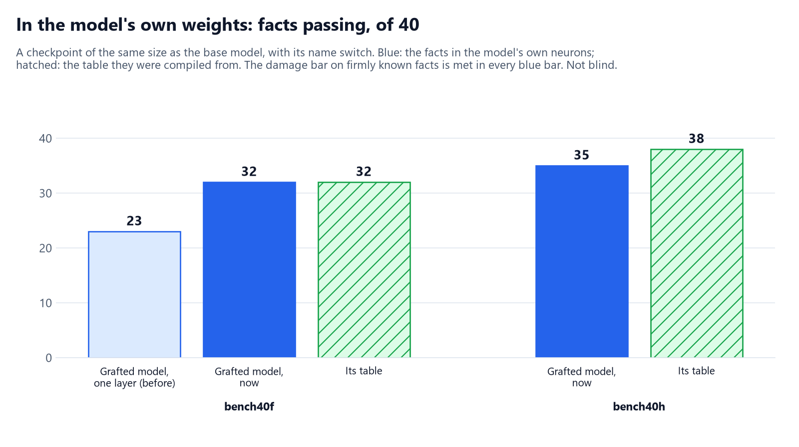
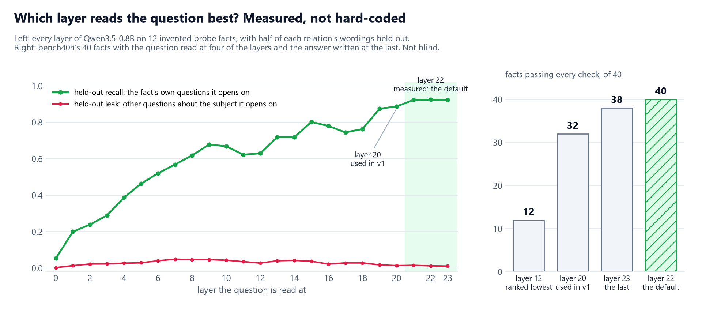
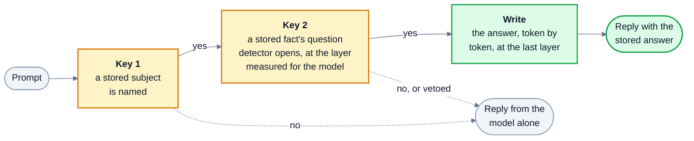

<p align="center"></p>

<p align="center">
  <a href="https://github.com/GhoshSrinjoy/CramSchool/actions/workflows/tests.yml"></a>
  <a href="CHANGELOG.md"></a>
  
  
  
  
  <a href="LICENSE"></a>
</p>

<p align="center"><b>
  <a href="docs/getting-started.md">Getting started</a> ·
  <a href="docs/user-guide.md">User guide</a> ·
  <a href="docs/inputs-and-outputs.md">Inputs and outputs</a> ·
  <a href="docs/how-it-works.md">How it works</a> ·
  <a href="docs/benchmarks.md">Benchmarks</a> ·
  <a href="docs/limitations.md">Limitations</a> ·
  <a href="examples/">Examples</a> ·
  <a href="CHANGELOG.md">Changelog</a>
</b></p>

**cramschool** teaches small language models new facts without training them. Its method, **GRAFT** (*Gated Relation-Aware Fact Tables*), gives you the facts in **two forms**:

| | Form | What you get |
|---|---|---|
| 1 | **A table beside the model** | One inserted layer holds the facts. No weight changes, and taking the table off gives the model back bit for bit |
| 2 | **A grafted model** | The same facts written into the model's own weights: a model folder of the same size, loaded like any model. A small switch still turns each fact on when its subject is named |

Use either, or both: the table while you add and check facts, the grafted model when you want the facts inside the model.

Both forms answer only when two keys turn: a stored subject is named, and the question asks for one of its stored facts, for example: who runs it, who founded it, where it is, or in which year it happened. The answer is then written in, token by token. Every part is computed from forward passes of the unedited model.

**What it can hold today.** A fact is a named subject, a relation and a short answer, for example *Vorantis Biotech, CEO, Ingrid Solberg*.

| | |
|---|---|
| **Built in** | Four relations about companies: owner, CEO, founder and head office |
| **Any other relation** | Added from a few dozen ways of asking it, which you write or a bigger model drafts |
| **Any other kind of subject** | Eight kinds ship ready to use: person, town, product, work, concept, institution, medicine and event. Another kind, such as software or a chemical substance, is added with invented names and general questions about it |
| **Measured: companies** | All 40 facts of one bench pass with the settings a new table has now, and 35 of 40 of a second. Neither count is blind. The last blind count is 31 of 40, with an earlier setup |
| **Measured: eight other kinds** | 53 of 96 pass on a blind bench. People, organisations and years work; cities and phrases fall short |
| **Tried once: software and science** | Twelve facts in one editor session, not a bench. The answers come (94 of 96 new questions) and look-alike names get none (0 of 36), but 23 of 48 other questions about the same subject get the stored answer too: 1 of the 12 facts is good by the editor tool's rule |
| **Not held** | Free text and documents, programs, step-by-step procedures, and behaviours. A stored answer is one short, fixed string |

<p align="center"></p>

- **Any named subject, once its relation is taught.** Four relations about companies are built in; the table above says what else was measured and what was not.
- **The grafted model is behind its table, and loses nothing the model knew.** On two benches of 40 facts it passes 35 and 32, where the table passes 40 and 35. Its neurons sit at the last layer and read the question there; a table read there passes 38 and 32. No fact the model knew firmly is lost (not blind results).
- **The layer is measured, not picked by hand.** A new table profiles every layer of the model on invented probe facts and reads the question at the best one: layer 22 on Qwen3.5-0.8B, where all 40 facts of a bench pass. The profile takes about 3 minutes, once for a model. The answer is written at the last layer. The grafted model is compiled from detectors built at the last layer, where its neurons sit, so it does not depend on where the table reads.
- **No training.** A fact is built from forward passes of the frozen model in about 40 seconds. Nothing in the package takes a gradient.
- **Exact undo, for the table.** It is a set of hooks. Detached, the model's replies are the unedited model's again, bit for bit.
- **Many facts in one layer.** With 180 facts loaded, another stored fact's answer appeared in 1 of the 2,120 replies checked.
- **A name one letter off stays silent.** For example: "Nimbrosco Software" never opens a fact about "Nimbresco Software". On the blind company benches no fact answered for a look-alike company.
- **Measured blind, for the earlier setup.** 31 of 40 new facts pass every check on a bench written by an agent that never saw the code. The settings a new table has now were measured on benches I had already read; a fresh bench would give their blind number.
- **Limits stated plainly.** Questions close to a fact's relation leak, names must be exact, and on another group's benchmark GRAFT is behind ([status](docs/status.md), [limitations](docs/limitations.md)).

## Quick start

```bash
pip install -e ".[all]"          # Python 3.10+, PyTorch, Transformers 5; a CUDA GPU recommended
```

```python
from cramschool import Graft

graft = Graft(model, tokenizer)                                  # any Hugging Face causal LM; validated on Qwen3.5-0.8B
graft.add("Vorantis Biotech", "ceo", "Ingrid Solberg")           # about 40 seconds, forward passes only
graft.compare("Who is the CEO of Vorantis Biotech?")
# without: '... The CEO of Vanguard Group is **Mark Douglas**. ...'   with: 'Ingrid Solberg is the CEO of Vorantis Biotech. ...'
graft.save("my.graft")
graft.export_grafted("my-grafted-model", base_dir="models/Qwen3.5-0.8B")   # the facts in the model's own weights, same size
```

```bash
cramschool graft add-file --model models/Qwen3.5-0.8B --table my.graft --facts facts.csv            # your own data
cramschool teach --editor anthropic:claude-opus-5-5 --model models/Qwen3.5-0.8B --table my.graft --facts facts.csv
cramschool teach --editor ollama:qwen3:14b --model models/Qwen3.5-0.8B --table my.graft --facts facts.csv   # a local editor
claude mcp add cramschool -- python -m cramschool serve --model models/Qwen3.5-0.8B --table my.graft      # MCP
```

[Getting started](docs/getting-started.md) walks through it. The [user guide](docs/user-guide.md) covers the settings, your own generation code, a system message and what to check when a fact doesn't answer, and [`examples/`](examples/) has four scripts to run.

## Results

### What a new table and its grafted model do now

**Qwen3.5-0.8B**, 40 new fictional facts on each bench, added through the API. A new table reads the question at the layer measured for the model (22), writes the answer at the last layer, and uses no extra detector.

| | bench40h | bench40f |
|---|---|---|
| **The table:** facts passing every check, of 40 | **40** | **35** |
| **The grafted model,** the same facts in the model's own weights | **35** | **32** |

- **None of these counts is blind.** I had read both benches' replies before these settings existed. The layer was not chosen on them: it comes from invented probe facts, by a rule fixed beforehand.
- **The grafted model is behind the table by 5 and 3 facts.** Its neurons sit at the last layer and read the question there, so it is compiled from the same facts built at the last layer. A table read there passes 38 and 32: the grafted model is 3 behind that one on bench40h and level with it on bench40f.
- **"Facts passing" for a grafted model means its recall and leak checks,** with damage judged on the facts the model knows firmly: none is lost. By the bench's own count of known facts lost, which fails every fact at 7 of 133, the bench40f model loses 8 and would pass 0 of 40; on bench40h it loses 6.
- **The grafted model keeps the size of the base model to the byte.**

### The last blind result

Measured on **blind bench40e**: 40 new fictional facts, written by an agent that never saw the code. This is the first version's setup: the question read at layer 20, the answer pushed there, **180 facts** loaded into one table.

| Check | Result |
|---|---|
| Facts passing every check | **31 of 40** |
| Answers given to look-alike companies, unrelated companies or name slots | **none**, on every fact |
| Real facts the model already knew, lost | **0 of 133**, on every fact |
| Drift on ordinary text | **0.000** nats per token |
| Storage per fact | 44 KB in float32 |
| Generation time | unchanged: 1.2 s for 48 prompts, with the layer or without it |

- **Many facts at once:** with 180 facts loaded, another stored fact's answer appeared in 1 of the 2,120 replies checked.
- **Facts added through the API,** taught from drafted wordings alone, passed 24, 30 and 23 of 40 on the three blind benches written after it, with that setup.
- **One option was confirmed blind since:** a second detector for the prompt's last token (`prompt_detector=True`) passed 31 of 40 against 23 on bench40h, for tables with at most two facts on a subject.

How the numbers moved from that setup to today's, step by step and bench by bench, is in [benchmarks](docs/benchmarks.md).

<p align="center"></p>

<p align="center"></p>

<p align="center"></p>

<p align="center"></p>

## How it works



- **Key 1, which subject?** A name index finds every stored subject in the text, as a whole name, ignoring case and spacing. For example: a look-alike such as "Nimbrosco Software" never matches "Nimbresco Software", so it never opens the layer.
- **Key 2, which question?** Each stored fact has a linear detector for its relation, for example: "who founded it". It reads one layer's MLP input at the question's last token. Which layer is measured: every layer of the model is profiled on invented probe facts and the best one is taken, layer 22 on Qwen3.5-0.8B. The detector opens only above a threshold set from negative examples. Detectors for relations with no stored fact can veto it.
- **Write.** Only at the position where the model picks its next token, the answer's first token is written at the output of the model's last layer, then each next token while the reply matches. A write there changes the next token and nothing after it, so it is sized to win. After one answer, the model writes on its own.

The [walk-through](docs/how-it-works.md) explains this with pictures, and [GRAFT](docs/graft.md) gives the method with every formula.

## What is in the box

| | |
|---|---|
| **GRAFT** | Add, update, remove, save and load facts in one inserted layer. Any capitalisation; look-alike names never match; other names for a subject can be declared. New relations and new kinds of subject from your own wordings |
| **History, for both forms** | Record a table as a version, see what changed between two, load any version back as it was saved, and go back to one. The grafted model's weights can be recorded, compared, written back and gone back to as well: a version stores only the tensors that differ from the base model, names the table version it was compiled from, and is written back byte for byte. One call records both forms together, and one call goes back in both. Nothing is built again, and no version is ever lost ([tables](docs/python-api.md#a-tables-history), [weights](docs/python-api.md#the-weights-history), [both](docs/python-api.md#both-forms-in-one-call)) |
| **Grafted model** | The table's facts compiled into the model's own neurons: a checkpoint of the same size, plus a name switch that turns each fact on when its subject is named and follows an answer of several tokens ([GRAFT, section 12](docs/graft.md#12-the-grafted-model)) |
| **Editor models** | A bigger model adds and checks facts, drafts relations and writes blind benches. It can be Claude, OpenAI, Ollama, vLLM, LM Studio, llama.cpp, OpenRouter, or a local transformers model ([editor models](docs/editors.md)) |
| **MCP server** | `cramschool serve` gives Claude Code or any MCP client the GRAFT tools and the weight-edit tools on one loaded model ([MCP](docs/mcp.md)) |
| **Your own data** | Facts from CSV, JSON, JSONL, bench files or Hugging Face datasets ([datasets](docs/datasets.md)) |
| **Bench tool** | Blind benches with every check, and paired reports, for companies and for eight other kinds of subject. The published numbers reproduce exactly ([bench tool](docs/bench-tool.md)) |
| **Instruments (beta, separate from GRAFT)** | A weight-edit workflow for behaviour fixes, a live progress window, a monitoring grid, and layer and isolation tools ([tools](docs/tools.md)) |

## Documentation

| | |
|---|---|
| [Getting started](docs/getting-started.md) | Install, a first fact, and handing the work to a bigger model |
| [User guide](docs/user-guide.md) | Settings, your own generation code, a system message, checking a fact, troubleshooting |
| [Inputs and outputs](docs/inputs-and-outputs.md) | What you give it, what you get back, and what is in a saved table and in a grafted model, file by file |
| [How it works](docs/how-it-works.md) | GRAFT step by step, with the animation and diagrams |
| [GRAFT, the method](docs/graft.md) | Definitions, formulas, the build, defaults and cost |
| [Benchmarks](docs/benchmarks.md) | Protocol, models, hardware, every result |
| [Python API](docs/python-api.md), [command line](docs/cli.md) | The classes and every command |
| [Editor models](docs/editors.md), [MCP](docs/mcp.md) | Bigger models driving the tools |
| [Your own data](docs/datasets.md), [the bench tool](docs/bench-tool.md) | Datasets, new relations, blind benches |
| [Tools](docs/tools.md) | The GRAFT toolbox, the weight-edit workflow and the instruments |
| [Status](docs/status.md), [limitations](docs/limitations.md) | What is shown with its numbers, and what it cannot do, stated plainly |
| [History](docs/history.md), [related work](docs/related-work.md), [lab notebook](docs/lab-notebook.md) | Where it came from and where it sits |
| [Changelog](CHANGELOG.md) | What changed between versions |

## Status

- **Validated on the Qwen3.5 family:** the blind company benches on Qwen3.5-0.8B, and the CounterFact recipe on Qwen3.5-0.8B and 4B. Other models need their own validation run.
- **New facts about companies:** 31 of 40 on a blind bench with 180 facts in one layer. Facts added through the API, from drafted wordings alone, pass 23 to 32 of 40 on four blind benches.
- **Beyond companies:** on a blind bench of nine kinds of subject, 53 of the 96 facts outside companies pass. People, organisations and years work; cities and phrases fall short.
- **Facts the model already knows:** on CounterFact, 25 relations in one table reach 65% on reworded prompts against 12% unedited, and 91% on Qwen3.5-4B.
- **The grafted model:** the facts in the model's own neurons, in a checkpoint of the same size. Its neurons sit at the last layer and write what the table writes there: 32 of 40 facts pass where a table read there passes 32, and 35 where it passes 38, with no firmly known fact lost (not blind). Two grafted models merge into one at the weights. It needs a name switch: three attempts to put the name match into the weights failed their rules.
- **Behind on another group's benchmark:** their circuit answers 103 of 120 held-out questions and GRAFT 93, by the rule written before the run.
- **Questions close to a relation leak.** A stored chief executive also answers for other jobs at the company. No fix is adopted.
- **Exact names only,** unless an alias is declared.
- **The largest tables measured** hold 180 new facts and 300 edits of known facts. Published editors report thousands of edits.
- **Facts only.** A stored answer is a fixed string. Behaviours, such as a way of working through a problem, have not been shown.

[Status](docs/status.md) has each of these with its numbers and what was tried, and [limitations](docs/limitations.md) the full list of what it can't do.

## Repository

| Folder | What it holds |
|---|---|
| [`src/cramschool/`](src/cramschool/) | The package: `graft`, `editors`, `bench`, `datasets`, `tools`, the MCP server, and the weight-edit workflow |
| [`benchmarks/`](benchmarks/) | The ten benches, with the blind writers' source files |
| [`research/`](research/) | The raw results behind every published number, and the GRAFT parts cached for them |
| [`docs/`](docs/) | The documentation, its figures and the lab notebook |
| [`examples/`](examples/) | Four runnable scripts: a first fact, your own `model.generate`, facts from a CSV with a check, a system message |
| [`scripts/`](scripts/) | Reproduction checks, the CounterFact and grafted-model runs with their diagnostics, the trace and figure generators, and the API-facts validation |
| [`tests/`](tests/) | 341 tests on tiny random models, CPU only |

## Credits

- **Origins:** the project began with my January 2025 prototype, which stored facts with activation patterns and edited key layers ([history](docs/history.md)).
- **Weight-space programming:** the editor workflow and the loop fix follow *Sparks of Weight-Space Programming* by Takehi, Teoh, Zhang and Khattab ([post](https://rikiyat.github.io/blog/weight-space-programming/), [logs](https://github.com/RikiyaT/lm_understand-logs)).
- **Fact editing:** the beta's weight writes built on ROME (Meng et al., 2022) and MEMIT (Meng et al., 2023), and its last-token key on [RETS](https://arxiv.org/abs/2408.15091).
- **Calibration text:** 355 paragraphs of WikiText-103 (Merity et al., 2016, CC BY-SA).

## Citation

If you use cramschool or GRAFT in your work, please cite it:

```bibtex
@software{ghosh2026cramschool,
  author  = {Ghosh, Srinjoy},
  title   = {cramschool: {GRAFT}, Gated Relation-Aware Fact Tables. New facts for small language models, without training them},
  year    = {2026},
  version = {1.2.0},
  url     = {https://github.com/GhoshSrinjoy/CramSchool}
}
```

[`CITATION.cff`](CITATION.cff) holds the same, for GitHub's "Cite this repository" button.

## Licence

CramSchool is source-available under the [PolyForm Noncommercial License 1.0.0](LICENSE).

- **Allowed:** any noncommercial use, including research, teaching and personal projects. You may change it and share it under the same terms.
- **Not allowed without my permission:** commercial use. Open an issue to ask.
- **Not open source:** the licence restricts commercial use, so it does not meet the Open Source Definition.
- **The bundled calibration text** keeps its own licence, CC BY-SA ([NOTICE](NOTICE)).
