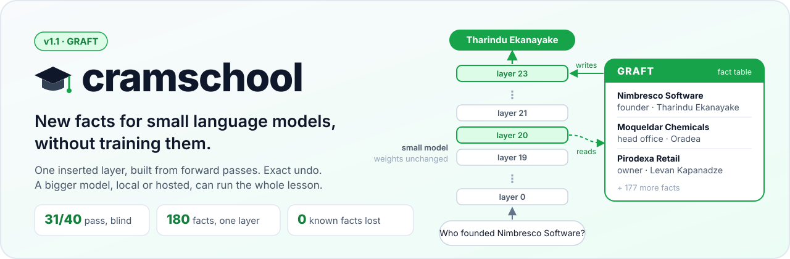
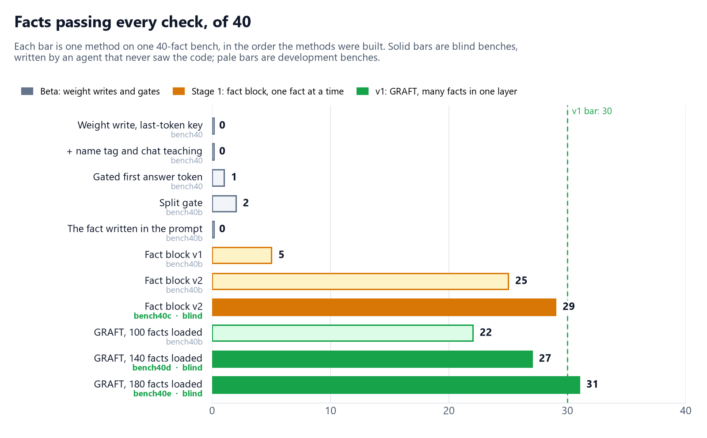

**cramschool** teaches small language models new facts without training them. Its method, **GRAFT** (*Gated Relation-Aware Fact Tables*), inserts one layer beside a frozen model. The layer acts only when two keys turn: a stored company is named, and the question asks for one of its stored facts. It then pushes the answer in, token by token. Every part is computed from forward passes of the unedited model, and detaching the layer restores the model bit for bit.

## v1 at a glance

Measured on **blind bench40e**: 40 new fictional facts, written by an agent that never saw the code. **Qwen3.5-0.8B**, with **180 facts** loaded into one GRAFT layer.

| Check | Result |
|---|---|
| Facts passing every check | **31 of 40** |
| Answers given to look-alike companies, unrelated companies or name slots | **none**, on every fact |
| Real facts the model already knew, lost | **0 of 133**, on every fact |
| Drift on ordinary text | **0.000** nats per token |
| Storage per fact | 44 KB in float32 (52 KB with the optional looser start) |
| Generation time | unchanged: 1.2 s for 48 prompts, with the layer or without it |

The stage-1 method holds one fact at a time. On the same facts it passes 34 of 40: 4 facts pass only with GRAFT and 7 only one at a time (McNemar p = 0.55). So v1's gain is holding many facts at once without them disturbing each other, not a higher pass rate per fact. Every number, and how it was measured, is in [benchmarks](docs/benchmarks.md).

## How it works

- **Key 1, which company?** A name index finds every stored company in the text, as a whole name, ignoring case and spacing. A look-alike such as "Nimbrosco Software" never matches "Nimbresco Software", so it never opens the layer.
- **Key 2, which question?** Each stored fact has a linear detector that reads layer 20's MLP input at the last token. It opens only above a threshold set from negative examples. Detectors for relations with no stored fact can veto it.
- **Push.** Only at the position where the model picks its next token, the answer token's vector is added to layer 20's MLP output, then the next token's while the reply matches. After one answer, the model writes on its own.

The [walk-through](docs/how-it-works.md) explains this with pictures, and [GRAFT](docs/graft.md) gives the method with every formula.

## Repository

| Folder | What it holds |
|---|---|
| [`src/cramschool/`](src/cramschool/) | The package: the editor workflow, the monitoring grid, layer and isolation tools, tracked edits, the MCP server and the live progress window |
| [`research/`](research/) | The scripts and raw results behind every v1 number: the benches, each method's per-fact results and the cached fact tables |
| [`docs/`](docs/) | The documentation, its figures and the dated lab notebook |
| [`scripts/`](scripts/) | [`make_figures.py`](scripts/make_figures.py) redraws every chart and the animation from the saved results |
| [`tests/`](tests/) | Tests on tiny random models, CPU only |

GRAFT moves from `research/` into the package API next. Until then, `research/bench/fact_table.py` runs it; see [benchmarks](docs/benchmarks.md#reproducing-the-numbers).

## Documentation

| | |
|---|---|
| [How it works](docs/how-it-works.md) | GRAFT explained step by step, with the animation and diagrams |
| [GRAFT, the method](docs/graft.md) | Definitions, formulas, the build, defaults and cost |
| [Benchmarks](docs/benchmarks.md) | Protocol, models, hardware, every result and how to reproduce it |
| [Tools](docs/tools.md) | The editor workflow, the monitoring grid, layer and isolation tools, the MCP server |
| [Limitations](docs/limitations.md) | What v1 cannot do, stated plainly |
| [History](docs/history.md) | From the January 2025 prototype through the beta to v1 |
| [Related work](docs/related-work.md) | Where GRAFT sits among published editors |
| [Lab notebook](docs/lab-notebook.md) | Every rule written before its run, and every result after it |

## Status

- **Validated on one model, Qwen3.5-0.8B,** and on four relations: owner, CEO, founder and head office. Other models need their own validation run.
- **Exact names only.** Aliases, abbreviations, misspellings and "it" in a later turn don't open the layer.
- **180 facts** is the largest table measured. Published editors report thousands of edits, on standard benchmarks.

[Limitations](docs/limitations.md) has the full list.

## Credits

- **Origins:** the project began with the author's January 2025 prototype, which stored facts with activation patterns and edited key layers ([history](docs/history.md)).
- **Weight-space programming:** the editor workflow and the loop fix follow *Sparks of Weight-Space Programming* by Takehi, Teoh, Zhang and Khattab ([post](https://rikiyat.github.io/blog/weight-space-programming/), [logs](https://github.com/RikiyaT/lm_understand-logs)).
- **Fact editing:** the beta's weight writes built on ROME (Meng et al., 2022) and MEMIT (Meng et al., 2023), and its last-token key on [RETS](https://arxiv.org/abs/2408.15091).
- **Calibration text:** 355 paragraphs of WikiText-103 (Merity et al., 2016, CC BY-SA).

No licence has been chosen yet.
