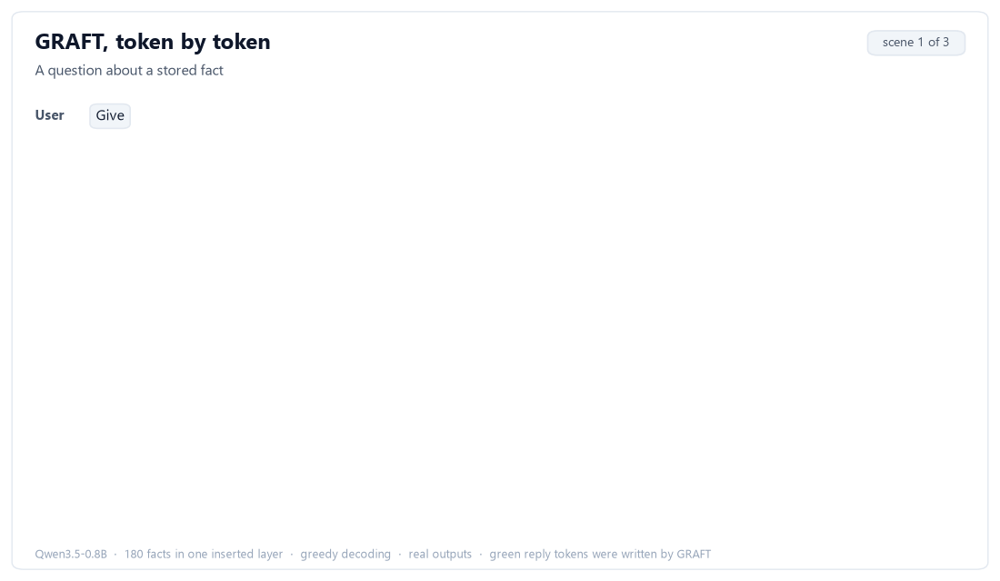
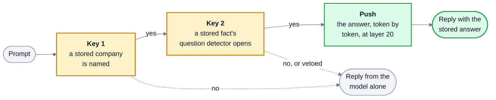

<p align="center"></p>

**cramschool** teaches small language models new facts without training them. Its method, **GRAFT** (*Gated Relation-Aware Fact Tables*), inserts one layer beside a frozen model. The layer acts only when two keys turn: a stored company is named, and the question asks for one of its stored facts. It then pushes the answer in, token by token. Every part is computed from forward passes of the unedited model, and detaching the layer restores the model bit for bit.

<p align="center"></p>

## v1 at a glance

Measured on **blind bench40e**: 40 new fictional facts, written by an agent that never saw the code. **Qwen3.5-0.8B**, with **180 facts** loaded into one GRAFT layer.

| Check | Result |
|---|---|
| Facts passing every check | **31 of 40** |
| Answers given to look-alike companies, unrelated companies or name slots | **none**, on every fact |
| Real facts the model already knew, lost | **0 of 133**, on every fact |
| Drift on ordinary text | **0.000** nats per token |
| Storage per fact | 44 KB in float32 (52 KB with the optional looser start) |
| Generation time | unchanged: 1.2 s for 48 prompts, with the layer or without it |

The stage-1 method holds one fact at a time. On the same facts it passes 34 of 40: 4 facts pass only with GRAFT and 7 only one at a time (McNemar p = 0.55). So v1's gain is holding many facts at once, not a higher pass rate per fact: with 180 facts loaded, another stored fact's answer appeared in 1 of the 2,120 replies checked.

Facts added through the API are taught from drafted wordings alone, with none of the bench's own. On the same bench they pass 32 of 40 with 40 facts loaded, or 31 counted conservatively. Every number, and how it was measured, is in [benchmarks](docs/benchmarks.md).

<p align="center"></p>

## How it works



- **Key 1, which company?** A name index finds every stored company in the text, as a whole name, ignoring case and spacing. A look-alike such as "Nimbrosco Software" never matches "Nimbresco Software", so it never opens the layer.
- **Key 2, which question?** Each stored fact has a linear detector that reads layer 20's MLP input at the last token. It opens only above a threshold set from negative examples. Detectors for relations with no stored fact can veto it.
- **Push.** Only at the position where the model picks its next token, the answer token's vector is added to layer 20's MLP output, then the next token's while the reply matches. After one answer, the model writes on its own.

The [walk-through](docs/how-it-works.md) explains this with pictures, and [GRAFT](docs/graft.md) gives the method with every formula.

## Quick start

```bash
pip install -e ".[all]"          # Python 3.10+, PyTorch, Transformers 5; a CUDA GPU recommended
```

```python
from cramschool import Graft

graft = Graft(model, tokenizer)                                  # any Hugging Face causal LM; validated on Qwen3.5-0.8B
graft.add("Vorantis Biotech", "ceo", "Ingrid Solberg")           # about 40 seconds, forward passes only
graft.compare("Who is the CEO of Vorantis Biotech?")
# without: '... The CEO of Vanguard Group is **Mark Douglas**. ...'   with: 'Ingrid Solberg is the CEO of Vorantis Biotech. ...'
graft.save("my.graft")
```

```bash
cramschool graft add-file --model models/Qwen3.5-0.8B --table my.graft --facts facts.csv            # your own data
cramschool teach --editor anthropic:claude-opus-5-5 --model models/Qwen3.5-0.8B --table my.graft --facts facts.csv
cramschool teach --editor ollama:qwen3:14b --model models/Qwen3.5-0.8B --table my.graft --facts facts.csv   # a local editor
claude mcp add cramschool -- python -m cramschool serve --model models/Qwen3.5-0.8B --table my.graft      # MCP
```

[Getting started](docs/getting-started.md) walks through it.

## What is in the box

| | |
|---|---|
| **GRAFT** | Add, update, remove, save and load facts in one inserted layer. Any capitalisation; look-alike names never match. New relations from your own wordings |
| **Editor models** | A bigger model adds and checks facts, drafts relations and writes blind benches. It can be Claude, OpenAI, Ollama, vLLM, LM Studio, llama.cpp, OpenRouter, or a local transformers model ([editor models](docs/editors.md)) |
| **MCP server** | `cramschool serve` gives Claude Code or any MCP client the GRAFT tools and the weight-edit tools on one loaded model ([MCP](docs/mcp.md)) |
| **Your own data** | Facts from CSV, JSON, JSONL, bench files or Hugging Face datasets ([datasets](docs/datasets.md)) |
| **Bench tool** | Blind benches with every check, and paired reports. The published numbers reproduce exactly ([bench tool](docs/bench-tool.md)) |
| **Instruments** | The weight-edit workflow for behaviour fixes, a live progress window, a monitoring grid, and layer and isolation tools ([tools](docs/tools.md)) |

## Repository

| Folder | What it holds |
|---|---|
| [`src/cramschool/`](src/cramschool/) | The package: `graft`, `editors`, `bench`, `datasets`, `tools`, the MCP server, and the weight-edit workflow |
| [`benchmarks/`](benchmarks/) | The six benches, with the blind writers' source files |
| [`research/`](research/) | The raw results behind every published number, and the GRAFT parts cached for them |
| [`docs/`](docs/) | The documentation, its figures and the lab notebook |
| [`scripts/`](scripts/) | Reproduction checks, the trace and figure generators, and the API-facts validation |
| [`tests/`](tests/) | 215 tests on tiny random models, CPU only |

## Documentation

| | |
|---|---|
| [Getting started](docs/getting-started.md) | Install, a first fact, and handing the work to a bigger model |
| [How it works](docs/how-it-works.md) | GRAFT step by step, with the animation and diagrams |
| [GRAFT, the method](docs/graft.md) | Definitions, formulas, the build, defaults and cost |
| [Benchmarks](docs/benchmarks.md) | Protocol, models, hardware, every result |
| [Python API](docs/python-api.md), [command line](docs/cli.md) | Every class and command |
| [Editor models](docs/editors.md), [MCP](docs/mcp.md) | Bigger models driving the tools |
| [Your own data](docs/datasets.md), [the bench tool](docs/bench-tool.md) | Datasets, new relations, blind benches |
| [Tools](docs/tools.md) | The GRAFT toolbox, the weight-edit workflow and the instruments |
| [Limitations](docs/limitations.md) | What v1 cannot do, stated plainly |
| [History](docs/history.md), [related work](docs/related-work.md), [lab notebook](docs/lab-notebook.md) | Where it came from and where it sits |

## Status

- **Validated on one model, Qwen3.5-0.8B,** and on four relations: owner, CEO, founder and head office. Other models need their own validation run.
- **Exact names only.** Aliases, abbreviations, misspellings and "it" in a later turn don't open the layer.
- **180 facts** is the largest table measured. Published editors report thousands of edits, on standard benchmarks.

[Limitations](docs/limitations.md) has the full list.

## Credits

- **Origins:** the project began with the author's January 2025 prototype, which stored facts with activation patterns and edited key layers ([history](docs/history.md)).
- **Weight-space programming:** the editor workflow and the loop fix follow *Sparks of Weight-Space Programming* by Takehi, Teoh, Zhang and Khattab ([post](https://rikiyat.github.io/blog/weight-space-programming/), [logs](https://github.com/RikiyaT/lm_understand-logs)).
- **Fact editing:** the beta's weight writes built on ROME (Meng et al., 2022) and MEMIT (Meng et al., 2023), and its last-token key on [RETS](https://arxiv.org/abs/2408.15091).
- **Calibration text:** 355 paragraphs of WikiText-103 (Merity et al., 2016, CC BY-SA).

No licence has been chosen yet.
