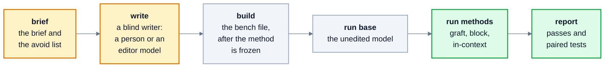

# The bench tool

`cramschool bench` is the evaluation protocol behind every published number, as a tool. Use it to:
- check GRAFT on your own model;
- measure a new relation;
- judge a change to the method on a bench it has never seen.



## 1. A blind bench

```bash
cramschool bench brief --avoid-from benchmarks/*.json --seed 20261201 --out brief.txt --avoid-out avoid.json
```

- **The brief** says exactly what to write: 40 facts on 30 companies, 10 of them holding two facts, plus 16 plain and 8 chat wordings per relation.
- **The avoid list** holds every name and answer the earlier benches used, so the new bench is fresh.

Give both to a writer who has never seen the code. A person can do it, or an editor model:

```bash
cramschool bench write --editor anthropic:claude-opus-5-5 --avoid avoid.json --seed 20261201 --out bench41_source.json
```

- **The check:** the writer's file is checked against every rule a script can check: counts, edit distances, repeated names, answers inside wordings. `bench write` sends the problems back until it passes.
- **Keep the source closed** until the method it judges is frozen and committed. Then build it:

```bash
cramschool bench build --source bench41_source.json --out benchmarks/bench41.json --avoid-benches benchmarks/bench40*.json
```

## 2. Run

```bash
B=benchmarks
cramschool bench run --model models/Qwen3.5-0.8B --bench $B/bench41.json --method base          # always first
cramschool bench run --model models/Qwen3.5-0.8B --bench $B/bench41.json --method graft --load $B/bench40b.json $B/bench40c.json $B/devpairs.json
cramschool bench run --model models/Qwen3.5-0.8B --bench $B/bench41.json --method block         # fact block v2, one fact at a time
cramschool bench run --model models/Qwen3.5-0.8B --bench $B/bench41.json --method in-context    # the fact written in the prompt
```

| Method | What runs |
|---|---|
| `base` | The unedited model. Every leak check compares with its replies |
| `graft` | GRAFT with every fact of `--load` and of the scored bench in one layer |
| `graft-loose` | GRAFT with the looser start ([GRAFT](graft.md#8-the-looser-start-optional)) |
| `block` | Fact block v2: one fact at a time, exact name tokens |
| `in-context` | The fact's statement written before every prompt |

- **Output:** results go to `runs/<bench>/<method>.jsonl`, one row per fact, with every check and every reply.
- **Resuming:** a stopped run resumes where it stopped.
- **Subsets:** `--only f01,f02` scores some facts with the bench's context unchanged.
- **Caching:** built GRAFT parts are cached in `--cache` (default `runs/_parts/{bench}`).

## 3. Report

```bash
cramschool bench report --out runs/bench41 --bench benchmarks/bench41.json
```

The report gives:
- passes, medians and failure kinds for each method;
- passes by relation;
- the two-fact-company count;
- paired comparisons between methods: McNemar on passes, Wilcoxon on recall and on the same-company leak.

[Benchmarks](benchmarks.md#the-checks) explains every check.

## Reproducing the published numbers

The cached GRAFT parts of the published runs are in `research/results/<bench>/fact_table/`, so a rerun skips the builds:

```bash
B=benchmarks
cramschool bench run --model models/Qwen3.5-0.8B --bench $B/bench40e.json --method base --out runs/bench40e
cramschool bench run --model models/Qwen3.5-0.8B --bench $B/bench40e.json --method graft --out runs/bench40e \
    --load $B/bench40b.json $B/bench40c.json $B/devpairs.json $B/bench40d.json --cache "research/results/{bench}/fact_table"
cramschool bench report --out runs/bench40e --bench $B/bench40e.json        # 31 of 40
```

`python scripts/check_graft_reproduction.py models/Qwen3.5-0.8B` checks the package against the research run directly. On the published setup it reports four things:
- the rebuilt parts are identical;
- the shared detectors are identical;
- 212 of 212 replies are identical;
- detaching restores the model exactly.
