# Benchmarks

Every number on this page comes from the result files in [`research/results/`](../research/results/). The charts are redrawn from them by [`scripts/make_figures.py`](../scripts/make_figures.py). Each method's pass rule was written in the [lab notebook](lab-notebook.md) before the method ran.

**Which write.** Every number on this page, except in the section [Finishing an answer](#finishing-an-answer-its-tokens-written-at-the-last-layer), was measured with the answer pushed at the table's layer (`last_layer=None`), the write of version 1.0. Since version 1.1 a new table writes the answer at the model's last layer. `cramschool bench run` and the reproduction scripts still use the earlier write, so the numbers reproduce as written.

## Summary: the blind benches

A blind bench is written by a separate agent with no access to the code. It is opened only after the method it judges is frozen and committed.

| Bench | Method | Facts in the model | Pass | Recall median | Same-company leak median | Look-alike, unrelated, name slots | Known facts lost | Drift |
|---|---|---|---|---|---|---|---|---|
| bench40c | Fact block v2 (stage 1) | 1 at a time | 29 | 1.000 | 0.125 | 0 on every fact | 0 | 0.0000 |
| bench40d | Fact block v2 | 1 at a time | 27 | 0.917 | 0.125 | 0 on every fact | 0 | 0.0000 |
| bench40d | **GRAFT** | 140 in one layer | **27** | 0.833 | **0** | 0 on every fact | 0 | 0.0000 |
| bench40e | Fact block v2 | 1 at a time | 34 | 0.917 | 0 | 0 on every fact | 0 | 0.0000 |
| bench40e | **GRAFT** | 180 in one layer | **31** | 0.833 | **0** | 0 on every fact | 0 | 0.0000 |
| bench40e | GRAFT + looser start | 180 in one layer | 31 | 0.917 | 0 | 0 on every fact | 0 | 0.0000 |
| bench40e | GRAFT, facts added through the API | 40 in one layer | 32 | 0.833 | 0 | 0 on every fact | 0 | 0.0000 |
| bench40f | GRAFT, facts added through the API | 40 in one layer | 24 | 0.750 | 0 | 0 on every fact | 0 | 0.0000 |
| bench40f | **Grafted model**, the same table in layer 20's own neurons | 40 in 377 neurons | **23** | 0.750 | 0 | 0 on every fact | 0 firmly known; 4 of 133 by the count | 0.0027 |
| bench40g | GRAFT, facts added through the API, the fast build | 40 in one layer | 30 | 0.833 | 0 | 0 on every fact | 0 | 0.0000 |
| bench40g | The same, with a bigger model's wordings for the forms that failed on earlier benches | 40 in one layer | 33; 29 on wordings it didn't teach | 0.833 | 0 | 0 on every fact | 0 | 0.0000 |
| bench40g | The same, taught by a bigger model through the tools, from the facts as a dataset | 40 in one layer | 31; 29 on wordings it didn't teach | 0.833 | 0 | 0 on every fact | 0 | 0.0000 |
| bench40g | **Grafted model**, the first editor's table in layer 20's own neurons, loaded back from disk | 40 in 359 neurons | **31** | 0.833 | 0 | 0 on every fact | 0 firmly known; 4 of 133 by the count | 0.0026 |
| bench40h | GRAFT, facts added through the API, the fast build | 40 in one layer | 23 | 0.750 | 0 | 0 on every fact | 0 | 0.0000 |
| bench40h | The same table with the looser start | 40 in one layer | 28 | 0.833 | 0 | 0 on every fact | 0 | 0.0000 |
| bench40h | **The same table with a detector for the prompt's last token** | 40 in one layer | **31** | 1.000 | 0 | 0 on every fact | 0 | 0.0000 |

<p align="center"></p>

**How to read it:**
- **GRAFT ties fact block v2 on both blind benches it ran on:** 27 against 27, and 31 against 34. Neither difference is significant (McNemar p = 1.0 and 0.55).
- **What GRAFT adds is holding many facts at once.** With 140 or 180 facts in one layer, another stored fact's answer appeared in 1 of 4,240 checked replies. Asked "What products does Lumbravic Brewing sell?", the model named the company's stored head office: "a well-known craft brewery in Asahikawa". No known facts were lost, and there was no drift.
- **The trade inside that tie:** GRAFT's gate is stricter. It leaks less to other questions about the same company (lower on 25 facts, higher on none, bench40d) and recalls less (lower on 27 facts, higher on 2, bench40e).
- **Facts added through the API pass as many on bench40e, and fewer on bench40f.** Taught from the drafted wordings alone, without the bench's own wordings, 32 of 40 pass on bench40e with 40 facts loaded, or 31 counted conservatively ([details](#facts-added-through-the-api)). On bench40f, written later and by another writer model, 24 of 40 pass. bench40e had already been opened for v1 when this path was measured on it, and bench40f was opened only after the code was frozen, so bench40f is this path's blind result.
- **The grafted model answers at the inserted layer's level,** with the same write: 23 against 24 on bench40f, from the model's own neurons ([details](#the-grafted-model-edits-in-the-models-own-neurons)). Its damage is judged on firmly known facts; the count of the 133 follows answers the model barely knows.
- **A bigger model as the editor moves replies, not facts.** On blind bench40g, Claude Opus 5.5 either taught the question forms that had failed on the development benches, or was given the 40 facts as a dataset and taught them itself through the tools. On the test wordings neither editor taught, 29 of 40 pass with or without its teaching, and the answer comes on 2 to 3 points more of those prompts ([details](#a-bigger-model-as-the-editor-on-new-facts)). Compiled into the model's own neurons and loaded back from disk, the two tables keep 31 and 30 of their 33 and 31.
- **A detector for the prompt's last token adds facts on a blind bench.** A fact's question detector is fitted against other prompts, the inside of its own answer and the model's replies, all at once. A second detector, fitted against other prompts alone and counted only where the reply starts, passes 31 of 40 on blind bench40h against 23 for the same table without it. No fact is lost, and no leak, garbling or damage check fails. The looser start in the same place passes 28 ([details](#a-detector-for-the-prompts-last-token)).

<p align="center"></p>

## Protocol

### The benches

Each bench holds 40 fictional facts, 10 for each relation: owner, CEO, founder and head office.

- **Companies:** an invented first word of 5 to 10 letters plus an industry word, such as "Nimbresco Software".
- **Answers:** fictional people's names from many cultures, or real cities of moderate size for head offices.
- **Per fact:**
  - 12 training wordings and 12 test wordings of its relation, each 8 plain sentence openings and 4 chat questions, drawn from separate pools;
  - 8 other questions about the same company: other relations and generic ones;
  - 3 look-alike companies for testing, one of each kind: the same first word in another industry, one letter changed, and an invented first word in the same industry;
  - 3 more look-alikes for training, and 3 unrelated companies;
  - name slots: a look-alike or unrelated company followed by "… a man named" or "… a woman named".
- **Two-fact companies:** in bench40d to bench40h, the 40 facts sit on 30 companies, and 10 companies hold two facts of different relations.

| Bench | Role | Written | Facts |
|---|---|---|---|
| bench40 | first development bench (beta experiments) | from a hand-made pool | 40 |
| bench40b | development | blind | 40 |
| bench40c | blind test of stage 1, then development | blind | 40 |
| devpairs | development, two facts per company | built from bench40b's wordings | 20 |
| bench40d | blind test of GRAFT, then development | blind | 40 on 30 companies |
| bench40e | blind test of GRAFT v1 | blind | 40 on 30 companies |
| bench40f | blind test of the grafted model | blind, by a different writer model from the earlier benches | 40 on 30 companies |
| bench40g | blind test of a bigger model as the editor | blind, by the same writer model as bench40f | 40 on 30 companies |
| bench40h | blind test of the detector for the prompt's last token, beside the looser start | blind, by Claude Opus as a separate agent | 40 on 30 companies |

**How a blind bench is made.** The writer gets a brief and an avoid list, and nothing else. The brief gives the format, the counts and the rules for names and wordings. The avoid list holds every earlier company word, look-alike, invented name and answer. The writer's file is validated by script and stays closed until the method is frozen.

```mermaid
%%{init: {"theme": "base", "themeVariables": {"fontSize": "16px", "primaryColor": "#F1F5F9", "primaryTextColor": "#0F172A", "primaryBorderColor": "#94A3B8", "lineColor": "#64748B", "edgeLabelBackground": "#FFFFFF"}}}%%
flowchart LR
    R["<b>Rule written</b><br/>in the lab notebook,<br/>before any run"] --> B["<b>Blind writer</b><br/>brief and avoid list only,<br/>no access to the code"]
    B --> F["<b>Method frozen</b><br/>and committed"]
    F --> O["<b>Bench opened</b><br/>built, unedited model run"]
    O --> M["<b>Methods run</b><br/>every check, every fact"]
    M --> J["<b>Judged by the rule</b><br/>paired against the<br/>earlier method"]
    classDef plain fill:#F1F5F9,stroke:#94A3B8,stroke-width:1.5px,color:#0F172A
    classDef key fill:#FEF3C7,stroke:#D97706,stroke-width:2px,color:#0F172A
    classDef good fill:#DCFCE7,stroke:#16A34A,stroke-width:2px,color:#0F172A
    class R,J key
    class B,F,O plain
    class M good
```



### The checks

A fact passes only if it passes every check below, on prompts never used to build it. Replies are generated greedily, 16 new tokens, with thinking off. Chat prompts go through the model's chat template.

| Check | Prompts | Counts as a hit | Limit |
|---|---|---|---|
| Recall | 12 test wordings | the whole answer appears | at least 9 of 12 |
| Same company | 8 other questions about the company | the answer, or a distinctive part of it, appears | at most 2 of 8 |
| Look-alike companies | 12 | as above | at most 1 of 12 |
| Unrelated companies | 12 | as above | at most 3 of 12 |
| Name slots | 12, for people | any part of the name | at most 1 of 12 |
| Garbled text | every reply | the reply repeats or breaks down | at most 34% in recall, 10% elsewhere |
| Known facts | 133 real-world questions the unedited model answers | an answer lost | fewer than 7 lost |
| Drift | held-out ordinary text | change in next-token predictions, nats per token | at most 0.05 |
| Other stored facts (stage 2) | all replies above | another loaded fact's whole answer, where it doesn't belong | none |
| Sibling (stage 2) | the 12 recall prompts | the answer of any other fact of the company | at most 1 of 12 |
| Capitalisation (reported, not graded) | 2 plain and 2 chat test wordings, company in lower and upper case | recall | none |

- **Partial answers count as leaks.** A leak counts "Julian" alone as well as "Julian Rodlauer", unless the prompt or the unedited model's reply to the same prompt already had it.
- **A company's other facts:** each may answer a same-company prompt that asks for its own relation, and no other prompt. With one other fact on the company this is the rule the benches were always scored by, and every stored row comes out the same under it.
- **The checks on other facts are uneven.** The other-facts check reads whole answers and allows none. The same-company and sibling checks also read a distinctive part, and allow 2 of 8 and 1 of 12. So where in a 16-token reply an answer starts can decide whether it is counted ([four facts on every company](#four-facts-on-every-company)).
- **Recall needs the whole answer** anywhere in the 16 tokens.
- **Strictness:** this rule is stricter than the usual editing benchmarks.
  - Those report averages of teacher-forced probabilities.
  - Here one fact must recall and stay quiet at the same time, by generation, in plain and chat form, next to one-letter-off names.

### Statistics

Methods are compared fact by fact on the same bench:
- an exact McNemar test on passes;
- a Wilcoxon signed-rank test on recall and on each leak rate.

The rule for each stage, and every deviation from it, is in the [lab notebook](lab-notebook.md).

## Models and hardware

| Model | Used for |
|---|---|
| **Qwen3.5-0.8B** (24 layers, hybrid Gated DeltaNet and attention) | v1 GRAFT, stage 1, every bench experiment; the beta's loop fix and fact writes |
| Qwen3-0.6B, Qwen3.5-4B | beta: fact writes without backpropagation, and the loop edit |
| Phi-3-mini-4k-instruct | beta: fact writes; the January 2025 prototype |
| Phi-3.5-mini | the January 2025 prototype |
| Qwen3-4B | beta: a bigger model drafting teaching prompts (usable for 1 of 3 sentences) |
| Claude Opus 5.5, through Claude Code | the editor in the beta's tracked sessions; drafted the relation wordings; wrote blind benches bench40b to bench40e, each as a separate agent; the editor on new facts in step 11, both its rounds of wordings and its run from a dataset through the tools |
| Claude Fable 5.2, through Claude Code | wrote blind bench40f and bench40g, each as a separate agent |
| Claude Opus, through Claude Code, as a separate agent given the brief alone | wrote blind bench40h |
| Claude Sonnet 5.5, through Claude Code | wrote 24 blind questions about other jobs at a company for step 12, never asked |

The blind company benches are on **Qwen3.5-0.8B**; the CounterFact recipe is validated on **Qwen3.5-0.8B and Qwen3.5-4B**.

| Hardware and software | |
|---|---|
| GPU | NVIDIA GeForce RTX 3090, 24 GB |
| OS | Windows 11 |
| Python, PyTorch, Transformers | 3.11.15, 2.12.1 with CUDA 13.0, 5.12.1 |
| Weights | bfloat16 |
| Qwen3.5 fast path | not installed: Gated DeltaNet ran on the PyTorch fallback, so generation is slower than it could be |

Typical times on this machine:
- **Building a GRAFT fact:** about 43 s with the research scripts and 25 to 36 s with the package, once. With the fast build (`GraftOptions(fast=True)`), facts after the first of each relation take 5 to 9 s. A new table first spends about 40 s on calibration.
- **Scoring one fact:** every check, about 7 s with 180 facts loaded.
- **Fact block v2:** about 30 s per fact, building and scoring.

## Results in detail

### v1: GRAFT on blind bench40e, 180 facts loaded

| | GRAFT | GRAFT + looser start | Fact block v2, one at a time |
|---|---|---|---|
| Passes | **31** | 31 | 34 |
| Recall median | 0.833 | 0.917 | 0.917 |
| Same-company leak median | 0 | 0 | 0 |
| Capitalisation recall median | 0.875 | 0.875 | — (can't match other casings) |
| Failures | 8 recall, 1 recall and another fact's answer | 5 recall, 3 another fact's answer, 1 same company | 4 same company, 2 recall |
| Passes by relation (owner, CEO, founder, head office) | 7, 7, 7, 10 | 8, 6, 8, 9 | 10, 8, 8, 8 |
| Both facts pass, of 10 two-fact companies | 5 | 5 | — |

- **GRAFT against fact block v2:**
  - 4 facts pass only with GRAFT and 7 only one at a time (McNemar p = 0.55).
  - Recall is lower on 27 facts and higher on 2.
- **The looser start against GRAFT:**
  - Recall is higher on 22 facts and lower on none (Wilcoxon p = 3e-5).
  - Passes don't move: 3 only with it and 3 only without (p = 1).
  - What it lost: head-office facts firing at the start of replies to general questions about their company, so another fact's city appears.
- **bench40e was easier than bench40d for every method:** fact block v2 rose from 27 to 34, and GRAFT from 27 to 31.

### v1: GRAFT on blind bench40d, 140 facts loaded

- **Passes:** 27 of 40, the same as fact block v2. 6 facts pass only with each (McNemar p = 1).
- **Same-company leak:** lower on 25 facts, higher on none (p = 8e-6).
- **Recall:** lower on 23 facts, higher on 2 (p = 3e-5).
- **Failures:** all 13 are recall.
- **Two-fact companies:** both facts pass on 4 of 10. The companies' two facts were not confused: a fact's recall prompts got its sibling's answer at most once in 12.

### Facts added through the API

The runs above built each bench fact from the bench's own 12 training wordings plus the drafted ones. A fact added through `Graft.add`, the command line, the editor tools or the MCP server has only the drafted wordings ([GRAFT](graft.md#3-key-2-question-detectors)). [`scripts/validate_api_facts.py`](../scripts/validate_api_facts.py) adds the 40 facts of bench40e this way, into one table, and scores each with every check.

| | Through the API, 40 loaded | Bench path, 180 loaded |
|---|---|---|
| Passes | **32** | 31 |
| Recall median | 0.833 | 0.833 |
| Same-company leak median | 0 | 0 |
| Look-alike, unrelated, name slots | 0 on every fact | 0 on every fact |
| Known facts lost; drift | 0; 0.0000 | 0; 0.0000 |
| Capitalisation recall median | 0.875 | 0.875 |
| Passes by relation (owner, CEO, founder, head office) | 8, 7, 7, 10 | 7, 7, 7, 10 |
| Both facts pass, of 10 two-fact companies | 7 | 6 |

- **Paired:** one fact, f09, passes on one path only, through the API (McNemar p = 1). Recall is higher on 16 facts and lower on 13 (Wilcoxon p = 0.47). The same-company leak is lower on 3 head-office facts and higher on none.
- **The failures are the same kind:** all 8 are recall. One of them also has another fact's answer: the same Lumbravic Brewing reply as on the bench path.
- **On blind bench40f the same path passes 24 of 40** ([`research/results/bench40f/`](../research/results/bench40f/)): recall median 0.75, the same-company leak 0 on every fact, no look-alike, unrelated or name-slot leak, no known fact lost and no drift. All 16 failures involve recall; one of them also has another fact's answer in a reply, and one its sibling's. Owner facts account for 8 of the 16, with 2 of 10 passing against 8 of 10 on bench40e. Three drafted wordings equal test wordings of this bench; without those prompts the count is still 24.
- **On blind bench40g the same path, with the fast build, passes 30 of 40** ([`research/results/bench40g/`](../research/results/bench40g/)): recall median 0.833, the same-company leak 0 on every fact, no look-alike, unrelated or name-slot leak, no known fact lost and no drift. All 10 failures are recall.
- **On blind bench40h the same path, with the fast build, passes 23 of 40** ([`research/results/bench40h/`](../research/results/bench40h/)): recall median 0.75, the same-company leak 0 on 37 facts and one reply of eight on 3, no look-alike, unrelated or name-slot leak, no known fact lost and no drift. All 17 failures are recall. Founder facts account for 7 of them.
- **Two differences besides the wordings:**
  - The table held 40 facts, not 180. That difference doesn't reach the replies: the layer reads a fact only where its own company is named, and loading 180 more facts beside bench40h's table changed no reply ([lab notebook, step 21](lab-notebook.md#result-of-step-21-no-reply-changes-with-180-more-facts-loaded-the-tables-size-was-never-the-risk-the-facts-on-one-company-are)).
  - Two drafted founder wordings equal bench40e test wordings, and the API path has no bench to guard against. They are among the recall prompts of 9 founder facts. Scored without them, f08 drops from 9 of 12 to 8 of 11, below the threshold, so the conservative count is **31 of 40**.

### Why answers go missing

Every recall prompt of bench40e and bench40f was generated again with the layer's own readings logged at each position of the reply ([lab notebook](lab-notebook.md#why-the-answer-is-missing-a-reading-of-every-recall-prompt-2026-11-14)). Both runs reproduced the saved replies exactly.

| Of the replies with no part of the answer | bench40e (91 of 480) | bench40f (117 of 480) |
|---|---|---|
| The fact's detectors never opened, but came close: under the threshold by less than a quarter of its distance to the taught wordings' median | 20 | 38 |
| The fact's detectors never opened, and stayed further under | 36 | 42 |
| **A detector opened and the first token was pushed, but the model wrote another token** | **32** | **33** |
| Other | 3 | 4 |

- **A quarter to a third of the misses are lost pushes, not shut detectors.** The question opened the fact at the prompt's last token and the model began its reply with its own first word. Mostly it then restates the question and invents an answer: "The founder of **Chumbelow Textiles** is **John Chumbelow".
- **At the place of the invented answer the layer is silent.** Its detectors were fitted on the ends of prompts, and on purpose against positions inside replies.
- **The detector's own misses gather in a few wordings,** such as "Speaking to reporters on Tuesday, the owner of {s}," and "At the anniversary event, {s} founder".
- **A fact almost never opens on a question that isn't its own:** once in bench40f's 320 other questions about the companies, besides 24 questions that ask for the sibling fact's own relation.
- **Pushing again inside the reply was tried and not adopted** ([lab notebook](lab-notebook.md#result-of-step-8s-revision-three-more-facts-and-nothing-broken-but-the-placement-bar-is-missed-the-armed-push-is-not-adopted)). Pushed at every later position, the answer landed in the wrong place ("I don't Omolara Adegoke, …"). Pushed only at the place of the answer, it added 3 facts of 80 with nothing lost, but 3 of 14 gained answers were still misplaced. Nine more replies got the right answer in the right place and were cut off by the bench's 16 new tokens.

### A bigger model as the editor, on new facts

The method's own loop: a bigger model sees what fails, teaches it and checks, and the change is kept only if it helps on questions nobody taught ([lab notebook, step 11](lab-notebook.md#step-11-the-editor-teaches-the-wordings-that-fail-written-2026-11-15-before-it-ran)). Claude Opus 5.5 was the editor, run as a separate agent that saw its input and nothing of the bench.

- **Part 1, wordings for the forms that fail.** Shown the question forms that failed on bench40e and bench40f, the editor wrote new wordings for each relation, in two rounds.
- **Part 2, a dataset through the tools.** Given bench40g's 40 facts as a CSV and the tools of a running server, the editor added every fact, checked each three times on questions it wrote itself, taught 76 wordings over two rounds, rebuilt after each and saved the table: 85 minutes and 75 tool calls, with no person in the loop.

| bench40g, blind: 40 facts through the API, one table, the fast build | Built-in wordings | Part 1: the editor's wordings | Part 2: the editor's own run |
|---|---|---|---|
| Facts passing, every test wording counted | 30 | 33 | 31 |
| **Facts passing, on the 456 test prompts neither editor taught** | **29** | **29** | **29** |
| Whole answer on those 456 prompts | 344 | 359 | 350 |
| Facts failing a leak, garbling or damage check | 0 | 0 | 0 |
| In layer 20's own neurons, loaded back from disk | not compiled | 31 | 30 |

- **Neither is adopted,** by the rule written before the run: at least 3 more facts on the wordings the editor didn't teach. Teaching the forms that fail carries over to new wordings a little, 2 to 3 points of replies, and adds no fact.
- **The editor's own count moved more,** from 71% to 80% of its new questions, but its three checks drew on three different pools of questions, so the bench is the measure.
- **The whole loop runs end to end:** a dataset given to a bigger model ends in the small model's own weights, in a checkpoint that loads with the library and its switch, with no firmly known fact lost ([the grafted model](#the-grafted-model-edits-in-the-models-own-neurons)).
- **Its checks found what the benches miss.** A chief-executive fact answers for other jobs at its company: "Who is the head of human resources at Dwenkali Telecom?" gets "Rania Sabbagh is the Head of Human Resources at Dwenkali Telecom." Asked about all 10 companies, 26 of 30 such questions get the chief executive's name. None of the benches asks about another job.
- **Teaching what not to answer was tried and not adopted** ([lab notebook, step 12](lab-notebook.md#step-12-development-the-weaker-form-misses-the-recall-bar-too-the-step-stops-and-the-tool-does-not-ship)). Taught 5 other jobs, the facts stopped answering 3 others they weren't taught, and answered 18 of 80 of their own questions instead of 59; as ordinary negatives, 29. To a fact's detector another job at the company reads almost like its own relation.

### A detector for the prompt's last token

Most missing answers are prompts on which the fact's detector stays shut ([why answers go missing](#why-answers-go-missing)). Part of the cause is the fit. A fact's detector is fitted against three groups at once: other prompts, the positions inside its own taught answer, and the model's replies. A second detector for each fact and form is fitted against the other prompts alone, with the same threshold rule, and counts only at the prompt's last token, where the reply starts. Inside replies the strict detectors still decide alone ([lab notebook, step 20](lab-notebook.md#result-of-step-20-on-blind-bench40h-confirmed-31-of-40-against-23-and-the-looser-start-doesnt-tie-it)).

- **Chosen** on bench40e and bench40f, by readings and then by generation.
- **Dry-run** on bench40g, which had no say in choosing it but had been read before.
- **Judged** on bench40h, written blind and opened after the code was frozen by content hash.

Three arms are scored from one saved table of 40 facts added through the API, so they differ only in the detectors that count at the prompt's last token.

| bench40h, blind: one saved table, 40 facts | As built | Looser start | **Detector for the prompt's last token** |
|---|---|---|---|
| Facts passing | 23 | 28 | **31** |
| Facts passing, test wordings equal to a taught one left out | 23 | 28 | **30** |
| Facts passing only with it; only without it | | 5; 0 | 8; 0 |
| McNemar p against as built | | 0.062 | 0.008 |
| Recall replies with the whole answer, of 480 | 351 | 387 | 415 |
| Facts failing a leak, garbling or damage check | 0 | 1 | 0 |
| By relation, of 10: owner; CEO; founder; head office | 6; 6; 3; 8 | 8; 6; 5; 9 | 10; 7; 5; 9 |

- **Confirmed, by the rule written before the dry run:** at least 3 more facts than the table as built, on both counts, with at most 1 more fact failing a leak, garbling or damage check.
- **No leak came with it.** The same three facts leak to one same-company question each, as without it. No reply about a look-alike or an unrelated company changes, and no known fact is lost.
- **The looser start gains too:** 5 facts. One of its facts fails because the company's other fact answers a general question. On bench40e, with facts built by the bench path, it had gained 3 facts and lost 3, to head-office facts answering general questions about their own company.
- **Facts about other companies don't reach it.** The layer reads a fact only where its own company is named. With the 180 facts of bench40b to bench40e loaded beside bench40h's 40 in one layer, none of 2,440 replies changes in either arm, and 23 and 31 facts pass again ([lab notebook, step 21](lab-notebook.md#result-of-step-21-no-reply-changes-with-180-more-facts-loaded-the-tables-size-was-never-the-risk-the-facts-on-one-company-are)).
- **It gains on companies with one fact and with two.** On bench40h's 20 one-fact companies, 17 facts pass against 12. On its 10 two-fact companies, 14 of 20 facts pass against 11, and both facts pass on 4 companies against 1.
- **The other benches it was scored on:**

| Facts passing, of 40 | As built | With the detector | Gained; lost |
|---|---|---|---|
| bench40e (development, chose it) | 32 | 35 | 4; 1 |
| bench40f (development, chose it) | 24 | 31 | 7; 0 |
| bench40g (read before, no say in choosing it) | 30 | 36 | 6; 0 |
| **bench40h (blind)** | **23** | **31** | **8; 0** |

- **What still fails:** bench40h's 9 failing facts all fail on recall, with the fact's own detector over its threshold on every one of their prompts. What is left looks like pushes that lose and answers that break off.
- **Limits:**
  - it is for tables with at most two facts on a company. With four on every company it passes 24 of 40 against 23 as built, and 8 facts fail the other-facts check against 2 ([four facts on every company](#four-facts-on-every-company));
  - it opens more near questions, about 60 more on benchmix1 by an estimate from readings ([limitations](limitations.md));
  - the grafted model doesn't have it, because the compile takes the strict detectors only;
  - it is off by default: `GraftOptions(prompt_detector=True)` switches it on ([GRAFT, section 8](graft.md#the-end-of-prompt-detector-optional)).

### Four facts on every company

No bench has more than two facts on a company. For a development measurement, each of bench40h's 30 companies was given the relations it lacked: 80 added facts, with answers from bench40f and bench40g, went through the API into the saved table, so that every company holds owner, CEO, founder and head office. With all four stored, no relation is left for the veto to read. bench40h's own 40 facts were then scored again on that table ([lab notebook, step 22](lab-notebook.md#result-of-step-22-the-kill-rule-is-met-with-four-facts-on-every-company-the-detector-passes-24-of-40-against-23-and-8-facts-fail-a-leak-check-against-2)).

| bench40h's 40 facts | Sparse, as built | Sparse, with the detector | Dense, as built | Dense, with the detector |
|---|---|---|---|---|
| Facts in the table; on a company | 40; 1 or 2 | 40; 1 or 2 | 120; 4 | 120; 4 |
| **Facts passing** | 23 | 31 | **23** | **24** |
| Facts passing, test wordings equal to a taught one left out | 23 | 30 | 23 | 23 |
| Recall replies with the whole answer, of 480 | 351 | 415 | 350 | 412 |
| Facts failing the other-facts check | 0 | 0 | 2 | 8 |

- **GRAFT as shipped, with four facts on a company:** the same 23 facts pass by the rule, and 18 of them have no part of another fact's answer in a reply to a general question (the last point but one).
  - Of the 168 same-company prompts that ask for another relation, 138 get the answer the table stores for it and none gets a wrong fact's, with no veto to stop it. Of the 154 whose wording was not taught, 124 do.
  - On recall, another fact of the company takes the first word in 4 replies of 480: the CEO fact on one head-office wording ("Do you know where the headquarters of … are?"). The sparse table had none. Each fact has one such reply in 12, which the sibling check allows.
- **The detector for the prompt's last token adds no fact there.** By the rule written before the run it is for tables with at most two facts on a company. It keeps its recall, 412 whole answers against 350, and 8 facts fail the other-facts check against 2.
- **The cause is one general question.** Of bench40h's 8 general wordings, only "The history of {company} stretches back to" gets a stored answer, and it is the founder's.
  - With the detector the founder fact opens at the prompt's last token: "… stretches back to Lubna Farouk, a visionary entrepreneur who founded the company". That happens on 7 of the 13 history prompts whose company got an added founder fact.
  - As built the name comes later in the reply, where the model itself writes "was founded by", also on 7 of the 13.
- **The as-built count is helped by the scoring.** The other-facts check reads whole answers, and a name that starts late in a 16-token reply is cut off: 6 of those 7 as-built replies hold only part of it. Read with parts, another of the company's answers stands in a reply to a general question on 8 facts as built and on 13 with the detector. That reading was made after the run and is not the rule.
- **A development measurement:** bench40h has been open since step 20, and the added facts are mine.

### Another group's benchmark: thirty facts on one company

Every result above is on my own benches, where no other method is scored. One other project measures the same job on the same model: experiment 9 of [HomoHabilis/weight-space-programming](https://github.com/HomoHabilis/weight-space-programming), in which an editor model wrote a gated circuit into Qwen3.5-0.8B's weights with closed-form solves ([related work](related-work.md#8-update-2026-11-23-a-direct-comparison-on-facts)). I ran GRAFT on its benchmark with its scoring, with the rule written before the run ([lab notebook, step 23](lab-notebook.md#result-of-step-23-the-kill-rule-is-met-on-their-benchmark-graft-answers-93-of-the-120-held-out-questions-against-their-circuits-103-and-learns-24-facts-against-27)).

- **The benchmark:** 30 invented facts about one company: 8 department heads, 6 product codenames, 6 site cities and 10 single facts. Each has 3 questions an editor may use and 4 held-out ones. A reply counts if it holds the answer; a fact is learned at 3 of its 4 held-out questions.
- **Its protocol** puts a system message before every question. The judged table was taught in that format, as their editor measured in it.
- **The table:** one relation per fact, GRAFT as built, with wordings drafted by writers who never saw the held-out questions. One drafted wording of 1,800 equalled a held-out question and was dropped before the build.
- **My copy of their scoring was checked first:** it gives their verdict on all 5,600 of their published rows, and the unedited model through it gives their counts.

| Qwen3.5-0.8B, their benchmark and protocol | Editor questions, of 90 | **Held-out, of 120** | **Facts learned, of 30** | Real-world kept | Leaks to a neighbour company, of 30 |
|---|---|---|---|---|---|
| Unedited model | 0 | 0 | 0 | 37 of 37 | 0 |
| Their closed-form edit | 48 | 49 | 11 | 34 of 37 | 3 |
| Their editor-written circuit | 84 | 103 | 27 | 37 of 37 | 1 |
| **GRAFT, taught in the benchmark's chat format** | 76 | **93** | **24** | 37 of 37 | 0 |
| GRAFT as the package builds it, with no system message | 41 | 51 | 10 | 37 of 37 | 0 |

- **GRAFT is behind, and by the rule it loses.** The line was 94 held-out answers or fewer, and it has 93. Paired on the 120 questions, 16 are right only for GRAFT and 26 only for their circuit (exact McNemar p = 0.16), so one run of each doesn't separate them statistically. The rule was fixed first, and I don't write that GRAFT is better at facts.
- **Where each is ahead, held-out:**

| | Heads | Codenames | Sites | Invented names | Three-letter codes | Year | Mascot |
|---|---|---|---|---|---|---|---|
| Their circuit | 24 of 32 | 20 of 24 | 24 of 24 | 23 of 24 | 4 of 8 | 4 of 4 | 4 of 4 |
| GRAFT | 26 of 32 | 20 of 24 | 16 of 24 | 15 of 24 | 8 of 8 | 4 of 4 | 4 of 4 |

- **GRAFT held the questions that differ by one word.** The eight heads are eight relations that differ only in the department, which is where I expected it to fail.
- **Most of what it lost starts like the answer.** 15 of its 27 misses begin with the answer's letters and end as something else: "Fenna Halvors" for Halvorsen, "Kaunas" for Kaohsiung, "Mitre" for Mitami. Read token by token, 6 of them lose a later token after its push was made, and in 9 the first token comes in the answer's other spelling (" Ka" with a leading space where "Ka" was pushed), which the layer doesn't follow. In 12 of the 27 another fact's answer also stands in the reply, mostly after a line break. [Writing the tokens at the last layer](#finishing-an-answer-its-tokens-written-at-the-last-layer) addresses both kinds.
- **A system message the table was not taught behind costs 42 answers.** The table as the package builds it answers 51 of 120, and 41 of the 90 questions it was taught word for word. The judged table was built with a tokenizer patched in my script. `Graft(system=...)` now does the same in the package: it gives that table's first fact bit for bit and its 90 stored replies (`scripts/check_system_setting.py`).
- **Zero leaks and nothing lost are not wins here.** A prompt that doesn't name the company is never touched, because the name is matched outside the weights. Their circuit detects the company inside the weights.
- **Their benchmark doesn't ask general questions about the company, and GRAFT fails them on this table.** Of 22 of the package's general questions, 18 replies hold a stored answer, 9 as the first word: "What is the main product of Veltrano Systems?" gives "okapi", the mascot. Their edited weights are not in their repository, so their circuit could not be asked.
- **Cost:** the table builds in 26 minutes on an RTX 3090 with no model in the loop, after about 5 minutes of drafting (260,000 tokens). Their run was one editor session of 1.9 hours and $13.78.
- **What it doesn't show:** a second run of either; more than one company, which GRAFT is built for and their circuit was not tested on; the grafted model.

### Finishing an answer: its tokens written at the last layer

Step 23 left replies that start like the answer and end as something else. This is the fix: `GraftOptions(last_layer="all")`, an option when it was measured and the default for a new table since version 1.1 ([GRAFT, section 8](graft.md#writing-the-answer-at-the-last-layer); plan, rule and results in the [lab notebook, step 24](lab-notebook.md#step-24-finishing-an-answer-its-tokens-written-at-the-models-last-layer-written-2026-11-23-before-the-package-code-and-before-any-question-is-asked-again)).

**What was wrong,** read token by token on the 27 held-out misses of the other group's benchmark:

| Kind of miss | Replies |
|---|---|
| A later token loses after its push was made ("Fenna Halvors") | 6 |
| The first token comes in the answer's other spelling, and the layer stops ("Kaunas") | 9 |
| The fact opens and its first token loses to another word | 4 |
| Another fact of the company opens first | 1 |
| The fact doesn't open at the prompt's last token | 6 |
| Right when asked alone, wrong in the bench's batch | 1 |

- **A push at layer 20 has to survive three more layers,** and what they compute is read by every later position. The push for the last token of "Halvorsen" costs that token: with every earlier push made and this one left out, "en" leads by 4 to 6 logits, and with it the reply ends.
- **The same vector written at the last MLP's output changes its own position's next token and nothing else.** Every other position's logits are bit-identical. So there its length can be chosen to win.

**The option** writes each answer token there, as the token's own row of the output matrix at a fixed length. `"later"` does it for the tokens after the first and follows an answer in either spelling; `"all"` does it for the first token too. When a fact opens is unchanged.

| The same saved tables, option off and on | As built | `"later"` | **`"all"`** |
|---|---|---|---|
| bench40e, facts passing of 40 (development) | 32 | 32 | **37** |
| bench40f (development) | 24 | 25 | **33** |
| **bench40h (confirmation)** | 23 | — | **32** |
| bench40h with the end-of-prompt detector (outside the rule) | 31 | — | **40** |
| The other group's benchmark, held-out answers of 120 (development) | 93 | 108 | 112 |

<p align="center"></p>

- **Confirmed by the rule written before the runs.** bench40h needed 2 more facts with none lost; it has 9 more. Development needed no fact lost and no new leak failure; both settings met it, and `"all"` was chosen there, before bench40h was scored.
- **Nothing was lost.** Over the three benches no fact stops passing, no recall reply of 1,440 loses an answer it had, and no fact newly fails a leak, garbling or damage check. Whole answers rise from 1,095 to 1,227 replies.
- **The first token carried most of it.** Finishing a begun answer gave 1 fact over the two development benches. Making the first token certain as well gave 14.
- **With the end-of-prompt detector, all 40 facts of bench40h pass.** The detector opens questions the fact didn't recognise, and the write makes every opening give its answer. The one recall reply of 480 without the answer is a refusal on which the fact doesn't open.
- **bench40h did not choose the setting, and it is not blind.** I had read its replies at earlier steps. A fresh bench would give a blind number.
- **The 112 is a development number.** The other group's questions had been asked, and I had read the misses. Their circuit's 103 was scored once; by the rule of that comparison GRAFT lost with 93, and that stands.

**What it costs:**
- **A wrong opening is finished too.** On the other group's company, which holds 30 facts, 20 of 22 general questions get a stored answer, against 18. The same questions open; two answers that used to break off are now whole.
- **Same-company leak, summed over bench40h's 40 facts, goes from 0.375 to 0.5:** one more reply of 320. On bench40f it goes from 0 to 0.125. No fact crosses its bar.
- **An answer that opens inside a sentence is written at that word:** "The Hira Si…" where the reply was heading for "The CEO of …". Garbling as the benches count it falls on all three.
- **Look-alike and other-company prompts:** none of bench40h's 960 replies differs from as built.

**They don't show:** a blind bench; questions close to a fact's relation, which leak in 0.72 of replies on benchmix1 and cannot leak less with every opening finished; the grafted model, which doesn't have the option; another model.

### The layer is measured: read at the profile's pick, all 40 facts pass

Until step 25 a table read the question at layer 20, a layer picked once from a screen of layers 18 to 22 on this model. Since a table writes its answers at the last layer, its own layer is only where the question is read, so the choice can be measured ([lab notebook, step 25](lab-notebook.md#step-25-the-layer-is-measured-not-hard-coded-written-2026-11-23-before-the-code-and-before-any-run)).

**The profile** (`cramschool.graft.layers.profile_layers`, `cramschool graft layers`):
- **Probe facts:** for each relation, 3 invented companies with invented answers. No bench fact and no bench wording.
- **Held out:** half of each relation's wordings teach the probe's detectors, exactly as the build does. The other half are never fitted.
- **Every layer in the same passes:** one forward pass reads the MLP input of every layer. About 3 minutes on the 0.8B.
- **Two measures per layer:** held-out recall, the share of the fact's own held-out questions its detectors open on; and held-out leak, the share of held-out questions about the same subject that are not its relation.
- **The pick, fixed before any run:** among the layers whose leak is within 0.02 of the smallest, the best recall; layers within two standard errors of it are tied, and the middle of the tied set is taken.

<p align="center"></p>

On Qwen3.5-0.8B the pick is layer 22, and the profile is flat over layers 21 to 23. Real generation then decided, on bench40h's 40 facts, built by the script that built step 20's table with the layer alone changed, and asked with the answer written at the last layer:

| bench40h, 40 facts, `last_layer="all"` | Layer 20 (hard-coded) | **Layer 22 (the pick)** | Layer 12 (ranked lowest of 12 to 22) |
|---|---|---|---|
| Facts passing every check | 32 | **40** | 12 |
| Recall replies holding the whole answer, of 480 | 410 | 422 | 323 |
| Facts failing a leak, garbling or damage check | 0 | 0 | 2 |
| The profile's held-out recall; leak | 0.887; 0.014 | 0.924; 0.013 | 0.630; 0.028 |

- **By the rule written before the runs,** `layer="auto"` ships as an option: the pick had to pass at least 30 to ship and 34 to be proposed as the default, and the lowest-ranked layer had to pass fewer than the pick.
- **All 8 facts that failed at layer 20 failed on recall, and all 8 pass at layer 22.** No fact stops passing, and no reply to a look-alike or unrelated company changes.
- **It is a gain of margins:** 16 recall replies gain the whole answer and 4 lose it. The 8 facts sat just under the bar.
- **I had predicted no movement.** Earlier estimates compared readings up to layer 20 only: a table's layer was also where it pushed, and a push that late loses. The same tables asked with the push at their own layer pass 16 of 40 at layer 22 and 7 at layer 12, so `layer="auto"` selects only for a table that writes at the last layer.
- **A layer per fact is not built.** On the probe facts it loses 0.030 of held-out recall against one layer per table.

**It doesn't show:** a blind result (I had read bench40h's replies; what keeps the comparison honest is that the layer came from invented probe facts by a rule fixed before); another model.

**A second bench, and the default.** Step 26 built both benches at layer 23, the last, for the grafted model:

| With the answer written at the last layer | Layer 20 | Layer 22 (the pick) | Layer 23 (the last) |
|---|---|---|---|
| bench40h, facts passing of 40 | 32 | 40 | 38 |
| bench40f, facts passing of 40 | 33 | not built | 32 |

- **Over the two benches a table at the last layer passes 70 of 80 facts, against 65 at layer 20.** On bench40f nothing moves.
- **Since version 1.2 a new table reads at the last layer** unless a layer is given. It is the layer the grafted model needs, it exists in every model without a depth picked by hand, and it costs no profile. `layer="auto"` is for a table that will only be used beside the model.

### In the weights: the grafted model at the last layer

The grafted model is the same facts in the model's own neurons, in a checkpoint of the same size. Until step 26 its neurons sat at layer 20 and pushed from there, so it had none of the gain of the write at the last layer: 23 of 40 facts on bench40f, where the table with that write passed 33 ([lab notebook, step 26](lab-notebook.md#step-26-the-facts-neurons-at-the-last-layer-so-that-the-weights-hold-what-the-table-does-written-2026-11-23-before-the-code-and-before-any-run)).

**What changed.** A fact's neuron reads with its gate row and writes with its output column, at its own layer. The last layer is where a write always wins and where the question reads as well as anywhere, so a fact's neurons can do both there. The gate row is the fact's detector fitted at the last layer, and the output column is the token's own row of the output matrix at length 2R, the vector the table writes.

**What the last layer can afford** (`scripts/damage_profile.py`: N neurons freed as the compile frees them, no fact written; the mean change of the firmly known facts' margins, with the bar's limit at 0.10):

| Neurons freed, of 3,584 | Layer 20 | Layer 21 | Layer 22 | Layer 23, the last |
|---|---|---|---|---|
| 128 | −0.014 | −0.002 | −0.029 | −0.021 |
| 256 | −0.009 | −0.005 | −0.043 | −0.050 |
| 384 | −0.058 | −0.046 | −0.047 | **−0.111, fails** |
| 537 | −0.076 | −0.061 | −0.046 | **−0.145, fails** |

The last layer is the only place a write always wins, and it can spare the fewest neurons: about 256. So the export gives it a budget of 1/14 of its neurons. Every fact's first-token neurons go there (one per form and spelling), then the later tokens that fit, every fact's second token first. What doesn't fit goes to layer 20 as before. A table of up to about 27 facts fits whole, and then one layer is edited.

<p align="center"></p>

| In the model's own weights, 40 facts | bench40f: passes | Margin change (limit 0.10) | Knife-edge lost, of 92 | Drift | bench40h: passes | Margin change | Knife-edge lost | Drift |
|---|---|---|---|---|---|---|---|---|
| The grafted model at layer 20 | 23 | | 4 | 0.0027 | not measured | | | |
| Everything at the last layer (537 neurons) | 32 | **−0.145, fails** | 9 | 0.0213 | | | | |
| First tokens at the last layer, later tokens at layer 20 | 31 | −0.032 | 7 | 0.0097 | 34 | −0.009 | 7 | 0.0097 |
| **The budget: first tokens and the later tokens that fit at the last layer** | **32** | −0.062 | 8 | 0.0101 | **35** | −0.062 | 6 | 0.0102 |
| The table it was compiled from | 32 | | | 0 | 38 | | | 0 |

- **On bench40f the grafted model passes what its table passes,** 9 facts more than the grafted model before. On bench40h it is 3 behind its table: in a table of 40 facts some later tokens are still pushed from layer 20, and a push there can lose.
- **No firmly known fact is lost** in any row (0 of 41), and the budget's rows are inside the bar.
- **By the bench's own damage count the bench40f model fails.** That clause fails every fact when 7 or more of the 133 known facts are lost, and this model loses 8, all of them knife-edge, so under it 0 of 40 pass. On bench40h it loses 6 and 35 pass under the clause too. A grafted model is judged by the firm bar in this project, which is what the numbers above use; the other count is its own number and I am not hiding it.
- **The package's export gives the same model.** bench40f's table exported with `Graft.export_grafted`, loaded back from disk with its switch and scored: 32 of 40, the firm bar met, and every reply of all four groups identical to the compile scored above (`scripts/check_export_from_table.py`, then `scripts/grafted_disk_bench.py`).
- **The rule and its one revision** were written before each run. The first layout failed the bar and was not shipped; the layout with later tokens at layer 20 was confirmed; the budget was adopted because it passed at least as many facts on both benches with the bar met.
- **The export was checked end to end** (`scripts/check_last_layer_export.py`): a table of three facts built at the last layer, exported, loaded back from disk with its switch. All four questions get the stored answers, the weight file keeps its size to the byte, a company one letter off is left alone, and with the switch detached the facts are dormant.

**What it costs:**
- **6 to 8 of the 92 knife-edge facts flip,** against 4. They are answers the unedited model gives with a lead of less than one logit.
- **Drift is about 0.010,** against 0.0027.
- **Two layers are edited** for a table over the budget.

**It doesn't show:** a blind result (both benches had been read); capacity beyond the budget, which is the first tokens of about 64 facts; a model without the name switch; another model.

### The subject at the question's end: a name match in the weights, killed

The grafted model keeps one thing outside the weights: which subject is named. Step 27 measured whether the model's own state at the question's last token, where a fact's neuron acts, says it ([lab notebook, step 27](lab-notebook.md#step-27-the-subject-at-the-questions-last-token-layer-by-layer-written-2026-11-23-before-it-ran)). For each of 12 invented companies a linear subject reading was fitted at every layer, with three look-alike names of the company among its negatives, and scored on wordings and look-alike names it had never seen.

| Layer | Held-out recall | Look-alike opened: one letter changed | Another industry word | Another first word | A company never seen | Companies passing, of 12 |
|---|---|---|---|---|---|---|
| 0 to 13 | no reading | | | | | 0 |
| 16 | 0.476 | 0.408 | 0.182 | 0.055 | 0.012 | 0 |
| 20 | 0.698 | 0.613 | 0.366 | 0.049 | 0.003 | 0 |
| 23 | 0.832 | 0.735 | 0.518 | 0.073 | 0.008 | 0 |

- **No company meets the bench's bars at any layer** (recall at least 0.75, at most 1 in 12 look-alike questions opened). The kill line written before the run was 5 of 12.
- **It tells a different company apart, not a near one.** By the end of a question the model holds roughly which entity was asked about, not how its name was spelled.
- **Third attempt, third place:** a reading at layer 20 without look-alikes in the fit (step 5), the name read where it stands (step 13: 40 of 90 companies), and this. The name switch stays.

### Beyond companies: benchmix1, nine kinds of subject

A blind bench of 112 new facts in nine kinds of subject. Next to a company block, it has people, towns, products with model codes, creative works, concepts of science or mathematics, institutions, medicines and events. The answers are people, cities, organisations, years and phrases ([bench tool](bench-tool.md#benches-beyond-companies); plan and rule in the [lab notebook, step 14](lab-notebook.md#step-14-a-bench-beyond-companies-written-2026-11-18-before-the-bench-exists)).

**Who wrote what:**
- **The bench:** a blind agent.
- **The teaching wordings for the 16 new relations:** two other blind agents, who never saw the bench.
- **The facts:** added through the API (`Graft.add`, fast build), all 112 in one table.
- **The unedited model** answers none of them, so no fact is excluded.

| | Passes, as scored | Other subjects' years not counted as cross leaks |
|---|---|---|
| Company block (16) | 5 | 9 |
| **Other kinds (96)** | **53 (0.55)** | 66 (0.69) |
| people, cities, organisations, years, phrases | 14/24, 5/18, 10/18, 19/24, 5/12 | 19, 9, 12, 19, 7 |

- **By the rule written before the run, GRAFT carries over to these kinds:** at least half of the non-company facts pass, and not more than 15 points under the company block. People, organisations and years work; cities and phrases do not, as scored.
- **The cross check over-counted.** It fails a fact when another stored fact's answer appears in its replies. On this bench that is mostly another subject's year in an ordinary continuation ("The 2019-2020 season"), which no stored fact can have pushed. The right-hand column leaves out only those, and is reported, not judged. The check has since been fixed: a year, a city or a phrase counts only where its subject is named. Rescored from the stored replies, the bench gives the right-hand column exactly.
- **Near questions leak on every kind.** A fact answers a question close to its relation with its own answer in 0.72 of the replies. For example, "The deputy director of the Restoval Academy is" gets its stored head, and "When did they stop making the Pyxonel A-300?" gets its release year. Held to the same-subject bar, only 4 of the 112 facts would pass. This is the largest real failure the bench found, and the plan reported it without judging it. That is the chief executive's other-jobs leak, on every kind.
- **The grafted model:** the table compiled in four chunks of at most 32 facts, each into layer 20 of its own model.
  - Every chunk passes within 3 facts of the inserted layer on the same facts, with the firm bar met (0 firm facts lost).
  - Whole answers come in 1,074 replies, against the inserted layer's 1,089, of 1,344.
  - One chunk loaded back from disk gives the same replies.

### Software and science facts: a first check through the editor tools

Twelve invented facts about software and science, taught and checked by a bigger model through the tools of a running server. It is one session with one editor, which also wrote every question: a first check, not a bench. The facts and the rule were written before the session ([`facts.json`](../research/results/editor_any_subject/facts.json)), and the counts are made from the saved calls, not from the editor's report.

- **The facts:** two default ports, two licences, a version number and an install command (software); two melting points and two discoverers (substances); two years of discovery (concepts).
- **The editor:** Claude Fable 5.2, run as a separate agent in a folder of its own. It had a brief with the protocol and the tools' descriptions, and called the tools with `cramschool call`. It wrote the seven relations' wordings, 16 plain and 16 chat each, and all the questions.
- **The table:** the server's defaults, which read and write at the last layer with the fast build.
- **The rule, which is the editor tool's own:** a fact is good when its answer comes on at least 6 of 8 new questions, and the table brings it into none of 4 other questions about the same subject and none of 3 look-alike names.

| | Good | Answer on new questions | Answer on other questions about the subject | Answer for look-alike names |
|---|---|---|---|---|
| **All twelve** | 1 | 94 of 96 | 23 of 48 | 0 of 36 |
| Software (6) | 1 | 46 of 48 | 7 of 24 | 0 of 18 |
| Substances (4) | 0 | 32 of 32 | 11 of 16 | 0 of 12 |
| Concepts (2) | 0 | 16 of 16 | 5 of 8 | 0 of 6 |

By the type of the answer:

| Answer | Facts | Good | New questions | Other questions |
|---|---|---|---|---|
| a number (a port) | 2 | 0 | 15 of 16 | 3 of 8 |
| a phrase (a licence) | 2 | 1 | 16 of 16 | 1 of 8 |
| a version number | 1 | 0 | 7 of 8 | 1 of 4 |
| a short command | 1 | 0 | 8 of 8 | 2 of 4 |
| a number with a unit | 2 | 0 | 16 of 16 | 5 of 8 |
| a person | 2 | 0 | 16 of 16 | 6 of 8 |
| a year | 2 | 0 | 16 of 16 | 5 of 8 |

- **The facts are learned, and the names are told apart.** The answer comes on 94 of 96 questions the build never saw, and on none of 36 questions about a name one step away.
- **They fail on other questions about the same subject.** In 22 of the 23 leaks the stored answer opens the reply: "How hard is Zentharite on the Mohs scale?" gets "1412 °C", "What is the default data directory of Tavrik DB?" gets "7741", and "Who is the largest supplier of Corvaline?" gets its discoverer.
- **It is not the two new kinds alone.** `concept` ships with the package and was on the blind bench above, and its two facts leak in the same way (5 of 8). The cause was not measured.
- **By the rule written before the session, the two kinds drafted for it do not ship.** Software had 1 good fact of 6 and substance 0 of 4, under the 3 that would have kept each. Their names and general questions are kept ([`drafted_kinds.json`](../research/results/editor_any_subject/drafted_kinds.json)), for `add_kind`.
- **Read afterwards, and not the rule:** held to the benches' bar for other questions, at most a quarter of them, four of the twelve would be good.
- **Another stored fact's answer** came into 11 of the 48 replies to other questions, each time the same subject's other fact. Nine of those questions ask for that fact, which is right to answer. Two do not: "Which company maintains Tavrik DB?" gets the licence, and "What storage engine does Tavrik DB use?" gets the port. The session's check did not count these; `check_fact` now lists them with each reply.
- **In the weights:** the session recorded the table and the grafted model three times (`commit_grafted` twice, then `revert_grafted`) and asked the recorded weights. At version 1 all twelve replies hold their answer; at the base weights one does, the install command, which the unedited model also gives on that question. Read from their files afterwards, both histories are whole.
- **What it shows about the tools:** the tools that record both forms ran over the server once, in 63 calls with no error. A first attempt had stopped after six calls on a fault older than this round: over the server, `add_relation` failed on every call. It is fixed, with the two other faults that attempt found ([changelog](../CHANGELOG.md)).

Every call and reply is in [`research/results/editor_any_subject/`](../research/results/editor_any_subject/).

### Stage 1: fact block v2 on blind bench40c

- **Passes:** 29 of 40, one fact at a time, under a rule of 20 or more.
- **Other measures:** recall median 1.00; no look-alike, unrelated or name-slot leaks on any fact; no known facts lost; no drift.
- **The 11 failures:** 6 same-company leaks, mostly owner and head office, and 5 recall.

### Development benches

| Bench | Method | Pass | Recall median | Same-company leak median |
|---|---|---|---|---|
| bench40b | Fact block v1 | 5 | 0.667 | 0 |
| bench40b | Fact block v2 | 25 | 0.917 | 0.125 |
| bench40b | GRAFT, 100 facts loaded | 22 | 0.750 | 0 |
| devpairs | GRAFT, 100 facts loaded | 15 of 20 | 0.792 | 0 |
| bench40d | GRAFT + looser start, 140 loaded (the bench used to choose it) | 31 | 0.917 | 0 |

<p align="center"></p>

### The yardstick: the fact in the prompt

The simplest alternative is to write the fact in front of every prompt. On bench40b this passes **0 of 40**:
- **Recall:** median 0.75.
- **Look-alike leak:** a median of 0.58, and all 40 facts fail it. The 0.8B model applies the stated fact to companies with similar names.
- **Known facts:** all 40 fail. With the fact in front of them, a median of 41 of 133 real-world questions the model answers correctly on its own go wrong.

### Beta: facts written into the weights

Before the inserted layer, facts were written into the MLP weights. No version passed more than 2 of 40 facts, on bench40 or bench40b:
- the closed-form write with a last-token key, with and without leave-alone prompts;
- the name tag;
- chat teaching;
- gates on the first answer token;
- the split gate: a name tag times a question detector, the best at 2 of 40.

The [history](history.md) has the full sequence, and the [journey chart](assets/journey.png) shows every step.

## Facts the model already knows: CounterFact

The blind benches teach facts about invented companies, which the model knew nothing about. CounterFact (Meng et al., 2022) asks for the harder thing: change a fact the model already knows, such as McGill University's headquarters, Montreal → Dublin. Each rewrite comes with 2 reworded prompts about the same subject and 10 neighbour prompts about other subjects whose true answer is the old one.

- **Which facts the model knows:** a screen of all 21,919 rewrite prompts found that the unedited Qwen3.5-0.8B gives the old answer on 4,070. Edits are drawn only from those, leaving out answers that are part of the subject's name ("Ferrari F40 → Ferrari").
- **One table per run:** all of a run's edits are loaded together, with real-world negatives of the fact's own relation left out, since the subjects are real ([GRAFT, section 11](graft.md#11-subjects-that-are-not-companies-and-real-subjects)).
- **CounterFact's measures, by probability:** efficacy (ES), the new answer above the old on the rewrite prompt; paraphrase (PS), the same on reworded prompts; neighbourhood (NS), the old above the new on neighbour prompts. Answers are forced token by token, so the layer acts as it does in generation.
- **By generation:** the new answer in greedy replies; replies to neighbour prompts and to held-out questions about the same subject that newly give it; known facts lost; drift.

### Headquarters: confirmed

| | Pilot, 40 edits | Fresh draw, 40 edits |
|---|---|---|
| ES | 1.000 | 1.000 |
| PS | 0.988 | 0.963 |
| Says the new answer, reworded | 0.975 | 0.963 |
| NS (unedited model) | 0.848 (0.860) | 0.828 (0.845) |
| Neighbour leaks; same-subject leaks | 0.013; 0.037 | 0.018; 0.040 |
| Known facts lost; drift | 0; 0.0000 | 0; 0.0000 |
| By the rule written before the run | in between: its NS bar was set without measuring the unedited model, which scores below it | **works** |

- **The neighbourhood changes on one edit per draw,** and both times the cause is a longer name that contains the stored one, such as "Vanderbilt University Department of English". The name index matches it ([limitations](limitations.md#names)).
- **Whenever a reworded prompt opens the detector, the new answer wins.** The misses (3 edits of 80) are prompts where it stays shut.

### Beyond companies: citizenship confirmed, the rest in development

Six relations about people, countries, places, creative works and products. The wordings were drafted by agents with no access to the dataset ([lab notebook](lab-notebook.md#counterfact-breadth-beyond-companies-written-2026-11-08-before-it-ran)). Each development draw has 12 known facts per relation.

| Relation (CounterFact) | Subject | PS, development: first run | Rev. 1 | Rev. 2 | Rev. 2, fresh draw | Confirmation, 24 fresh edits |
|---|---|---|---|---|---|---|
| citizenship (P27) | person | 0.750 | 0.958 | 1.000 | 1.000 | **1.000: works** |
| developer (P178) | product | 0.583 | 0.958 | 1.000 | 0.958 | 0.875: misses ES only (0.917) |
| original_language (P364) | work | 0.042 | 0.667 | 0.708 | 0.833 | — |
| located_in_country (P17) | place | 0.083 | 0.458 | 0.583 | 0.750 | — |
| official_language (P37) | country | 0.333 | 0.667 | 0.667 | 0.625 | — |
| mother_tongue (P103) | person | 0.208 | 0.708 | 0.750 | 0.500 | — |
| **Pooled** | | **0.333** | **0.736** | **0.785** | **0.778** | — |

- **The first run failed its rule:** detectors were fitted against other relations' questions about other kinds of subject ("the official language of" a person), which crowded their thresholds. Revision 1 keeps negatives within the subject's kind.
- **Revision 2** teaches plain prompts also behind sentences of ordinary text, as CounterFact's reworded prompts often follow an unrelated sentence, and gives each kind more generic questions. On a fresh draw it holds (0.778 against 0.785), so it wasn't fitted to its development edits.
- **Revision 3** (60 wordings per relation, and real-world negatives within a kind) added nothing on the fresh draw: the same pooled PS, and a lower ES. It isn't used.
- **No pooled confirmation:** neither revision reached PS 0.80 pooled, the bar set for one.
- **Citizenship, confirmed:** it met every bar on both development draws, so a narrower confirmation was set for it and developer, on 24 fresh edits each. Citizenship met every bar: ES and PS 1.000, the neighbourhood exactly as unedited, same-subject leaks 0.059. Developer reached PS 0.875 but missed ES (0.917 against 0.95).
- **Phrasing:** CounterFact builds reworded prompts from a fixed set of phrasings per relation. In the confirmation, 89 of 96 reworded prompts repeat a phrasing that appeared among development edits (PS 0.944), and 7 are new (PS 0.857). The wordings were drafted blind, so neither set was taught.
- **Unchanged throughout:** NS within 0.004 of the unedited model, no known facts lost, no drift.
- **Where the language relations fail:** whenever a detector opens, the new answer wins, in 149 of 149 diagnosed prompts. The misses are phrasings the detector doesn't recognise, mostly CounterFact's terse ones ("X, speaker of", "X, a native", "In X, they understand", "X, in").
- **A lower threshold doesn't fix them.** Opening at the 95th or 90th percentile of the prompt negatives, where the reply starts, raised the estimated PS by 0.06 to 0.08 on development edits. It also opened on 2.5 to 3.6 times as many other questions about the subject, and left mother tongue at 0.54 and official language at 0.67.
- **Answers spelled with several tokens get a fix:** `inside="scatter"`. It lifts original language from 0.79 to 0.96 with no more leaks. Pooled, the gain (+0.042) fell short of the bar set for a confirmation run, so it is not confirmed ([lab notebook](lab-notebook.md#result-of-the-options-diagnostic-stop)).

### The full mix: 25 relations in one table

Every CounterFact relation the model knows at least 16 usable facts for: 25 of 34. Of the other nine, seven have too few known facts, "named after" has the answer inside the name, and "owned by" mostly copies the subject's name. The 18 new relations' wordings were drafted blind. 300 fresh edits (12 per relation) sit in one table, built with revision 2's settings ([lab notebook](lab-notebook.md#result-of-the-full-counterfact-mix)).

| | GRAFT, 300 edits | Unedited |
|---|---|---|
| ES | 0.657 | 0.027 |
| PS | 0.523 | 0.120 |
| NS | 0.802 | 0.803 |
| Neighbour leaks; same-subject leaks | 0.000; 0.036 | — |
| Known facts lost; drift | 0; 0.0000 | — |

- **Works** (every bar): citizenship and headquarters (both still ES and PS 1.000 among 25 relations), and original network (PS 0.958).
- **Near-twin relations crowd each other**, the largest problem. 12 relations share their subject kind with a near-synonym: developer and manufacturer, original language and language of work, mother tongue and languages spoken, the country, continent and region of a place, and a person's places of birth, death and work. They average PS 0.31, against 0.72 for the other 13. Each detector is fitted against its twin's questions as negatives, and CounterFact asks them in nearly the same words. Developer fell from PS 0.875 to 0.04 once manufacturer joined the table.
- **The neighbourhood is untouched at this scale:** NS equals the unedited model's in 24 of 25 relations, and no known fact is lost.
- **The fix for near-twins, confirmed:** a fact's detector stops taking its twin's questions as negatives, while the shared detectors keep them and the veto arbitrates ([GRAFT, section 11](graft.md#11-subjects-that-are-not-companies-and-real-subjects)). On 97 fresh edits of 9 twin relations, paired on the same answer vectors, PS rose from 0.284 to 0.629. 48 edits went up and none down; leaks and NS stayed within their bars. Developer and place of birth now meet every bar.
- **The full mix with that fix** (development numbers): ES 0.780 and PS 0.648, against 0.657 and 0.523, with NS 0.802 (unedited 0.803) and same-subject leaks 0.041. The place relations (country, continent, region) are left out of the fix: the veto can't tell them apart, and they stay at PS 0.08 to 0.33.
- **Unlike the published editors below, these numbers are on Qwen3.5-0.8B,** with edits restricted to facts the model knows.

### A big model as editor: teaching the phrasings that fail

After the twin rule, about a third of reworded prompts still missed, often in short forms ("X, a native", "In X, they understand"). Two ways of writing more wordings were compared, each by a big-model agent with no dataset access:
- **an editor** that saw which phrasings failed on the 300 development edits, and wrote 20 wordings per relation teaching those forms and their variants;
- **a blind writer** that saw no failures, and wrote 20 varied short fragments per relation.

They were tested on 167 fresh edits of 21 relations, all three arms with the same answer vectors ([lab notebook](lab-notebook.md#result-of-phrasing-coverage-the-editors-wordings-are-adopted)):

| | Base (twin rule) | Editor's wordings | Blind wordings |
|---|---|---|---|
| PS | 0.638 | **0.766** | 0.653 |
| ES | 0.743 | **0.862** | 0.754 |
| Relations meeting every bar | 5 of 21 | **9 of 21** | 4 of 21 |
| Same-subject leaks; NS (unedited 0.841) | 0.033; 0.839 | 0.040; 0.839 | 0.041; 0.839 |

- **Teaching what fails works, and general variety doesn't.** The editor's gain is largest on the forms it was shown (0.487 → 0.680 on 197 prompts); CounterFact reuses its phrasings, so these recur in fresh edits.
- **On the 137 prompts phrased in forms it never saw,** the editor's wordings still help a little (0.854 → 0.891). The blind wordings add nothing there (0.854).
- **In use, this is the loop the package is meant to run:** the editor sees the failures on a user's own prompts and teaches them, and a change is kept only if it helps on fresh items.

### Qwen3.5-4B: the recipe carries over

The 0.8B's recipe, unchanged: revision 2's build, the twin rule and the editor's wordings, at layer 27 of 32 (the same depth). It was run on 200 fresh edits, 8 for each of the 25 relations, among facts the 4B knows, with a check written before the run ([lab notebook](lab-notebook.md#result-on-qwen35-4b-the-recipe-carries-over)):

| | Qwen3.5-4B | Unedited 4B | Qwen3.5-0.8B (fresh edits) |
|---|---|---|---|
| ES | **0.950** | 0.035 | 0.862 |
| PS | **0.910** | 0.048 | 0.766 |
| NS | 0.870 | 0.874 | 0.839 (unedited 0.841) |
| Same-subject leaks | 0.095 | — | 0.040 |
| Known facts lost; drift | 0; 0.0000 | — | 0; 0.0000 |

- **Every part of the check is met,** and 13 of 25 relations meet every bar.
- **Most of the rest miss only on same-subject leaks** (event location 0.31, religion 0.20): the bigger model's detectors open more readily on other questions about the subject too.
- **The weak spot is a place's continent and region** (PS 0.50 and 0.31).

### The grafted model: edits in the model's own neurons

The aim is a checkpoint whose own weights carry the edits, with no parameter added ([lab notebook](lab-notebook.md#the-grafted-model-facts-in-the-models-own-weights-size-unchanged-written-2026-11-09-before-any-of-it-ran)). Existing SwiGLU neurons are reused as slots. A neuron computes `down · (silu(gate·x) × (up·x))`, so it can hold one edit as an AND gate:
- the gate row is the edit's question detector, with its threshold carried by a direction whose reading is constant on ordinary text;
- the down column is the push;
- the up row says that the subject is present.

On 64 fresh CounterFact edits over 21 relations, against the inserted layer on the same edits:

| | Inserted layer | Edits in layer 20's neurons, subject switched by the name index | Edits written at the subject's name by name neurons (no hook) |
|---|---|---|---|
| ES; PS | 0.906; 0.727 | 0.906; 0.727 | 0.266; 0.266 |
| NS (unedited 0.880) | 0.880 | 0.878 | 0.870 |
| Known facts lost (of 133) | 0 | 1 | 4 |
| Same-subject answers changed (first two words) | 0.016 | 0.055 | 0.410 |

- **The question detector and the push compile into the model's own neurons.** With the subject switched by the name index, the edits in layer 20's neurons give the inserted layer's outcome on 97% of the rewrite prompts, 94% of the reworded ones and 100% of the neighbours'.
- **Neurons can detect the subject's exact name too:** at layer 8, for 64 of 64 subjects, with no false fires on held-out text, but a false fire on 22 of 640 neighbour prompts.
- **Joining the two by weights alone isn't solved.** Two designs failed on their merits; two failures were the implementation's ([review](lab-notebook.md#an-independent-review-and-corrections-2026-11-10)).
  - Failed on their merits:
    - a tag carried from the name by the model's own attention arrives too weakly to read;
    - writing the edit at the name is weak, and it changes 41% of the subject's other answers.
  - Failed through the implementation:
    - a subject reading at layer 20 separates the subject well at the question's end (8.6 standard deviations at the median) but broke the model, because it was applied unbounded at every token;
    - an attention head given a value channel broke the model too: the channel's read had a constant offset as large as its signal.

  So far the working form is the hybrid: the edits in the weights, switched by a name matcher at run time.
- **New facts with answers of several tokens** ([lab notebook](lab-notebook.md#step-7-the-grafted-model-finishes-its-answers-written-2026-11-14-before-it-ran)). The 40 facts of a company bench are added through the API into one table, and the same table is compiled into layer 20's neurons. The answers are names and cities of 2 to 7 tokens:

  | Facts passing every check, of 40 | bench40e (development) | bench40f (blind) |
  |---|---|---|
  | Inserted layer | 32 | 24 |
  | Grafted, the first shipped compile: one neuron per form, the first token only | 0 | — |
  | Grafted, a detector per later token, the switch knowing names only | 18 | — |
  | **Grafted, the default: the switch follows the answer** | **29** | **23** |

  - **The default compile:** the first token is a saturating pair of neurons per form; each later token has a neuron that the name switch turns on while the tokens read are the answer's; the facts act at the last position of a call, as in the inserted layer.
  - **On the blind bench** the two models agree fact by fact on 35 of 40, and reply by reply on 456 of 480. Recall is 0.75 at the median for both, the same-company leak 0 for both, and all of the grafted model's 17 failures are on recall, 14 of them failures of the inserted layer too.
  - **Damage:** 337 and 377 neurons freed. No firmly known fact is lost (next points); the count of the 133 reads 6 and 4.
  - **The first shipped compile fails here** because it writes the answer's first token only: "Ingrid." came out for "Ingrid Myrvold".
  - **Its switch does more:** it holds the answers' token ids and reads the first-token neurons, where it matched names only.
  - **Exported and loaded back from disk, on blind bench40g:** the two editors' tables of step 11, each compiled into 359 neurons of layer 20 and exported, pass 31 and 30 of 40 loaded back with their switch, against their inserted layer's 33 and 31. The replies are the same as in memory on all 40 facts, every failure is recall, and no firmly known fact is lost ([lab notebook](lab-notebook.md#result-of-step-11-the-weights-both-editors-tables-in-the-models-own-neurons-loaded-back-from-disk-within-2-of-their-inserted-layer)).
- **One-token answers with the default compile:** on step 2's 64 CounterFact edits, both forms in 305 neurons, a checkpoint reloaded off disk gives ES 0.922 and PS 0.742 with its switch, against the inserted layer's 0.906 and 0.727. NS is 0.877 against 0.880, the leaks 0.000 and 0.040, and without the switch the edits are dormant. With no veto, twin relations' questions get the new answer more often than with the inserted layer (0.75 against 0.57).
- **The first shipped form, checked from disk** (`complete=False`, one neuron per fact; [lab notebook](lab-notebook.md#result-of-the-plain-only-ship-check-it-ships)):
  - the checkpoint is the base's size, 1,746,942,600 bytes and 752,393,024 parameters, with 485 of 488 tensors identical;
  - loaded back with transformers and its own switch: ES 0.906, PS 0.727, NS 0.878, leaks 0.002 and 0.033, 1 of 133 and 6 of 391 known facts lost, drift 0.0008;
  - without the switch, the edits are dormant (ES 0.031, PS 0.070, as unedited);
  - the number of neurons was chosen with the same 133 known facts, and the configuration was settled after a first check failed. So it was checked again on 63 fresh edits never used for any choice ([lab notebook](lab-notebook.md#result-of-the-fresh-edit-check-the-shipped-grafted-model-holds-at-the-edge-of-the-damage-bar)): ES 0.857 and PS 0.802 against the inserted layer's 0.889 and 0.786 on the same edits, NS 0.827 (unedited 0.830), and 2 of 133 and 3 of 391 known facts lost, all from freeing the neurons and the same without the switch. A first count said 7 of 391: the 4 more were the edited facts themselves, which the 391 also ask about ([correction](lab-notebook.md#a-correction-to-the-fresh-edit-check-and-step-6-room-from-far-more-text-written-2026-11-10-before-step-6-ran));
  - without the veto, the twin relations' questions got the new answer more often than with the inserted layer (0.68 against 0.57).
- **More facts per layer: 237 hold** ([lab notebook](lab-notebook.md#result-of-step-6-part-2-one-bar-missed-by-one-knife-edge-fact-so-the-capacity-claim-stays-at-about-64)). The freed neurons were chosen and re-fitted with a million tokens of ordinary text (MS MARCO passages) on top of the calibration paragraphs. Then 237 neurons hold 242 fresh edits:
  - they answer as the inserted layer does on the same edits: ES 0.884 and PS 0.746, against 0.864 and 0.738;
  - by the count of known facts lost, the bar at the time, they failed by one: 3 of 133, with 1 of a fresh set of 396 and 4 of 376 others. The three are knife-edge: two capital questions whose answer led by 0.12 logits, one bf16 rounding step;
  - by the bar on firmly known facts, adopted since, they pass (next point).
- **The damage bar is on firmly known facts** ([lab notebook](lab-notebook.md#result-of-the-bars-check-the-firm-bar-is-adopted-and-the-237-fact-checkpoint-passes-it)). A fact is firmly known when the unedited model answers it with a first-token lead of at least one logit. A model passes when it loses none of them and their mean lead moves by at most 0.10. Checked on 600 known facts that nothing had used, 189 of them firm:

  | | Firm facts lost, of 189 | Mean lead change | Knife-edge answers lost, of 405 | The old count, of 133 |
  |---|---|---|---|---|
  | No weight changed, six other batchings | 0 | — | 2 to 14 | 0 or 1 |
  | 8 directions silenced in the whole model (damaged on purpose) | 0 | −0.250, fails | 60 | 19 |
  | 2,048 neurons switched off (damaged on purpose) | 0 | −0.194, fails | 61 | 28 |
  | 64 neurons freed, the first shipped size | 0 | −0.006 | 7 | 1 |
  | 256; 512 freed | 0; 0 | −0.030; −0.007 | 13; 20 | 3; 6 |
  | 1,024 freed | 0, and 1 of the 133's 41 | +0.034 | 24 | 11 |
  | The 237-fact checkpoint, with or without its switch | **0** | **−0.002** | 7 | 3 |

  - A count of lost answers follows the knife-edge ones, which batching alone flips. It reads 19 of 133 lost where no firm fact is.
  - The mean lead is what catches a damaged model: two of the three lost no firm fact at all.
- **Two layers hold twice as many** ([lab notebook](lab-notebook.md#result-of-step-10-part-2-two-layers-hold-80-facts-in-one-model-and-the-bar-is-met)). bench40e's 40 facts in layer 20 and bench40f's 40 in layer 19, compiled into one model (714 neurons), pass 30 and 22 of 40, against 29 and 22 with each table alone. No firmly known fact is lost of 41 or of 189; 5 of 92 and 16 of 405 knife-edge answers are. Both benches are development benches, so this shows that the layers don't interfere, not a new blind score.
- **Reusing neurons isn't free:** no layer-20 neuron is idle, and even with compensation (re-fitting the layer on the remaining neurons) zero damage is out of reach. Knife-edge answers flip at every size, and at 1,024 freed neurons a firm fact goes.

### Published editors, for scale

AlphaEdit's paper (Fang et al., ICLR 2025, Table 1) reports CounterFact after 2,000 edits, applied sequentially in batches of 100, on GPT-J:

| GPT-J, 2,000 edits | ES | PS | NS |
|---|---|---|---|
| Unedited | 16.22 | 18.56 | 83.11 |
| MEMIT | 98.55 | 95.50 | 63.64 |
| AlphaEdit | 99.75 | 96.38 | 75.48 |

They show the usual trade: generalizing an edit costs the neighbourhood. GRAFT's headquarters runs keep NS within 0.02 of the unedited model at a similar PS. They are not a comparison, though: another model, one relation, and 40 edits per table rather than 2,000.

## What the results do and don't show

**They show:**
- On a 0.8B model, one inserted layer holds 140 to 180 facts at once at about the level of one block per fact, on blind benches.
- Look-alike, unrelated-company and name-slot leaks are zero.
- No known facts are lost, and there is no drift.
- Facts added through the API, with no bench wordings, pass as many as facts built from the bench on bench40e: 32, or 31 counted conservatively, against 31. On blind bench40f they pass 24, on blind bench40g 30 and on blind bench40h 23.
- A detector for the prompt's last token, fitted against other prompts alone, adds facts on a blind bench: 31 of 40 pass on bench40h against 23 for the same table without it, with no fact lost and no leak, garbling or damage check failed (McNemar p = 0.008).
- On CounterFact, GRAFT changes facts the model already knows for two relations: a fresh draw of 40 headquarters edits met every bar written before it ran (reworded prompts 0.963, the neighbourhood within 0.017 of the unedited model), and so did 24 fresh citizenship edits (reworded prompts 1.000, the neighbourhood unchanged).
- With 25 CounterFact relations and 300 edits in one table, the neighbourhood stays as unedited and no known fact is lost. Reworded prompts reach PS 0.523, and 0.648 with the twin rule (a development number; the rule itself was confirmed on fresh edits).
- The same recipe, unchanged, carries over to Qwen3.5-4B (PS 0.910 on 200 fresh edits).
- The grafted model, with the facts in layer 20's own neurons and a name switch, answers at the level of the inserted layer with the same write (`last_layer=None`): 23 against 24 of 40 on blind bench40f, 31 against 33 on blind bench40g loaded back from disk, and ES 0.922 and PS 0.742 against 0.906 and 0.727 on 64 CounterFact edits. No firmly known fact is lost, also with 237 one-token facts in one layer.
- A bigger model can run the whole loop on new facts: given 40 facts as a dataset, it taught them through the tools and checked and fixed its work, and the table, in the model's own neurons and loaded back from disk, passes 30 of 40 on blind bench40g.

**They don't show:**
- **More than two facts on a company, blind:** one development table with four on every company keeps GRAFT's 23 of 40 and takes the detector for the prompt's last token back to 24 ([four facts on every company](#four-facts-on-every-company)).
- **That a bigger model's teaching adds facts:** on blind bench40g, 29 of 40 pass on the wordings it didn't teach, with or without it.
- **Questions about other jobs at a company:** no bench asks them, and chief-executive facts answer them (26 of 30 such questions). The leak checks above don't cover them.
- **Other models or larger tables:** behaviour outside the Qwen3.5 family, or with more than 180 new facts or 300 CounterFact edits in one table. Facts added through the API were measured with 40 in the table. The detector for the prompt's last token was measured with 40 and with 220, which gave the same replies. It is for companies holding one or two facts: with four it adds none ([four facts on every company](#four-facts-on-every-company)).
- **Other relations, aliases, or multi-turn and multi-hop questions.**
- **Standard benchmarks, fully:** only part of CounterFact has been run: at most 300 edits in one table, over 25 of its 34 relations, of which three meet every bar in the full mix. zsRE and QAEdit have not been run, and no published editor has been run on the same model.
- **That GRAFT is the better way to add facts:** on the one benchmark where another method is scored on the same model, thirty facts on one company, GRAFT answers 93 of 120 held-out questions against 103 and loses by the rule written before the run ([another group's benchmark](#another-groups-benchmark-thirty-facts-on-one-company)).
- **A system message:** every bench here asks with none. A table taught without one answers 51 of those 120 questions behind one, against 93 for a table taught behind it.
- **A grafted model without its name switch.** The subject's name is joined at run time; no weights-only way has worked yet.

**Two cautions:**
- **Development benches were used to choose options.** Only blind results count as evidence, so bench40d's 31 for the looser start is not. Its blind results are 31 against 31 on bench40e, with facts built by the bench path, and 28 against 23 on bench40h, with facts added through the API. The benches and the builds differ. The number of facts loaded is not what separates them ([lab notebook, step 21](lab-notebook.md#result-of-step-21-no-reply-changes-with-180-more-facts-loaded-the-tables-size-was-never-the-risk-the-facts-on-one-company-are)).
- **Recall needs only the whole answer to appear.** Many correct replies still invent details around it, as in "Shalini Deshpande, the founder of **Bazuventi Apparel**", where the stored fact was the owner.

## Reproducing the numbers

The package reproduces the published runs exactly: the same parts, the same shared detectors, and identical replies. `scripts/check_graft_reproduction.py` checks this on four bench40e facts in about 5 minutes.

```bash
python scripts/check_graft_reproduction.py models/Qwen3.5-0.8B
```

The full blind run reuses the GRAFT parts cached in `research/results/<bench>/fact_table/`, so it skips the build of about 40 seconds per fact:

```bash
B=benchmarks
cramschool bench run --model models/Qwen3.5-0.8B --bench $B/bench40e.json --method base --out runs/bench40e
cramschool bench run --model models/Qwen3.5-0.8B --bench $B/bench40e.json --method graft --out runs/bench40e --load $B/bench40b.json $B/bench40c.json $B/devpairs.json $B/bench40d.json --cache "research/results/{bench}/fact_table"
cramschool bench run --model models/Qwen3.5-0.8B --bench $B/bench40e.json --method block --out runs/bench40e
cramschool bench report --out runs/bench40e --bench $B/bench40e.json
python scripts/make_figures.py          # the charts and the animation, from research/results
```

Facts added through the API are checked by building all 40 facts of bench40e from scratch, which takes about 30 minutes:

```bash
python scripts/validate_api_facts.py models/Qwen3.5-0.8B runs/api_facts
```

The grafted model on a company bench compiles that saved table into layer 20's neurons and scores it next to the inserted layer's rows, in about 10 minutes. `--known` adds the damage bar on firmly known facts, here on the 600 fresh ones:

```bash
R=research/results
python scripts/grafted_bench.py models/Qwen3.5-0.8B benchmarks/bench40e.json $R/bench40e/base.jsonl runs/api_facts/bench40e.graft \
    runs/api_facts/graft_api.jsonl runs/grafted_bench40e --known $R/slots/16_firm_bar/known_new.json      # 29 of 40, against 32
```

The blind confirmation on bench40f ran as one script, kept with its results: [`research/results/slots/17_step7/confirm/chain.sh`](../research/results/slots/17_step7/confirm/chain.sh). The check of the damage bar itself is `scripts/firm_bar_check.py`, and the grafted model on CounterFact's one-token answers is `scripts/grafted_check.py`; each script's first lines give its arguments.

The editor on bench40g (step 11) ran as two scripts, kept with their results: [`research/results/bench40g/chain.sh`](../research/results/bench40g/chain.sh) builds the bench and part 1's two tables, and [`weights_chain.sh`](../research/results/bench40g/weights_chain.sh) compiles, exports and reloads the editors' tables. The live editor's own records are in `research/results/bench40g/live_editor/`; its table is scored with `scripts/score_table.py`, and `scripts/editor_strict_count.py` counts the arms on the same untaught prompts. Step 12's development check is `scripts/must_not_dev.py`.

The detector for the prompt's last token on bench40h (step 20) ran one stage at a time from one script, kept with its results: [`research/results/bench40h/chain.sh`](../research/results/bench40h/chain.sh) builds the bench and the table and scores the three arms. The package's option on the same saved table gives the same replies:

```bash
R=research/results/bench40h
python scripts/score_table.py models/Qwen3.5-0.8B benchmarks/bench40h.json runs/end_arms/bench40h/table.graft $R/base.jsonl \
    runs/bench40h_option.jsonl --prompt-detector --against $R/end_detector.jsonl      # 31 of 40, against 23 as built
```

[`research/results/slots/28_table_size/chain.sh`](../research/results/slots/28_table_size/chain.sh) scores the same table with the 180 facts of bench40b to bench40e loaded beside it (step 21). [`research/results/slots/29_dense/chain.sh`](../research/results/slots/29_dense/chain.sh) adds the 80 facts that put four on every company and scores that table (step 22).

Another group's benchmark (step 23) needs a clone of their repository. It has no licence, so none of its files and none of its question set is in this one: `scripts/rival_bench.py` generates the benchmark from their own script and keeps their question text under `runs/`. The drafts and every result row are in [`research/results/slots/30_rival_bench/`](../research/results/slots/30_rival_bench/). The rows do carry the company's name and each fact's answer, and the script writes their protocol again: their match rule, their prompt format and their one-line answer instruction, word for word.

```bash
C=path/to/weight-space-programming      # their repository at commit 6913045
R=research/results/slots/30_rival_bench
python scripts/rival_bench.py brief $C runs/rival_exp9                # what their editor was given, and the drafting briefs
python scripts/rival_bench.py data $C runs/rival_exp9                 # the evaluation; checks my copy of their scoring on their rows
python scripts/rival_bench.py wordings runs/rival_exp9 $R/draft_1.json $R/draft_2.json $R/draft_3.json
python scripts/rival_bench.py base models/Qwen3.5-0.8B runs/rival_exp9 $C                                   # 0 of 120, as theirs
python scripts/rival_bench.py build models/Qwen3.5-0.8B runs/rival_exp9 runs/rival_exp9/judged.graft        # ~27 min
python scripts/rival_bench.py ask models/Qwen3.5-0.8B runs/rival_exp9 runs/rival_exp9/judged.graft runs/rival_exp9/judged_all.jsonl all
python scripts/rival_bench.py report runs/rival_exp9 $C runs/rival_exp9/judged_all.jsonl                    # 93 of 120, against 103
```

The default of version 1.1 has a check of its own, on a new table through the package's path: `python scripts/check_default_write.py models/Qwen3.5-0.8B out.json` (about 3 minutes; mine is `research/results/slots/32_default_write/gate.json`).

Step 24 scores saved tables with the option switched on. The diagnosis reads the judged table of step 23:

```bash
O=research/results/slots/31_last_layer
python scripts/diag_lost_tokens.py models/Qwen3.5-0.8B runs/rival_exp9 $O/lost_tokens.json     # the 27 misses, token by token
python scripts/diag_last_layer_size.py models/Qwen3.5-0.8B runs/rival_exp9                      # why 2R and the plain row
python scripts/score_table.py models/Qwen3.5-0.8B benchmarks/bench40h.json runs/end_arms/bench40h/table.graft \
    research/results/bench40h/base.jsonl $O/bench40h_as_built.jsonl                             # 23 of 40
python scripts/score_table.py models/Qwen3.5-0.8B benchmarks/bench40h.json runs/end_arms/bench40h/table.graft \
    research/results/bench40h/base.jsonl $O/bench40h_all.jsonl --last-layer all --against $O/bench40h_as_built.jsonl   # 32 of 40
python scripts/last_layer_report.py $O/bench40h_as_built.jsonl $O/bench40h_all.jsonl            # check by check
python scripts/rival_bench.py ask models/Qwen3.5-0.8B runs/rival_exp9 runs/rival_exp9/judged.graft runs/rival_exp9/all_all.jsonl all --last-layer all
python scripts/rival_bench.py compare runs/rival_exp9 runs/rival_exp9/judged_all.jsonl runs/rival_exp9/all_all.jsonl   # 112 of 120, development
```

The CounterFact runs need the dataset (`https://rome.baulab.info/data/dsets/counterfact.json`, 45 MB):

```bash
CF=counterfact.json
python scripts/counterfact_screen.py models/Qwen3.5-0.8B $CF runs/counterfact/screen.jsonl                 # which facts the model knows, ~3 min
python scripts/counterfact_pilot.py models/Qwen3.5-0.8B $CF runs/counterfact/screen.jsonl runs/cf/pilot   # headquarters pilot, ~30 min
python scripts/counterfact_pilot.py models/Qwen3.5-0.8B $CF runs/counterfact/screen.jsonl runs/cf/confirm 20261109 runs/cf/pilot/facts.json
R=research/results/counterfact
python scripts/counterfact_breadth.py --model models/Qwen3.5-0.8B --data $CF --screen runs/counterfact/screen.jsonl     --relations $R/breadth/drafted_relations.json --heldout $R/breadth/heldout_questions.json     --more-generic $R/breadth_rev2/more_generic.json --context 4 --out runs/cf/breadth_rev2      # revision 2, ~40 min
python scripts/counterfact_breadth.py --model models/Qwen3.5-0.8B --data $CF --screen runs/counterfact/screen.jsonl     --relations $R/breadth/drafted_relations.json --heldout $R/breadth/heldout_questions.json     --more-generic $R/breadth_rev2/more_generic.json --context 4 --seed 20261111 --exclude $R/breadth/facts.json --fast --out runs/cf/dev2_rev2   # development check 2, ~20 min
python scripts/diag_counterfact_options.py models/Qwen3.5-0.8B runs/cf/dev2_rev2 $R/breadth/drafted_relations.json     $R/breadth_rev2/more_generic.json runs/cf/options_dev2      # the threshold options, ~15 min
python scripts/counterfact_full_wordings.py $R/full/drafts $R/full      # the full mix's wordings, from the blind drafts
python scripts/counterfact_breadth.py --model models/Qwen3.5-0.8B --data $CF --screen runs/counterfact/screen.jsonl     --relations $R/full/drafted_relations.json --heldout $R/full/heldout_questions.json --context 4 --seed 20261113     --exclude $R/{pilot,confirm,breadth,dev2_rev2,confirm2}/facts.json --fast --out runs/cf/full      # the full mix, 300 edits, ~75 min
python scripts/diag_twins.py models/Qwen3.5-0.8B runs/cf/full $R/full/drafted_relations.json runs/cf/twins.json      # which relations are twins, ~7 min
TW="--relations $R/full/drafted_relations.json --heldout $R/full/heldout_questions.json --context 4 --seed 20261114 --per-relation 12 --at-least 6 --only P178 P176 P364 P407 P103 P1412 P19 P20 P937 --exclude $R/{pilot,confirm,breadth,dev2_rev2,confirm2,full}/facts.json --fast --twins $R/full/twins_narrow.json"
python scripts/counterfact_breadth.py --model models/Qwen3.5-0.8B --data $CF --screen runs/counterfact/screen.jsonl $TW --twin-questions-only --out runs/cf/twins_A   # arm A
python scripts/counterfact_breadth.py --model models/Qwen3.5-0.8B --data $CF --screen runs/counterfact/screen.jsonl $TW --vectors-from runs/cf/twins_A --out runs/cf/twins_B   # arm B, twin rule
python scripts/merge_wordings.py $R/full/drafted_relations.json runs/cf/editor_relations.json $R/phrasing/drafts/editor_person.json $R/phrasing/drafts/editor_other.json
bash scripts/counterfact_phrasing_arms.sh "P159 P27 P178 P103 P37 P17 P364 P140 P1412 P413 P641 P937 P101 P39 P106 P30 P131 P36 P407 P176 P276"   # base, editor, blind arms, ~1.5 h
```

[The bench tool](bench-tool.md) explains every command. The original research scripts are in git history at commit `4325028`, under `research/bench/`.
