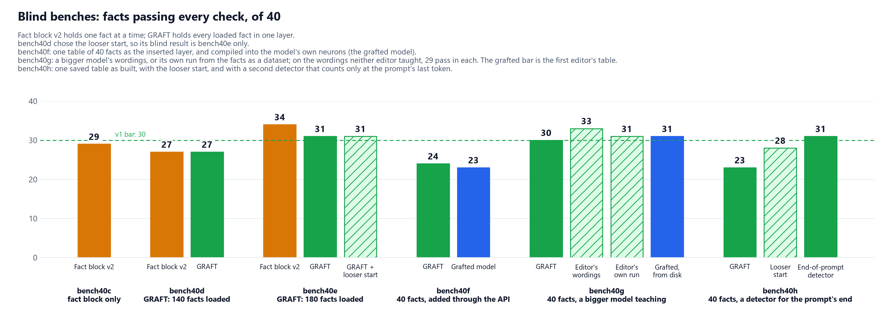
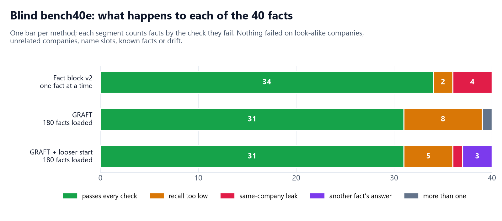
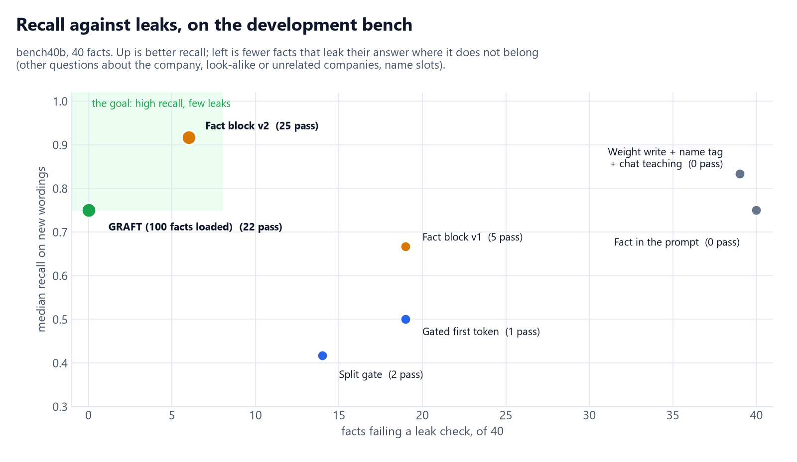

# Benchmarks

Every number on this page comes from the result files in [`research/results/`](../research/results/). The charts are redrawn from them by [`scripts/make_figures.py`](../scripts/make_figures.py). Each method's pass rule was written in the [lab notebook](lab-notebook.md) before the method ran.

## Summary: the blind benches

A blind bench is written by a separate agent with no access to the code. It is opened only after the method it judges is frozen and committed.

| Bench | Method | Facts in the model | Pass | Recall median | Same-company leak median | Look-alike, unrelated, name slots | Known facts lost | Drift |
|---|---|---|---|---|---|---|---|---|
| bench40c | Fact block v2 (stage 1) | 1 at a time | 29 | 1.000 | 0.125 | 0 on every fact | 0 | 0.0000 |
| bench40d | Fact block v2 | 1 at a time | 27 | 0.917 | 0.125 | 0 on every fact | 0 | 0.0000 |
| bench40d | **GRAFT** | 140 in one layer | **27** | 0.833 | **0** | 0 on every fact | 0 | 0.0000 |
| bench40e | Fact block v2 | 1 at a time | 34 | 0.917 | 0 | 0 on every fact | 0 | 0.0000 |
| bench40e | **GRAFT** | 180 in one layer | **31** | 0.833 | **0** | 0 on every fact | 0 | 0.0000 |
| bench40e | GRAFT + looser start | 180 in one layer | 31 | 0.917 | 0 | 0 on every fact | 0 | 0.0000 |
| bench40e | GRAFT, facts added through the API | 40 in one layer | 32 | 0.833 | 0 | 0 on every fact | 0 | 0.0000 |

<p align="center"></p>

**How to read it:**
- **GRAFT ties fact block v2 on both blind benches it ran on:** 27 against 27, and 31 against 34. Neither difference is significant (McNemar p = 1.0 and 0.55).
- **What GRAFT adds is holding many facts at once.** With 140 or 180 facts in one layer, another stored fact's answer appeared in 1 of 4,240 checked replies. Asked "What products does Lumbravic Brewing sell?", the model named the company's stored head office: "a well-known craft brewery in Asahikawa". No known facts were lost, and there was no drift.
- **The trade inside that tie:** GRAFT's gate is stricter. It leaks less to other questions about the same company (lower on 25 facts, higher on none, bench40d) and recalls less (lower on 27 facts, higher on 2, bench40e).
- **Facts added through the API pass as many.** Taught from the drafted wordings alone, without the bench's own wordings, 32 of 40 pass with 40 facts loaded, or 31 counted conservatively ([details](#facts-added-through-the-api)).

<p align="center"></p>

## Protocol

### The benches

Each bench holds 40 fictional facts, 10 for each relation: owner, CEO, founder and head office.

- **Companies:** an invented first word of 5 to 10 letters plus an industry word, such as "Nimbresco Software".
- **Answers:** fictional people's names from many cultures, or real cities of moderate size for head offices.
- **Per fact:**
  - 12 training wordings and 12 test wordings of its relation, each 8 plain sentence openings and 4 chat questions, drawn from separate pools;
  - 8 other questions about the same company: other relations and generic ones;
  - 3 look-alike companies for testing, one of each kind: the same first word in another industry, one letter changed, and an invented first word in the same industry;
  - 3 more look-alikes for training, and 3 unrelated companies;
  - name slots: a look-alike or unrelated company followed by "… a man named" or "… a woman named".
- **Two-fact companies:** in bench40d and bench40e, the 40 facts sit on 30 companies, and 10 companies hold two facts of different relations.

| Bench | Role | Written | Facts |
|---|---|---|---|
| bench40 | first development bench (beta experiments) | from a hand-made pool | 40 |
| bench40b | development | blind | 40 |
| bench40c | blind test of stage 1, then development | blind | 40 |
| devpairs | development, two facts per company | built from bench40b's wordings | 20 |
| bench40d | blind test of GRAFT, then development | blind | 40 on 30 companies |
| bench40e | blind test of GRAFT v1 | blind | 40 on 30 companies |

**How a blind bench is made.** The writer gets a brief and an avoid list, and nothing else. The brief gives the format, the counts and the rules for names and wordings. The avoid list holds every earlier company word, look-alike, invented name and answer. The writer's file is validated by script and stays closed until the method is frozen.

```mermaid
%%{init: {"theme": "base", "themeVariables": {"fontSize": "16px", "primaryColor": "#F1F5F9", "primaryTextColor": "#0F172A", "primaryBorderColor": "#94A3B8", "lineColor": "#64748B", "edgeLabelBackground": "#FFFFFF"}}}%%
flowchart LR
    R["<b>Rule written</b><br/>in the lab notebook,<br/>before any run"] --> B["<b>Blind writer</b><br/>brief and avoid list only,<br/>no access to the code"]
    B --> F["<b>Method frozen</b><br/>and committed"]
    F --> O["<b>Bench opened</b><br/>built, unedited model run"]
    O --> M["<b>Methods run</b><br/>every check, every fact"]
    M --> J["<b>Judged by the rule</b><br/>paired against the<br/>earlier method"]
    classDef plain fill:#F1F5F9,stroke:#94A3B8,stroke-width:1.5px,color:#0F172A
    classDef key fill:#FEF3C7,stroke:#D97706,stroke-width:2px,color:#0F172A
    classDef good fill:#DCFCE7,stroke:#16A34A,stroke-width:2px,color:#0F172A
    class R,J key
    class B,F,O plain
    class M good
```



### The checks

A fact passes only if it passes every check below, on prompts never used to build it. Replies are generated greedily, 16 new tokens, with thinking off. Chat prompts go through the model's chat template.

| Check | Prompts | Counts as a hit | Limit |
|---|---|---|---|
| Recall | 12 test wordings | the whole answer appears | at least 9 of 12 |
| Same company | 8 other questions about the company | the answer, or a distinctive part of it, appears | at most 2 of 8 |
| Look-alike companies | 12 | as above | at most 1 of 12 |
| Unrelated companies | 12 | as above | at most 3 of 12 |
| Name slots | 12, for people | any part of the name | at most 1 of 12 |
| Garbled text | every reply | the reply repeats or breaks down | at most 34% in recall, 10% elsewhere |
| Known facts | 133 real-world questions the unedited model answers | an answer lost | fewer than 7 lost |
| Drift | held-out ordinary text | change in next-token predictions, nats per token | at most 0.05 |
| Other stored facts (stage 2) | all replies above | another loaded fact's whole answer, where it doesn't belong | none |
| Sibling (stage 2) | the 12 recall prompts | the company's other fact's answer | at most 1 of 12 |
| Capitalisation (reported, not graded) | 2 plain and 2 chat test wordings, company in lower and upper case | recall | none |

- **Partial answers count as leaks.** A leak counts "Julian" alone as well as "Julian Rodlauer", unless the prompt or the unedited model's reply to the same prompt already had it.
- **Recall needs the whole answer** anywhere in the 16 tokens.
- **Strictness:** this rule is stricter than the usual editing benchmarks.
  - Those report averages of teacher-forced probabilities.
  - Here one fact must recall and stay quiet at the same time, by generation, in plain and chat form, next to one-letter-off names.

### Statistics

Methods are compared fact by fact on the same bench:
- an exact McNemar test on passes;
- a Wilcoxon signed-rank test on recall and on each leak rate.

The rule for each stage, and every deviation from it, is in the [lab notebook](lab-notebook.md).

## Models and hardware

| Model | Used for |
|---|---|
| **Qwen3.5-0.8B** (24 layers, hybrid Gated DeltaNet and attention) | v1 GRAFT, stage 1, every bench experiment; the beta's loop fix and fact writes |
| Qwen3-0.6B, Qwen3.5-4B | beta: fact writes without backpropagation, and the loop edit |
| Phi-3-mini-4k-instruct | beta: fact writes; the January 2025 prototype |
| Phi-3.5-mini | the January 2025 prototype |
| Qwen3-4B | beta: a bigger model drafting teaching prompts (usable for 1 of 3 sentences) |
| Claude Opus 5.5, through Claude Code | the editor in the beta's tracked sessions; drafted the relation wordings; wrote the blind benches as a separate agent |

GRAFT has been validated on **Qwen3.5-0.8B only**.

| Hardware and software | |
|---|---|
| GPU | NVIDIA GeForce RTX 3090, 24 GB |
| OS | Windows 11 |
| Python, PyTorch, Transformers | 3.11.15, 2.12.1 with CUDA 13.0, 5.12.1 |
| Weights | bfloat16 |
| Qwen3.5 fast path | not installed: Gated DeltaNet ran on the PyTorch fallback, so generation is slower than it could be |

Typical times on this machine:
- **Building a GRAFT fact:** about 43 s with the research scripts and 36 s with the package, once. A new table first spends about 40 s on calibration.
- **Scoring one fact:** every check, about 7 s with 180 facts loaded.
- **Fact block v2:** about 30 s per fact, building and scoring.

## Results in detail

### v1: GRAFT on blind bench40e, 180 facts loaded

| | GRAFT | GRAFT + looser start | Fact block v2, one at a time |
|---|---|---|---|
| Passes | **31** | 31 | 34 |
| Recall median | 0.833 | 0.917 | 0.917 |
| Same-company leak median | 0 | 0 | 0 |
| Capitalisation recall median | 0.875 | 0.875 | — (can't match other casings) |
| Failures | 8 recall, 1 recall and another fact's answer | 5 recall, 3 another fact's answer, 1 same company | 4 same company, 2 recall |
| Passes by relation (owner, CEO, founder, head office) | 7, 7, 7, 10 | 8, 6, 8, 9 | 10, 8, 8, 8 |
| Both facts pass, of 10 two-fact companies | 5 | 5 | — |

- **GRAFT against fact block v2:**
  - 4 facts pass only with GRAFT and 7 only one at a time (McNemar p = 0.55).
  - Recall is lower on 27 facts and higher on 2.
- **The looser start against GRAFT:**
  - Recall is higher on 22 facts and lower on none (Wilcoxon p = 3e-5).
  - Passes don't move: 3 only with it and 3 only without (p = 1).
  - What it lost: head-office facts firing at the start of replies to general questions about their company, so another fact's city appears.
- **bench40e was easier than bench40d for every method:** fact block v2 rose from 27 to 34, and GRAFT from 27 to 31.

### v1: GRAFT on blind bench40d, 140 facts loaded

- **Passes:** 27 of 40, the same as fact block v2. 6 facts pass only with each (McNemar p = 1).
- **Same-company leak:** lower on 25 facts, higher on none (p = 8e-6).
- **Recall:** lower on 23 facts, higher on 2 (p = 3e-5).
- **Failures:** all 13 are recall.
- **Two-fact companies:** both facts pass on 4 of 10. The companies' two facts were not confused: a fact's recall prompts got its sibling's answer at most once in 12.

### Facts added through the API

The runs above built each bench fact from the bench's own 12 training wordings plus the drafted ones. A fact added through `Graft.add`, the command line, the editor tools or the MCP server has only the drafted wordings ([GRAFT](graft.md#3-key-2-question-detectors)). [`scripts/validate_api_facts.py`](../scripts/validate_api_facts.py) adds the 40 facts of bench40e this way, into one table, and scores each with every check.

| | Through the API, 40 loaded | Bench path, 180 loaded |
|---|---|---|
| Passes | **32** | 31 |
| Recall median | 0.833 | 0.833 |
| Same-company leak median | 0 | 0 |
| Look-alike, unrelated, name slots | 0 on every fact | 0 on every fact |
| Known facts lost; drift | 0; 0.0000 | 0; 0.0000 |
| Capitalisation recall median | 0.875 | 0.875 |
| Passes by relation (owner, CEO, founder, head office) | 8, 7, 7, 10 | 7, 7, 7, 10 |
| Both facts pass, of 10 two-fact companies | 7 | 6 |

- **Paired:** one fact, f09, passes on one path only, through the API (McNemar p = 1). Recall is higher on 16 facts and lower on 13 (Wilcoxon p = 0.47). The same-company leak is lower on 3 head-office facts and higher on none.
- **The failures are the same kind:** all 8 are recall. One of them also has another fact's answer: the same Lumbravic Brewing reply as on the bench path.
- **Two differences besides the wordings:**
  - The table held 40 facts, not 180, so this comparison doesn't separate the two effects.
  - Two drafted founder wordings equal bench40e test wordings, and the API path has no bench to guard against. They are among the recall prompts of 9 founder facts. Scored without them, f08 drops from 9 of 12 to 8 of 11, below the threshold, so the conservative count is **31 of 40**.

### Stage 1: fact block v2 on blind bench40c

- **Passes:** 29 of 40, one fact at a time, under a rule of 20 or more.
- **Other measures:** recall median 1.00; no look-alike, unrelated or name-slot leaks on any fact; no known facts lost; no drift.
- **The 11 failures:** 6 same-company leaks, mostly owner and head office, and 5 recall.

### Development benches

| Bench | Method | Pass | Recall median | Same-company leak median |
|---|---|---|---|---|
| bench40b | Fact block v1 | 5 | 0.667 | 0 |
| bench40b | Fact block v2 | 25 | 0.917 | 0.125 |
| bench40b | GRAFT, 100 facts loaded | 22 | 0.750 | 0 |
| devpairs | GRAFT, 100 facts loaded | 15 of 20 | 0.792 | 0 |
| bench40d | GRAFT + looser start, 140 loaded (the bench used to choose it) | 31 | 0.917 | 0 |

<p align="center"></p>

### The yardstick: the fact in the prompt

The simplest alternative is to write the fact in front of every prompt. On bench40b this passes **0 of 40**:
- **Recall:** median 0.75.
- **Look-alike leak:** a median of 0.58, and all 40 facts fail it. The 0.8B model applies the stated fact to companies with similar names.
- **Known facts:** all 40 fail. With the fact in front of them, a median of 41 of 133 real-world questions the model answers correctly on its own go wrong.

### Beta: facts written into the weights

Before the inserted layer, facts were written into the MLP weights. No version passed more than 2 of 40 facts, on bench40 or bench40b:
- the closed-form write with a last-token key, with and without leave-alone prompts;
- the name tag;
- chat teaching;
- gates on the first answer token;
- the split gate: a name tag times a question detector, the best at 2 of 40.

The [history](history.md) has the full sequence, and the [journey chart](assets/journey.png) shows every step.

## Facts the model already knows: CounterFact

The blind benches teach facts about invented companies, which the model knew nothing about. CounterFact (Meng et al., 2022) asks for the harder thing: change a fact the model already knows, such as McGill University's headquarters, Montreal → Dublin. Each rewrite comes with 2 reworded prompts about the same subject and 10 neighbour prompts about other subjects whose true answer is the old one.

- **Which facts the model knows:** a screen of all 21,919 rewrite prompts found that the unedited Qwen3.5-0.8B gives the old answer on 4,070. Edits are drawn only from those, leaving out answers that are part of the subject's name ("Ferrari F40 → Ferrari").
- **One table per run:** all of a run's edits are loaded together, with real-world negatives of the fact's own relation left out, since the subjects are real ([GRAFT, section 11](graft.md#11-subjects-that-are-not-companies-and-real-subjects)).
- **CounterFact's measures, by probability:** efficacy (ES), the new answer above the old on the rewrite prompt; paraphrase (PS), the same on reworded prompts; neighbourhood (NS), the old above the new on neighbour prompts. Answers are forced token by token, so the layer acts as it does in generation.
- **By generation:** the new answer in greedy replies; replies to neighbour prompts and to held-out questions about the same subject that newly give it; known facts lost; drift.

### Headquarters: confirmed

| | Pilot, 40 edits | Fresh draw, 40 edits |
|---|---|---|
| ES | 1.000 | 1.000 |
| PS | 0.988 | 0.963 |
| Says the new answer, reworded | 0.975 | 0.963 |
| NS (unedited model) | 0.848 (0.860) | 0.828 (0.845) |
| Neighbour leaks; same-subject leaks | 0.013; 0.037 | 0.018; 0.040 |
| Known facts lost; drift | 0; 0.0000 | 0; 0.0000 |
| By the rule written before the run | in between: its NS bar was set without measuring the unedited model, which scores below it | **works** |

- **The neighbourhood changes on one edit per draw,** and both times the cause is a longer name that contains the stored one, such as "Vanderbilt University Department of English". The name index matches it ([limitations](limitations.md#names)).
- **Whenever a reworded prompt opens the detector, the new answer wins.** The misses (3 edits of 80) are prompts where it stays shut.

### Beyond companies: in development

Six relations about people, countries, places, creative works and products, 12 known facts each. The wordings were drafted by agents with no access to the dataset ([lab notebook](lab-notebook.md#counterfact-breadth-beyond-companies-written-2026-11-08-before-it-ran)).

| Relation (CounterFact) | Subject | PS: first run | Revision 1 | Revision 2 |
|---|---|---|---|---|
| citizenship (P27) | person | 0.750 | 0.958 | **1.000** |
| developer (P178) | product | 0.583 | 0.958 | **1.000** |
| mother_tongue (P103) | person | 0.208 | 0.708 | 0.750 |
| original_language (P364) | work | 0.042 | 0.667 | 0.708 |
| official_language (P37) | country | 0.333 | 0.667 | 0.667 |
| located_in_country (P17) | place | 0.083 | 0.458 | 0.583 |
| **All 72** | | **0.333** | **0.736** | **0.785** |

- **The first run failed its rule:** detectors were fitted against other relations' questions about other kinds of subject ("the official language of" a person), which crowded their thresholds. Revision 1 keeps negatives within the subject's kind.
- **Revision 2** teaches plain prompts also behind sentences of ordinary text, as CounterFact's reworded prompts often follow an unrelated sentence, and gives each kind more generic questions. Same-subject leaks went 0.042 → 0.113 → 0.082.
- **Unchanged throughout:** NS within 0.004 of the unedited model, no known facts lost, no drift.
- **Not yet evidence:** these 72 edits were used to choose both revisions, and the pooled PS of 0.785 is under the 0.80 that a confirmation on fresh edits needs.

### Published editors, for scale

AlphaEdit's paper (Fang et al., ICLR 2025, Table 1) reports CounterFact after 2,000 edits, applied sequentially in batches of 100, on GPT-J:

| GPT-J, 2,000 edits | ES | PS | NS |
|---|---|---|---|
| Unedited | 16.22 | 18.56 | 83.11 |
| MEMIT | 98.55 | 95.50 | 63.64 |
| AlphaEdit | 99.75 | 96.38 | 75.48 |

They show the usual trade: generalizing an edit costs the neighbourhood. GRAFT's headquarters runs keep NS within 0.02 of the unedited model at a similar PS. They are not a comparison, though: another model, one relation, and 40 edits per table rather than 2,000.

## What the results do and don't show

**They show:**
- On a 0.8B model, one inserted layer holds 140 to 180 facts at once at about the level of one block per fact, on blind benches.
- Look-alike, unrelated-company and name-slot leaks are zero.
- No known facts are lost, and there is no drift.
- Facts added through the API, with no bench wordings, pass as many as facts built from the bench: 32, or 31 counted conservatively, against 31.
- On CounterFact, GRAFT changes headquarters facts the model already knows: a fresh draw of 40 met every bar written before it ran, with reworded prompts at 0.963 and the neighbourhood within 0.017 of the unedited model.

**They don't show:**
- **Other models or larger tables:** behaviour on any other model, or with more than 180 facts. Facts added through the API were measured with 40 in the table.
- **Other relations, aliases, or multi-turn and multi-hop questions.**
- **Standard benchmarks, fully:** only part of CounterFact has been run: one confirmed relation, and six more in development. zsRE and QAEdit have not been run, and no published editor has been run on the same model.

**Two cautions:**
- **Development benches were used to choose options.** Only blind results count as evidence, so bench40d's 31 for the looser start is not.
- **Recall needs only the whole answer to appear.** Many correct replies still invent details around it, as in "Shalini Deshpande, the founder of **Bazuventi Apparel**", where the stored fact was the owner.

## Reproducing the numbers

The package reproduces the published runs exactly: the same parts, the same shared detectors, and identical replies. `scripts/check_graft_reproduction.py` checks this on four bench40e facts in about 5 minutes.

```bash
python scripts/check_graft_reproduction.py models/Qwen3.5-0.8B
```

The full blind run reuses the GRAFT parts cached in `research/results/<bench>/fact_table/`, so it skips the build of about 40 seconds per fact:

```bash
B=benchmarks
cramschool bench run --model models/Qwen3.5-0.8B --bench $B/bench40e.json --method base --out runs/bench40e
cramschool bench run --model models/Qwen3.5-0.8B --bench $B/bench40e.json --method graft --out runs/bench40e --load $B/bench40b.json $B/bench40c.json $B/devpairs.json $B/bench40d.json --cache "research/results/{bench}/fact_table"
cramschool bench run --model models/Qwen3.5-0.8B --bench $B/bench40e.json --method block --out runs/bench40e
cramschool bench report --out runs/bench40e --bench $B/bench40e.json
python scripts/make_figures.py          # the charts and the animation, from research/results
```

Facts added through the API are checked by building all 40 facts of bench40e from scratch, which takes about 30 minutes:

```bash
python scripts/validate_api_facts.py models/Qwen3.5-0.8B runs/api_facts
```

The CounterFact runs need the dataset (`https://rome.baulab.info/data/dsets/counterfact.json`, 45 MB):

```bash
CF=counterfact.json
python scripts/counterfact_screen.py models/Qwen3.5-0.8B $CF runs/counterfact/screen.jsonl                 # which facts the model knows, ~3 min
python scripts/counterfact_pilot.py models/Qwen3.5-0.8B $CF runs/counterfact/screen.jsonl runs/cf/pilot   # headquarters pilot, ~30 min
python scripts/counterfact_pilot.py models/Qwen3.5-0.8B $CF runs/counterfact/screen.jsonl runs/cf/confirm 20261109 runs/cf/pilot/facts.json
R=research/results/counterfact/breadth
python scripts/counterfact_breadth.py models/Qwen3.5-0.8B $CF runs/counterfact/screen.jsonl $R/drafted_relations.json $R/heldout_questions.json     runs/cf/breadth_rev2 4 - - research/results/counterfact/breadth_rev2/more_generic.json                  # revision 2, ~40 min
```

[The bench tool](bench-tool.md) explains every command. The original research scripts are in git history at commit `4325028`, under `research/bench/`.
