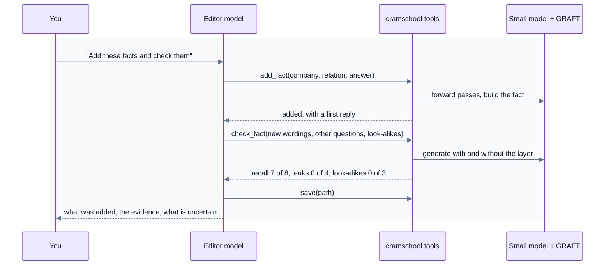

# Editor models

An editor model is a bigger model that operates the small one through tools.

GRAFT gives you the same facts in **two forms**, and you can use either or both: a **table** beside the model, which changes no weight, and a **grafted model**, the same facts written into the model's own weights. The grafted model still needs a small switch that turns a fact on when its subject is named. An editor can make and record both.

**What it can hold today.** A fact is a named subject, a relation and a short answer, for example *Vorantis Biotech, CEO, Ingrid Solberg*.

| | |
|---|---|
| **Built in** | Four relations about companies: owner, CEO, founder and head office |
| **Any other relation** | Added from a few dozen ways of asking it, which you write or a bigger model drafts |
| **Any other kind of subject** | A person, a town, a product, a book, a medicine and so on. A kind also needs invented names and general questions about it |
| **Measured** | Companies: 31 of 40 new facts pass on a blind bench. Eight other kinds of subject: 53 of 96 pass on a blind bench; people, organisations and years work, cities and phrases fall short. Facts about science and software: not measured yet |
| **Not held** | Free text and documents, programs, step-by-step procedures, and behaviours. A stored answer is one short, fixed string |

An editor can:
- add facts and check each one on wordings it writes itself;
- draft the wordings of a new relation;
- write a blind bench;
- run the beta's weight-edit workflow for behaviour fixes, which is separate from GRAFT.

The editor never touches weights or the table directly. Every action goes through a tool, every tool input is validated before it runs, and the checks are the same as for a person.



## Choosing one

Every editor is named by a spec string. Pass it as `--editor`, as `editor_from_spec(spec)`, or in the environment variable `CRAMSCHOOL_EDITOR`.

| Spec | Where it runs | Key | Notes |
|---|---|---|---|
| `anthropic:claude-opus-5-5` | Claude API | `ANTHROPIC_API_KEY`, or an `ant auth login` profile | The default model. Adaptive thinking at effort "high", streamed. The server-side refusal fallback is on. Needs `pip install "cramschool[claude]"` |
| `anthropic:claude-sonnet-5-5`, `anthropic:claude-haiku-5-5` | Claude API | as above | Cheaper and faster |
| `openai:<model>` | OpenAI | `OPENAI_API_KEY` | Any model with tool calling |
| `ollama:<model>` | Ollama, `http://localhost:11434/v1` | none | For example `ollama:qwen3:14b`, `ollama:llama3.1:8b`, `ollama:mistral-small`. The model must support tools |
| `vllm:<model>` | vLLM, `http://localhost:8000/v1` | none | Start vLLM with tool calling enabled (`--enable-auto-tool-choice --tool-call-parser ...`) |
| `lmstudio:<model>` | LM Studio, `http://localhost:1234/v1` | none | |
| `llamacpp:<model>` | llama.cpp's server, `http://localhost:8080/v1` | none | Start the server with `--jinja` for tool calling |
| `openrouter:<model>` | OpenRouter | `OPENROUTER_API_KEY` | Hundreds of hosted models |
| `openai-compatible:<model>@<url>` | any OpenAI-compatible server | `CRAMSCHOOL_API_KEY` | |
| `local:<path or id>` | transformers, on this machine | none | No server needed. Tools go through a JSON protocol, so any instruct model works, though small ones follow it less reliably |

- **Other base URLs:** any OpenAI-compatible spec takes `@<url>`, for example `ollama:qwen3:14b@http://gpu-box:11434/v1`. `CRAMSCHOOL_BASE_URL` sets one for every spec.
- **Validation:** these editor models were not validated as editors here. Every tool input is checked, and every result passes the same checks, so a weak editor makes slow progress, not silent damage.
- **Memory for a local editor:** it shares the GPU with the small model. On 24 GB, an editor of 4B to 9B parameters in bfloat16 fits beside Qwen3.5-0.8B. Larger editors fit better on a separate server (Ollama, vLLM) reached by URL.

## What an editor does

**Teach and check facts.**

```bash
cramschool teach --editor ollama:qwen3:14b --model models/Qwen3.5-0.8B --table my.graft --facts my_facts.csv
```

```python
run = run_editor(editor, GraftTools(graft), "Add Vorantis Biotech's CEO, Ingrid Solberg, and check it.")
```

The editor gets [the GRAFT protocol](../src/cramschool/tools.py) as its instructions:
1. look at the model's answer before adding;
2. add the fact;
3. check it on about 8 new wordings, 4 other questions about the company and 2 or 3 look-alike names;
4. remove a fact that leaks;
5. fix what misses: teach the relation the ways of asking that its facts missed (`teach_wordings`), build the facts again (`rebuild`), and check once more with questions it has not used before;
6. save, and report the evidence.

**Measured once, end to end** ([benchmarks](benchmarks.md#a-bigger-model-as-the-editor-on-new-facts)). Given a blind bench's 40 facts as a CSV and these tools on a running server, Claude Opus 5.5 followed the protocol with no person in the loop: it added the 40 facts, checked each three times on questions it wrote, taught 76 wordings in two rounds and saved the table, in 85 minutes and 75 tool calls. On the bench its table passes 31 of 40 against 30 with the built-in wordings, and 29 against 29 on the wordings it didn't teach. Its checks also found a leak no bench asks about: a chief-executive fact answers for other jobs at its company.

**Draft a new relation.**

```bash
cramschool draft-relation --editor anthropic:claude-opus-5-5 --name cto --description "the chief technology officer of a company" --out cto.json
cramschool graft add --model models/Qwen3.5-0.8B --table my.graft --relations cto.json --subject "Vorantis Biotech" --relation cto --answer "Kenji Aoyama"
```

Read the drafted wordings before using them. Each must have `{s}` exactly once and ask only for that relation.

**Write a blind bench.**

```bash
cramschool bench brief --avoid-from benchmarks/*.json --seed 20261201 --out brief.txt --avoid-out avoid.json
cramschool bench write --editor anthropic:claude-opus-5-5 --avoid avoid.json --seed 20261201 --out bench41_source.json
```

- **The writer** sees only the brief and the avoid list.
- **The check:** its source is checked against every rule a script can check, and the problems are sent back until it passes.
- **Keep the file closed** until the method it will judge is frozen. See [the bench tool](bench-tool.md).

**Run the weight-edit workflow.** `run_editor(editor, Surgery(model, tokenizer, ...), task)` gives an editor the beta's surgery tools: diagnose, map, localize, operate, check, decide. That is how the loop fix was found. See [tools](tools.md).

## Adapters

| Class | Module |
|---|---|
| `AnthropicEditor(model="claude-opus-5-5", effort="high", max_tokens=32000, fallbacks="default", client=None)` | `cramschool.editors.anthropic` |
| `OpenAICompatEditor(model, base_url=..., api_key=None, max_tokens=4096, temperature=None, extra=None)` | `cramschool.editors.openai_compat` |
| `LocalEditor(path=None, model=None, tokenizer=None, max_new_tokens=1024, enable_thinking=False)` | `cramschool.editors.local` |

**Writing your own adapter:**
1. Subclass `Editor` and return a `Session`.
2. Its `send(text, results)` returns a `Reply(text, tool_calls, stop_reason)`.
3. `run_editor` then drives it like the others.
