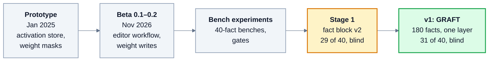
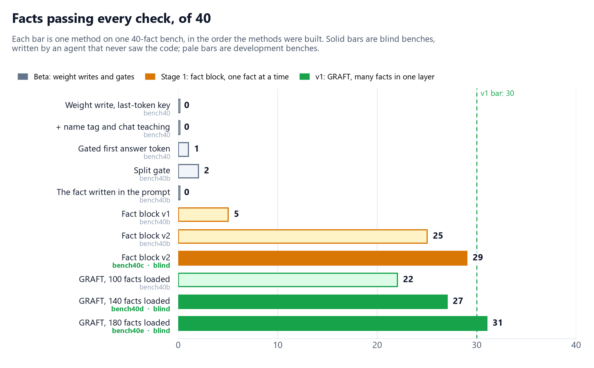

# History

cramschool v1 is the end of a line of experiments. This page follows it from the original prototype through the beta to GRAFT: what each step tried, what it showed, and where its code lives now. The [lab notebook](lab-notebook.md) has the dated detail, with every rule written before its run.



<p align="center"></p>

## January 2025: the original prototype

The project began with my own prototype, a "semantic knowledge system" for Phi-3-mini and Phi-3.5-mini. It predates the weight-space programming work by almost two years.

**How it worked:**
- A fact such as "Julian Rodlauer is the owner of RX Systems" was run through the model.
- Hooks on the MLP and attention layers recorded its activation patterns.
- The layers with the strongest activations were treated as the fact's key layers and nudged with a mask scaled by those patterns.
- The fact and its patterns went into a store. A later question was matched against the store by the similarity of its own activations, and the matching facts were used in the answer.

**What carried forward:**
- **Two ideas from the prototype became GRAFT:**
  - reading a fact's trigger from the model's own activations;
  - keeping a separate store that is consulted only when those activations match.
- **The weight edit did not carry forward.** Later work found that the prototype's hooks attached to modules with no usable weight, so no weight had actually changed. GRAFT keeps a store beside the model instead of writing into it.

## November 2026: beta 0.1 and 0.2, as `weightspace`

The beta followed *Sparks of Weight-Space Programming* (Takehi, Teoh, Zhang and Khattab, MIT CSAIL, November 2026). In that workflow a bigger model operates on a small one through tools, observing with forward passes and editing weights directly, like a surgeon.

- **The workflow** lives on in v1 as the [tools](tools.md):
  - forward passes only, within a budget;
  - a hash-chained log of every call;
  - exact undo;
  - an MCP server, so Claude Code could act as the surgeon.
- **A behaviour fix that worked.** The published loop fix for Qwen3.5-0.8B was rebuilt from scratch with forward passes.
  - On 32 new GSM8K problems with thinking on, correct answers went from 1 to 7: 6 rescued, 0 broken, p = 0.03.
  - On models that don't loop (Qwen3-0.6B, Qwen3.5-4B), the tracking rejected the edit, as it should.
- **Facts written into the weights did not work reliably.**
  - The writes were closed-form low-rank changes to an MLP's output matrix, with and without backpropagation for the value.
  - They passed 0 to 3 of 10 new facts across Qwen3.5-0.8B, Phi-3-mini, Qwen3-0.6B and Qwen3.5-4B.
  - One fact written in a live session, "RX Systems is owned by Julian Rodlauer", passed its session. On new prompts it leaked the first name "Julian" to other companies. Protecting name slots stopped that leak.
- **Retrieval:** 0.1 also had a retrieval path, and 0.2 removed it.

## The bench experiments

- **bench40, 40 fictional facts with look-alike companies and a pass rule written first:** every weight write failed. At most 1 of 40 passed, in every design tried:
  - the closed-form write, with and without leave-alone prompts (0);
  - a name tag at layer 4 (0);
  - the name tag with chat teaching (0);
  - a gated first answer token (0, then 1).
- **The measurement that changed direction.** At the last token of a question, the model's hidden state barely tells a company from its look-alikes: AUC at most 0.73 at every layer. At the company's own last token it does: AUC 0.96 to 1.00 at layers 2 to 16. So a fact should be keyed on the name, not on the end of the question.
- **Drafted wordings.** 240 drafted teaching wordings raised recall in every design, on the blind bench40b.
- **The split gate,** a name tag times a question detector: 2 of 40.
- **The yardstick,** the fact written in the prompt: 0 of 40.
- **Fact block v1,** the first inserted layer, which detected the company at layer 4: 5 of 40. It was the first method with no damage at all: no known facts lost, and no drift.

## Stage 1: fact block v2, one fact at a time

- **The change:** an exact name match replaced the layer-4 company detector, and the push was doubled.
- **Results:** 25 of 40 on the development bench, then **29 of 40 on blind bench40c**, against a rule of 20 or more.

## Stage 2, then v1: GRAFT, many facts in one layer

**One layer holds a table of facts**, with:
- a case-insensitive name index;
- competition between a company's facts, with shared detectors that veto unknown relations;
- pushes only where the next token is chosen;
- spelling by context;
- the model's own reply positions used as negatives.

| Run | Facts loaded | Pass |
|---|---|---|
| Development, bench40b | 100 | 22 of 40 |
| **Blind bench40d** | 140 | **27 of 40**, equal to fact block v2 |
| One allowed revision: a looser start | 180 | 31 against 31 on blind bench40e, so it is optional |
| **Blind bench40e, v1** | 180 | **31 of 40** |

## Where the beta code lives

When v1 was cut, everything it superseded was removed from the main branch. Commit `a860535` is the last one that still holds the beta:
- [`prototype/`](https://github.com/GhoshSrinjoy/weightspace-update-programming/tree/a860535/prototype): the January 2025 scripts and their notes.
- [`weightspace/`](https://github.com/GhoshSrinjoy/weightspace-update-programming/tree/a860535/weightspace): the beta package as it stood, including:
  - its README with every beta measurement;
  - about 50 experiment scripts and their raw results;
  - the tracked surgery session logs;
  - the exported loop-fix patch.

The research scripts that produced the v1 results (the bench builder, every method, the diagnostics) were replaced by the package, which reproduces them exactly. They are at commit [`4325028`, under `research/bench/`](https://github.com/GhoshSrinjoy/weightspace-update-programming/tree/4325028/research/bench).

To look at any of it locally:

```bash
git show a860535:weightspace/README.md        # the beta's full measurements
git checkout a860535 -- prototype             # restore the prototype into the working tree
git show 4325028:research/bench/fact_table.py   # the research version of GRAFT
```

## Credits

- **Origins:** my January 2025 prototype.
- **Weight-space programming:** the editor workflow and the loop fix follow *Sparks of Weight-Space Programming* by Rikiya Takehi, Jayden Teoh, Alex Zhang and Omar Khattab ([post](https://rikiyat.github.io/blog/weight-space-programming/), [logs](https://github.com/RikiyaT/lm_understand-logs)).
- **Fact editing:** the beta's fact writes built on ROME (Meng et al., 2022) and MEMIT (Meng et al., 2023), and its last-token key on [RETS](https://arxiv.org/abs/2408.15091).
- **The calibration text** is 355 paragraphs of WikiText-103 (Merity et al., 2016, CC BY-SA).
