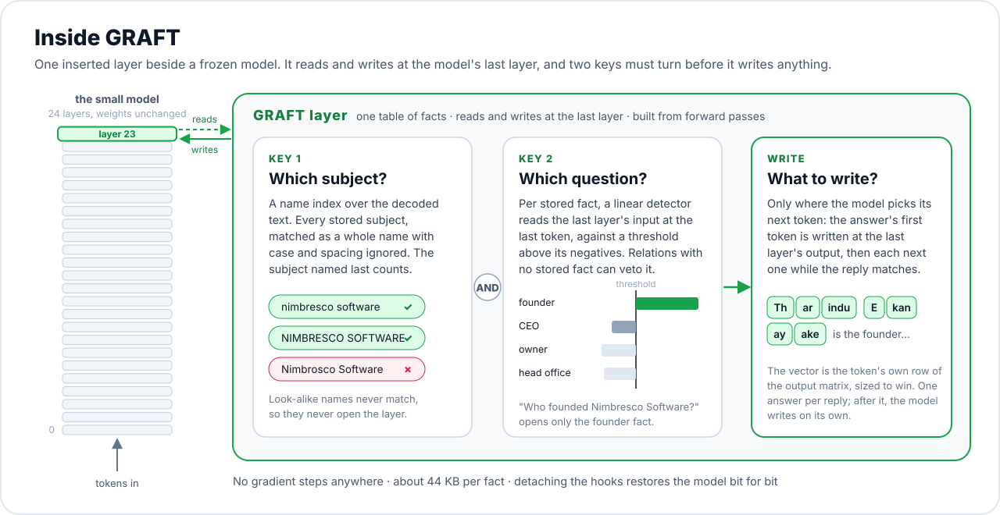
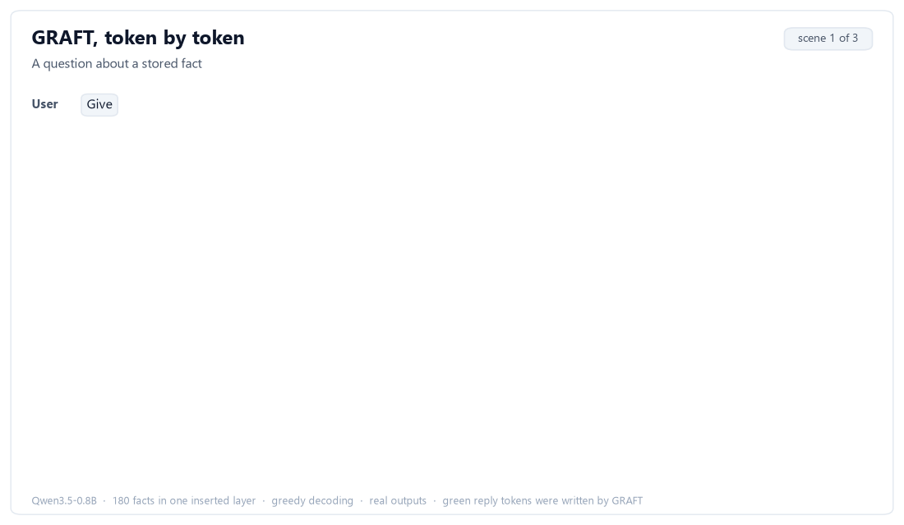
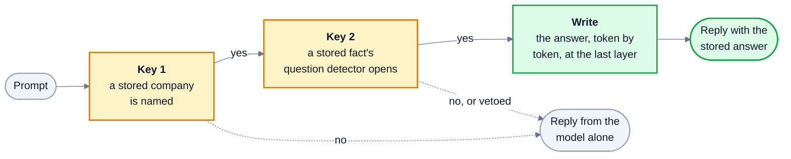
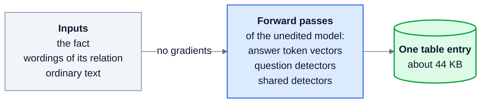
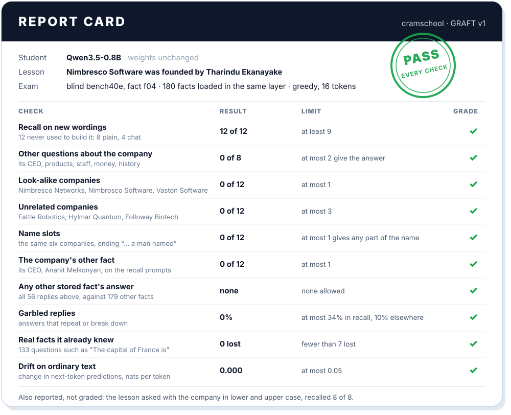

# How GRAFT works

A small model asked about a company it has never heard of invents an answer. Asked "Give me the name of the founder of Nimbresco Software.", Qwen3.5-0.8B replies "The founder of **Nimbresco Software** is **Rajesh Kumar**." That name is made up.

There are two obvious fixes, and neither works on this model:
- **Writing the fact into the prompt** passed 0 of 40 facts on the development bench.
  - The model repeated the answer for look-alike companies on a median of 7 of 12 prompts.
  - With the fact in front of them, it got a median of 41 of 133 real-world questions wrong that it answers correctly without it ([benchmarks](benchmarks.md#the-yardstick-the-fact-in-the-prompt)).
- **Writing the fact into the weights,** which the beta did in several ways, passed at most 2 of 40. The written fact fired on other questions about the company and on look-alike names ([history](history.md)).

The examples on this page are companies, with the four relations that are built in. The same two keys work for any named subject, for example: a person, a town, a product or a medicine, once its relation has wordings ([Python API](python-api.md#subjects-that-are-not-companies)).

GRAFT takes a third route. It leaves every weight alone and adds one small layer beside the model, which reads the question at layer 20 and writes the answer at the last layer. The layer stays silent unless two conditions hold.

## One question, token by token

The animation below was recorded on the real model with 180 facts loaded. It shows three questions:
1. a stored fact is asked for, so both keys turn and the answer is written;
2. another question about the same company, so key 2 stays shut;
3. a company one letter off, so key 1 stays shut.

If the animation doesn't play, the last frame of each scene is in [scene 1](assets/graft-trace-1.png), [scene 2](assets/graft-trace-2.png) and [scene 3](assets/graft-trace-3.png). The recorded data is [`graft_trace.json`](assets/data/graft_trace.json).

## Key 1: which company?

The layer keeps a **name index**: every stored company name, lower-cased and with runs of spaces collapsed. As tokens arrive, it decodes them and looks for any stored name as a whole word, with no letter or digit just before or after it. The company named last is the one the question is about.

- **Any capitalisation matches.** "nimbresco software" and "NIMBRESCO SOFTWARE" both open key 1. Across the blind benches, recall with the company in lower or upper case has a median of 0.875.
- **Look-alikes never match.** "Nimbrosco Software" differs by one letter, so the index finds nothing and the layer stays out of the way. This is why no fact has ever leaked to a look-alike company in v1.
- **The price is aliases.** "Nimbresco" alone, "NS" or a misspelling don't match either. See [limitations](limitations.md).

## Key 2: which question?

A company can be asked many things: who founded it, who runs it, how many people it employs. Key 2 decides whether the question asks for a fact that is stored.

Each stored fact has a **question detector** for plain text and another for chat. A detector is one direction in the 1,024-dimensional input of layer 20's MLP. The reading at the prompt's last token is compared with a threshold.

- **The direction** is fitted by linear discriminant analysis. Its positives are the fact's question asked in many wordings, about its own company and about invented ones. Its negatives are everything the layer must not answer:
  - other questions about the company;
  - questions about other relations;
  - generic questions about products, size or money;
  - real-world questions;
  - positions inside the model's own replies.
- **The threshold** sits above 99% of the negative prompts' readings, and above every reading taken inside an answer.
- **Shared detectors** cover each relation that has no stored fact for the company. If one of them reads clearly higher than the best stored fact, it **vetoes**: the question is about something the table doesn't know.
- **Two facts of one company compete.** In the animation, Nimbresco Software holds two facts. The founder detector reads +1.61 above its threshold and the CEO detector −0.62, so only the founder is answered.

## The write

When both keys turn, GRAFT writes at one position only: the last one, where the model is choosing its next token. It writes into the output of the model's last layer.

1. It writes the answer's **first token**: "Th" of "Tharindu Ekanayake".
2. When that token comes out, it writes the **next** token, and so on while the reply matches the answer exactly.
3. After the last answer token, or the first mismatch, it stops. **One answer per reply**; afterwards the model writes on its own.

The answer is written with a leading space after a word ("is Tharindu") and without one after a line break or an opening mark (`**Tharindu`). If the first token comes out in the other spelling, the layer follows that one.

- **Why the last layer.** Nothing reads the last layer's output except the model's final step at the same position. A write there changes which token comes next and nothing after it, so it can be made large enough to win every time. The vector is the token's own row of the output matrix at one fixed length, the same for every fact.
- **What version 1.0 did.** It pushed a vector measured for each token at layer 20, three layers below the output. There the push could lose to the model's own next word, and an answer could start right and go astray. `GraftOptions(last_layer=None)` still writes that way, and v1's published numbers were measured with it.
- **What changed in the numbers:** on a bench that did not choose the setting, 32 of 40 facts pass with the write at the last layer against 23 with the push at layer 20, and none stops passing. The bench was not blind ([benchmarks](benchmarks.md#finishing-an-answer-its-tokens-written-at-the-last-layer)).
- **What it costs:** an answer that opens on a question which isn't the fact's own is finished too ([limitations](limitations.md#leaks)).

## Built without training

- **Building a fact** takes about 40 seconds on an RTX 3090. The result is cached.
- **Nothing in the model changes.** GRAFT is a set of hooks on the model. Detaching them gives back the unedited model's output exactly; this was checked by comparing generations before and after.
- **Facts are independent.** Adding a fact builds its own detectors and vectors without touching other facts' entries. Only facts of the same company meet, in the competition of key 2.

## How a fact is judged

A fact counts as passing only if it passes every check, on prompts that were never used to build it. Here is one fact from the blind bench, with 180 facts loaded:

[Benchmarks](benchmarks.md) describes how each check works and gives the results over all facts. [GRAFT](graft.md) states the method precisely, with every formula and default.

## The same facts in the model's own neurons

Everything above leaves the weights alone. A table can also be compiled into the model: the **grafted model** is a checkpoint of the same byte size in which layer 20's own neurons hold the facts.

- **Key 2 and the push become neurons.** A neuron's gate row is a fact's question detector, and its output column is the push.
- **Key 1 stays outside the weights.** A small name switch, shipped with the checkpoint, turns a fact's neurons on when its company is named, and follows an answer of several tokens. Without it the facts are dormant.
- **It answers at the level of the inserted layer with the push at layer 20:** on a blind bench of 40 new facts, 23 pass every check against the inserted layer's 24. The grafted model has no write at the last layer, so a new table now answers better than its grafted model (33 of 40 on that bench, which had chosen the setting).
- **Reusing neurons costs a little,** since no neuron is idle. The cost is judged on the facts the model knows firmly, and none of those is lost.

[GRAFT, section 12](graft.md#12-the-grafted-model) has the compile and the damage bar, and [limitations](limitations.md#what-it-is-not) what it still can't do.
