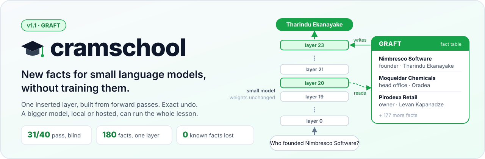
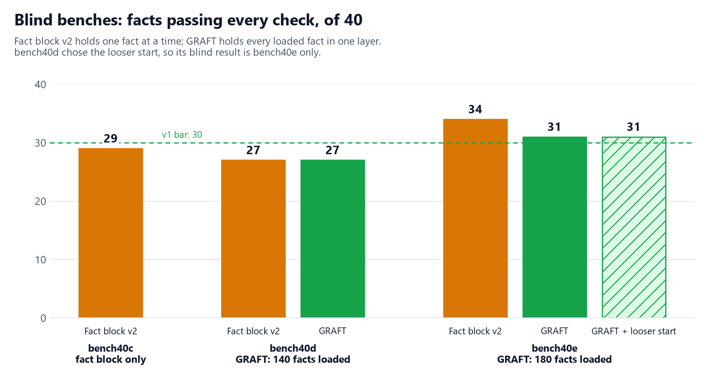
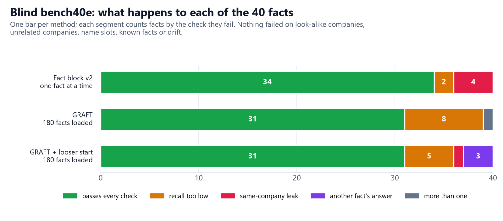

# cramschool documentation

cramschool teaches small language models new facts without training them, through **GRAFT**: one inserted layer that answers only when a stored company is named and a stored fact is asked for. These pages explain the method, the evidence and the tools.

## Understand it

| Page | What it covers |
|---|---|
| [How it works](how-it-works.md) | GRAFT step by step: the two keys, the push, the build. The animation, diagrams and a report card |
| [GRAFT, the method](graft.md) | Definitions and formulas: calibration, the name index, LDA detectors, thresholds, competition, answer vectors, defaults, cost |
| [Limitations](limitations.md) | What v1 cannot do, or has not been shown to do |

## The evidence

| Page | What it covers |
|---|---|
| [Benchmarks](benchmarks.md) | The blind-bench protocol and the checks; models and hardware; every result; how to reproduce them |
| [Lab notebook](lab-notebook.md) | The dated record: every rule written before its run, every result and deviation after it |
| [History](history.md) | From the January 2025 prototype, through the beta and the bench experiments, to v1 |
| [Related work](related-work.md) | A literature survey of fact editing, and where this project sits |

## Use it

| Page | What it covers |
|---|---|
| [Tools](tools.md) | The editor workflow for a bigger model, the MCP server, the live progress window, the monitoring grid, and layer and isolation tools |

## Figures

Every chart and the animation are drawn from the saved results by [`scripts/make_figures.py`](../scripts/make_figures.py). The illustrations (`hero.svg`, `graft-anatomy.svg`, `report-card.svg`) are hand-made, and their numbers come from the same result files.

| | |
|---|---|
|  |  |
|  |  |
