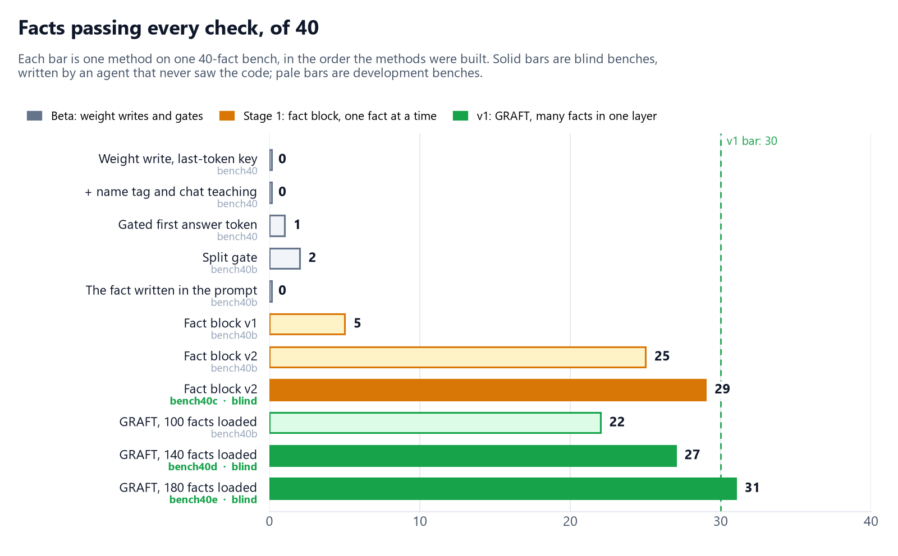
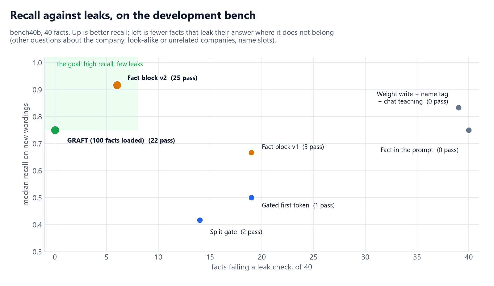
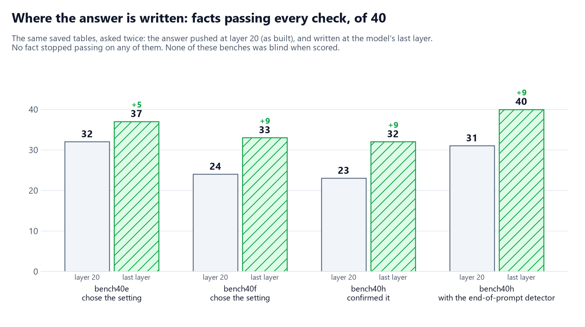
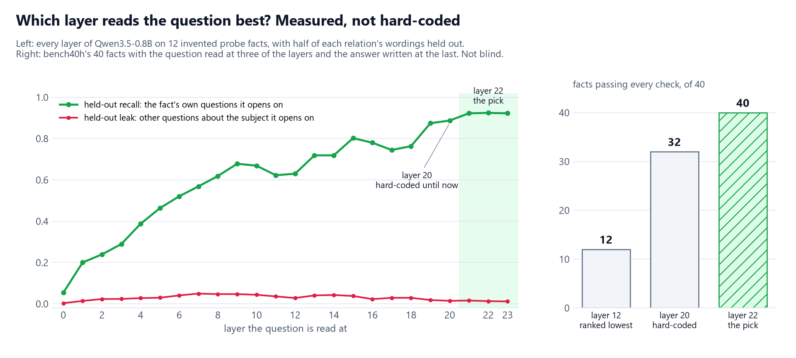

# cramschool documentation

cramschool teaches small language models new facts without training them, through **GRAFT**: one inserted layer that answers only when a stored subject is named and a stored fact about it is asked for. The subject can be any named thing, for example: a company, a person, a town, a product or a medicine. The same facts can be compiled into the model's own neurons, as a checkpoint of the same size (the grafted model). These pages explain the method, the evidence and the tools.

## Understand it

| Page | What it covers |
|---|---|
| [How it works](how-it-works.md) | GRAFT step by step: the two keys, the write, the build. The animation, diagrams and a report card |
| [GRAFT, the method](graft.md) | Definitions and formulas: calibration, the name index, LDA detectors, thresholds, competition, answer vectors, defaults, cost; the grafted model and its damage bar |
| [Status](status.md) | What has been shown, with its numbers, and what has not |
| [Limitations](limitations.md) | What v1 and the grafted model cannot do, or have not been shown to do |

## The evidence

| Page | What it covers |
|---|---|
| [Benchmarks](benchmarks.md) | The blind-bench protocol and the checks; models and hardware; every result, on new facts, on CounterFact and for the grafted model; how to reproduce them |
| [Lab notebook](lab-notebook.md) | The dated record: every rule written before its run, every result and deviation after it |
| [History](history.md) | From the January 2025 prototype, through the beta and the bench experiments, to v1 and the grafted model |
| [Related work](related-work.md) | A literature survey of fact editing, and where this project sits |

## Use it

| Page | What it covers |
|---|---|
| [Getting started](getting-started.md) | Install, a first fact in Python and on the command line, and handing the work to a bigger model |
| [User guide](user-guide.md) | Which settings to pick, a table inside your own generation code, a system message, checking a fact, a table from version 1.0, troubleshooting |
| [Examples](../examples/) | Four scripts that run as they stand |
| [Python API](python-api.md) | `Graft`, the grafted model, relations, datasets, editors, the bench, and the lower-level parts |
| [Command line](cli.md) | `graft`, `teach`, `draft-relation`, `bench`, `serve`, `call`, `watch` |
| [Changelog](../CHANGELOG.md) | What changed between versions |
| [Editor models](editors.md) | Claude, OpenAI, Ollama, vLLM, LM Studio, llama.cpp, OpenRouter, or a local model, driving the tools |
| [MCP](mcp.md) | The MCP server for Claude Code and other clients: setup and every tool |
| [Your own data](datasets.md) | CSV, JSON, JSONL, bench files and Hugging Face datasets; new relations |
| [The bench tool](bench-tool.md) | Blind benches: brief, write, build, run, report; reproducing the published numbers |
| [Tools](tools.md) | The GRAFT toolbox, the weight-edit workflow, the progress window, the monitoring grid, layer and isolation tools |

## Figures

Every chart and the animation are drawn from the saved results by [`scripts/make_figures.py`](../scripts/make_figures.py). The animation's data is recorded on the real model by [`scripts/trace_graft.py`](../scripts/trace_graft.py). The illustrations (`hero.svg`, `graft-anatomy.svg`, `report-card.svg`) are hand-made, and their numbers come from the same result files. The report card is one fact of v1's blind bench, measured with the earlier write.

| | |
|---|---|
|  |  |
|  |  |
|  |  |
