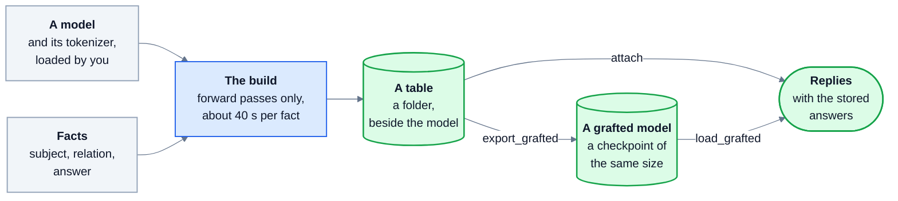

# Inputs and outputs

What you give cramschool, what it gives back, and what each of those things is. The file listings and sizes on this page are from real runs on Qwen3.5-0.8B.

## In one picture



There are two outputs you can keep. A **table** sits beside the model and changes none of its weights. A **grafted model** is the old model with the new facts written into its own weights, in a checkpoint of the same size.

## What you give it

| Input | What it is | Required | Where it goes |
|---|---|---|---|
| **A model** | A Hugging Face causal language model, loaded by you and used frozen. Validated on Qwen3.5-0.8B | yes | `Graft(model, tokenizer)`, `--model` |
| **Its tokenizer** | The model's own. Chat questions need its chat template | yes | the same |
| **Facts** | Each one is three pieces of text: a subject, a relation and an answer | yes | `graft.add(subject, relation, answer)`, `add_many`, a file |
| **A facts file** | The same facts as rows: CSV, TSV, JSON, JSONL, a bench file, or a Hugging Face dataset | no | `load_facts(path)`, `--facts` ([your own data](datasets.md)) |
| **Relations** | For a relation that isn't built in: the ways of asking it | only for new relations | `Relation(...)`, `--relations file.json` |
| **Settings** | Where the answer is written, the extra detector, the fast build, the layer, a system message | no | `GraftOptions(...)`, `layer=`, `system=` ([user guide](user-guide.md#which-settings)) |
| **Ordinary text** | At least 280 paragraphs of plain prose, used once to calibrate. The package ships 355 paragraphs of WikiText-103 | no | `calibration=` |
| **An editor model** | A bigger model that adds and checks facts for you | no | `cramschool teach --editor ...` ([editor models](editors.md)) |

### A fact, piece by piece

| Piece | What to write | Example |
|---|---|---|
| **Subject** | The name exactly as questions will write it. Capitals and spacing don't matter; spelling does | `Vorantis Biotech` |
| **Relation** | Which fact about the subject this is. Built in: `owner`, `ceo`, `founder`, `hq` (also accepted: "CEO", "head office"). Others you add | `ceo` |
| **Answer** | The text the model should give. One word or several | `Ingrid Solberg` |

```csv
subject,relation,answer
Vorantis Biotech,CEO,Ingrid Solberg
Vorantis Biotech,head office,Tartu
Moqueldar Chemicals,founder,Ama Owusu
```

### A relation, piece by piece

A relation is taught from the ways people ask it. `{s}` stands for the subject.

| Piece | What it is | How many |
|---|---|---|
| `plain` | Sentence openings that stop where the answer comes next: `"The CTO of {s} is"` | at least 8; 30 is what the built-in ones have |
| `chat` | Questions: `"Who is the CTO of {s}?"` | at least 4; 30 is better |
| `person` | Whether the answer is a person's name | true or false |
| `subject` | The kind of subject: `company`, or a kind you define with its own invented names and generic questions | optional |

## What it builds from them

For each fact, the build runs the unedited model forwards and computes, in closed form:

| Part | What it is | Size |
|---|---|---|
| **Two question detectors** | One for plain text and one for chat. Each is a direction of 1,024 numbers in the model's hidden state and a threshold: the fact opens when a question's reading is above it | 2 × 1,024 numbers |
| **The answer's tokens** | The answer as token ids, in two spellings: with a leading space (after a word) and without one (after a line break) | a few numbers |
| **Answer vectors** | One vector per answer token and spelling. The earlier write and the grafted model use them | 1,024 numbers per token |
| **Two end-of-prompt detectors** | Only with `prompt_detector=True`: detectors that count at the question's last token alone | 2 × 1,024 numbers |

Once per table it also computes a **calibration** (how the model's hidden state looks on ordinary text) and the **shared detectors** of each relation, which let a question about a relation the subject has no fact for veto the others.

## What you get back from a call

| Call | Returns | What it is |
|---|---|---|
| `graft.add(...)` | `StoredFact(id, subject, relation, answer, seconds)` | The stored fact and how long it took to build |
| `graft.ask(question)` | text | The model's reply with the table attached |
| `graft.compare(question)` | `{"question", "without", "with_graft"}` | The reply without the table and with it, side by side |
| `graft.find(text)` | a subject, or `None` | The stored subject the text names last, as the table sees it |
| `graft.events` | `{"first", "continued", "vetoed", "respelled"}` | Answers started, answer tokens written, vetoes, and answers followed in their other spelling, since the table was attached |
| `graft.facts` | a list of `StoredFact` | Everything stored |
| `GraftTools(graft).call("check_fact", {...})` | `{"recall": "3 of 3", "leaks_other_questions": "0 of 2", "leaks_lookalikes": "0 of 2", "good": true, ...}` | A check of one fact on questions you write, with every reply |
| `profile_layers(model, tokenizer)` | `LayerProfile` | Every layer's held-out recall and leak, the pick, and the layers tied with it |
| `graft.save(path)` | the path | Writes the table's folder (below) |
| `graft.export_grafted(out_dir, base_dir=...)` | a report | Writes the grafted model's folder (below). The report lists the edited tensors, how many values changed, and each weight file's size before and after |

## A saved table: a folder beside the model

`graft.save("facts.graft")` after the four facts of [`examples/facts_from_csv.py`](../examples/facts_from_csv.py):

```text
facts.graft/
  graft.json              11 KB    the facts, the settings, the relations' wordings, aliases, exclusions, the layer
  calibration.pt         4.2 MB    the calibration, once per table
  shared.pt               36 KB    the shared detectors of the four relations
  parts/f001.pt           44 KB    one file per fact: its two detectors and its answer vectors
  parts/f001.prompt.pt    10 KB    with prompt_detector: the fact's two end-of-prompt detectors
  parts/f002.pt           32 KB    a shorter answer has fewer vectors
  ...
```

| File | What it holds | When you'd look at it |
|---|---|---|
| `graft.json` | Readable text. Each fact as `{"id", "subject", "relation", "answer"}`; `options` (the settings); `layer`; `aliases` and `exclusions`; `system` (the system message, if any); `model` and `fingerprint`, which tie the table to the model it was built on | To see or script what a table holds. `cramschool graft list` prints it |
| `calibration.pt` | The constant direction, its scale, the covariance of the hidden state on ordinary text, and the size of the write at the last layer | Never by hand. It is why loading a table costs nothing |
| `shared.pt` | Per relation, the detectors that veto | Never by hand |
| `parts/<id>.pt` | One fact's detectors, token ids and answer vectors | Never by hand. Removing a fact removes its file |

- **A table belongs to its model.** `Graft.load` checks the fingerprint and refuses another model.
- **It is small:** about 4 MB once, then about 44 KB per fact.
- **It changes no weight.** Detach it and the model is exactly as it was.

## A grafted model: the old model with the new facts in its weights

`graft.export_grafted("my-grafted-model", base_dir="models/Qwen3.5-0.8B")` writes a folder you load like any model:

```text
my-grafted-model/
  config.json, tokenizer.json, ...      copied from the base model, unchanged
  model.safetensors...                  the base weights with three matrices of one layer changed. Same names, shapes and byte size
  grafted.json                          which neuron holds which fact
  grafted_switch.py                     the name switch: about 300 lines, needs torch alone
```

| File | What it holds |
|---|---|
| The weight file | The base model's weights. In one layer's MLP, a few hundred of its own neurons now hold the facts: a neuron's gate row is a fact's question detector and its output column is the fact's answer. The other neurons' output columns are re-fitted a little, to make up for the ones that were reused. No neuron or parameter is added |
| `grafted.json` | Readable text. Per neuron: its `slot` in the layer, the `subject`, `relation` and `answer` of its fact, its `form` (plain or chat) and `kind` (first token, or a later one). Also the layer, the answers' token ids, aliases and exclusions |
| `grafted_switch.py` | Turns a fact's neurons on when its subject is named, and follows an answer of several tokens. Without it the facts are in the weights and dormant |

```python
from cramschool import load_grafted
model, tokenizer, switch = load_grafted("my-grafted-model")     # transformers, plus the switch
```

- **Same size:** the report's `files` entry gives each weight file's `base_bytes` and `grafted_bytes`, and they are equal.
- **What it costs:** reusing neurons moves the model a little. It is judged on the facts the model knows firmly, and none was lost in the models measured ([GRAFT, section 12](graft.md#12-the-grafted-model)).
- **What it still needs:** the name switch. Recognising which subject is named is the one piece outside the weights ([limitations](limitations.md#what-it-is-not)).

## What the command line prints

| Command | Output |
|---|---|
| `cramschool graft add ...` | `added Vorantis Biotech \| ceo \| Ingrid Solberg in 38s; 1 fact in my.graft`, and the table's folder |
| `cramschool graft ask ... "Who is the CEO of Vorantis Biotech?"` | The question, then `without:` and `with:` and the two replies |
| `cramschool graft list --table T` | One line per fact: `f001  Vorantis Biotech \| ceo \| Ingrid Solberg`, then aliases and exclusions |
| `cramschool graft layers --model M` | One line per layer: held-out recall, leak, and which layer is picked |
| `cramschool graft export ...` | How many facts were compiled into which layer, how many values changed, and that the files are the same size as the base |

## What a bench gives you

`cramschool bench run` writes one row per fact to a `.jsonl` file, and `cramschool bench report` reads them ([the bench tool](bench-tool.md)).

| Field | What it is |
|---|---|
| `passed` | Whether the fact passes every check |
| `failed` | The checks it fails, each with its number |
| `measures.recall` | The share of its 12 unseen questions answered with the stored answer |
| `measures.same` | The share of other questions about the same subject that got the answer |
| `measures.lookalike`, `other`, `names` | The same for look-alike names, unrelated names, and name slots |
| `measures.cross`, `sibling` | Replies holding another stored fact's answer |
| `measures.garbled` | Replies that repeat or break down |
| `measures.known_lost`, `drift` | Real facts the model knew and lost, of 133; the change in its predictions on ordinary text |
| `answers` | Every reply, by group, so that any number can be read back to the text |
