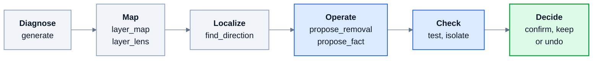

# Tools

cramschool ships the instruments around an edit:
- the GRAFT toolbox for facts;
- a workflow in which a bigger model operates on a small one through weight edits;
- a monitoring grid, layer tools and isolation tools;
- an MCP server and a live progress window.

Everything works with forward passes only: nothing in the package takes a gradient, and a test keeps it that way. The workflow logs every step and undoes exactly.

- **Facts:** use GRAFT ([how it works](how-it-works.md)). An editor model drives it through `GraftTools`, by API ([editor models](editors.md)) or MCP ([MCP](mcp.md)).
- **Behaviour fixes**, such as removing a loop, use the weight-edit workflow below.
- **The beta's weight-writing fact editor** (`KnowledgeEditor.add_fact`, `propose_fact`) stays for experiments. It measures the push each answer token needs and writes it where the token before it is read. It passed at most 2 of 40 bench facts ([history](history.md)).

## The GRAFT toolbox

`cramschool.tools.GraftTools(graft)` gives an editor these tools. Each takes and returns plain JSON, runs one call at a time, and has its input validated before it runs:

| Tool | What it does |
|---|---|
| `status`, `list_facts` | the table and its facts |
| `add_fact`, `remove_fact` | add or update a fact (about 40 seconds), or remove one exactly |
| `ask` | a reply with and without the layer, and the company key 1 found |
| `check_fact` | recall on new wordings, leaks on other questions and on look-alike companies, with every reply |
| `add_relation` | a new relation's wordings |
| `teach_wordings`, `rebuild` | teach a relation more ways of asking, when a check shows questions its facts miss; then build the stored facts again, all or one relation's, so that they learn them |
| `preview_dataset`, `add_facts_from_dataset` | facts from a CSV, JSON, JSONL, bench file or Hugging Face dataset |
| `save` | save the table |
| `commit`, `versions`, `diff`, `revert` | record the table as a version, list the versions, see what changed between two, and go back to one; nothing is built ([Python API](python-api.md#a-tables-history)) |

## The editor workflow

`Surgery` gives a bigger model the steps of weight-space programming as tools, and enforces the rules instead of asking for them.



| Step | What the bigger model does | Tool |
|---|---|---|
| 1. Diagnose | See how the model fails before changing anything | `generate` |
| 2. Map | Find which layer does what: where answers appear, what a layer already predicts | `layer_map`, `layer_lens` |
| 3. Localize | Find a behaviour's direction from matched good and bad continuations | `find_direction` |
| 4. Operate | Remove the direction from the MLPs that write it, or write a fact | `propose_removal`, `propose_fact` |
| 5. Check | Test several strengths against the unedited model, each part alone, and a same-sized random edit | `test`, `isolate` |
| 6. Decide | Paired test on problems never used to choose the edit; keep it only if it is better there | `confirm`, `keep`, `undo` |

**The rules:**
- **No backward pass:** every tool runs under `torch.no_grad`.
- **A budget of forward passes,** with each tool's cost stated in its description.
- **A hash-chained log of every call.** `log_is_intact()` checks it in memory, and `cramschool.surgery.log_file_is_intact(path)` checks the file alone.
- **Exact, bit-for-bit undo** of anything kept.
- **One call at a time,** even when an editor sends several at once.
- **Plain JSON in and out,** so any editor can drive the tools: a person, a script, or a model.

```python
from cramschool import Surgery

surgery = Surgery(model, tokenizer, calibration_texts=paragraphs, budget=40, log_path="surgery.jsonl")
surgery.call("layer_map", {})
surgery.call("find_direction", {"name": "loops", "pairs": pairs})   # [{"start": ..., "good": ..., "bad": ...}, ...]
surgery.call("propose_removal", {"name": "fix", "direction": "loops", "layers": [15, 19], "strength": 8, "neurons": 64, "test_pairs": other_pairs})
surgery.call("test", {"name": "fix", "strengths": [0.5, 1.0]})
surgery.call("isolate", {"name": "fix"})
surgery.call("confirm", {"name": "fix", "problems": held_out, "max_tokens": 2048})
surgery.call("keep", {"name": "fix", "strength": 1.0})
```

**Result on Qwen3.5-0.8B.** The loop fix, found and checked this way, took correct answers on 32 new GSM8K problems with thinking on from 1 to 7 (6 rescued, 0 broken).

## The MCP server

`cramschool serve` serves the GRAFT tools and the surgery tools together, on one loaded model. [MCP](mcp.md) has the setup for Claude Code and other clients, every tool, and the HTTP transport.

- **Patches:** `cramschool_export_patch` saves kept weight edits as a small hash-checked patch. `WeightPatch.load(path).apply(model)` refuses any other base weights.
- **Logs:** `--log-dir` gives every server run its own hash-chained log of the surgery calls.

### Watching a session

With `--watch`, the server opens a terminal window titled "cramschool surgery". It shows:
- the model and the session log;
- the forward-pass budget as a bar;
- the current step with its own progress bar and its results as they arrive;
- GPU memory, and the edits kept so far;
- one line per finished step.

```text
Model    Qwen__Qwen3.5-0.8B on cuda:0   running 0m30s
Budget   [#####-----------------------]  2 of 12 forward passes used
Kept     nothing yet: the weights are unchanged
GPU      [#---------------] 1.3 of 24.0 GB in use, busy 40%

Now      find_direction  [######################------]  78%   0m11s, about 0m03s left
         how much layer 18's MLP writes 'loops' (19 of 24)

Steps    (newest last)
  #1   23:15:01  layer_map: known answers first appear at layer 20 of 24   (4.8s, 1 pass)
  #2   23:15:14  generate (thinking on): 2 answer(s); first: '6 times 7 equals **42**.'   (12.9s, 1 pass)
```

```bash
cramschool watch sessions          # follow the newest session in a folder; Ctrl+C to stop
cramschool watch sessions --once   # print it once
```

## The monitoring grid

The grid is one table covering every kind of prompt an edit could affect, with no training involved.

```python
print(editor.grid()["all"].to_text())        # every fact in the weights
grids = editor.grid(by_layer=True)           # plus each layer's edit alone
```

```text
            trained  new plain  new chat  same subj  other subj  garbled  refused  pass
RX Systems     100%       100%      100%         0%          0%       0%       0%   yes
mean           100%       100%      100%         0%          0%       0%       0%   1/1
known facts 100% -> 100% | drift 0.0043 | same top prediction 98%
```

- **Name leaks:** when the target looks like a person's name, an `other names` column asks other subjects for a name, as in "The owner of X is a man named".
- **Leak baseline:** leaks are counted against the unedited answer to the same prompt.

## Layer tools

| Tool | What it answers |
|---|---|
| `firing_table(model, tok, fact, layer, metric, site, ridge, nulls)` | Does a key fire on new wording and stay quiet elsewhere? No solving, so it takes seconds |
| `reads_at(model, tok, prompts, layers, positions)` | What each layer's MLP reads at any token |
| `top_tokens(model, tok, vector)` | What a vector says if read directly as next-token scores |
| `layer_lens(...)` | What each layer's residual already predicts for the next token |
| `virtual_weights(model, from_layer, to_layer)`, `top_connections(...)` | Which neurons feed which, from the weights alone. Treat these as candidates to test, because the calculation ignores attention |

## Isolation tools

| Tool | What it answers |
|---|---|
| `isolate(model, parts, evaluate, doses, controls=True)` | Each part alone, all together, at several strengths, against same-sized random edits |
| `applied(model, update, dose)` | Try an edit inside a `with` block, then restore the exact bits |
| `random_control(model, update)` | An edit of the same size pointing elsewhere: if it does as much, the effect came from size |
| `ablation(model, layer, neurons)` | Silence chosen neurons |
| `paired_test(before, after)` | Items rescued and broken on the same test, with an exact p-value |

## Tracked weight edits

The way of working of weight-space programming:
1. observe with forward passes;
2. compute a change and apply it;
3. measure it against the unedited model;
4. keep it only if it helps.

```python
from cramschool import EditSession, matched_direction, removal_update

directions = matched_direction(model, tokenizer, good_texts, looping_texts, layers=[15, 19])
updates = [removal_update(model, layer, directions[layer], alpha=8, writers=64) for layer in (15, 19)]

session = EditSession(model, evaluate, goals=dict(looping=-1), guards=dict(useful=+1, known=+1, drift=-1),
                      tolerance=dict(looping=0.01, useful=0.02, known=0.05, drift=0.05), log_path="edits.jsonl")
session.measure_baseline()
for attempt in session.attempt("layers 15+19", updates, doses=(0.5, 1, 1.5)):
    print(attempt.dose, attempt.verdict, attempt.changes)   # "better", "worse", "mixed" or "same"
session.keep("layers 15+19", updates, dose=1)                 # session.undo_last() takes it back, bit for bit
```

`evaluate` is any function that returns a dict of scores. Every attempt is logged, whether it is kept or not, and leaves the weights exactly as it found them.

**Versions of the edited weights.** `weight_history.commit_model(history_dir, model, "the loop fix", base_dir=BASE)` records the weights as they are after a kept edit, storing only the tensors that differ from the base checkpoint. `weight_history.apply(history_dir, "base", model)` sets the model back to the unedited weights, and to any recorded version by its id ([Python API](python-api.md#the-weights-history)). On Qwen3.5-0.8B this was checked with eight weights changed by hand, taken back and set again bit for bit; it has not been run after an edit this workflow kept.

## Thinking on or off

The small model's thinking mode changes results, so say which mode an edit is for:
- **GRAFT and the beta's fact writes** were measured with thinking off.
- **The loop fix** was measured with thinking on, where looping happens.
- **`generate`** takes `thinking: true`. Thinking checks use sampling, because greedy decoding rarely finishes thinking on these models.
